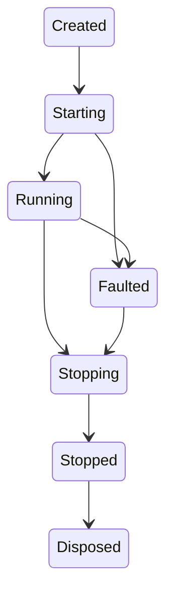

# Server, HTTP and protocol Public API specification

Version: **0.4.0**. Owners: D18/D19; implementation B15–B20, integration B21–B24.
Status: design specification; acceptance is determined by the exact current registry
and independent review. **No NativeWeave product package or server implementation
is announced by this document.** The .NET 11 / C# 15 declaration fixture is the
signature authority; examples are design compilation witnesses, not released samples.

## 1. Inputs, exact declarations and package boundaries

- [Complete declarations](../../experiments/public-api/NativeWeave.Api.Design/Server.cs)
  define every namespace, public type/member, generic constraint, nullability and
  default. There are no unspecified arbitrary-Delegate binding overloads.
- [Consumer witnesses](../../experiments/public-api/NativeWeave.Api.Consumers/ServerExamples.cs)
  cover a minimal app, typed JSON, scoped services, uploads, SSE, Generic Host,
  all four gRPC method shapes and modern MCP registrations.
- [Per-type semantic policies](server-symbol-policies.json) bind all public Server
  declarations to concrete semantic sections, native operations, capabilities, costs
  and owning tasks; the generated reference inherits these profiles per member.
- [Coverage matrix](server-coverage.json) records relevant ASP.NET Core 11,
  BCL/Extensions, grpc-dotnet and MCP C# feature families. Support classifications
  describe design intent; `product_implemented` is false throughout.
- [Source manifest](server-sources.json) records actual scoped reads, hashes and
  retained research evidence. ASP.NET Core v11.0.0 resolves to
  `1def4cdc07dc10fc267136060e3ef5c1a96d4a99`. Its mutable-main documentation is not
  the source authority. The pinned Rust seam is the already studied Tokio 1.54.1,
  Hyper 1.12.0, hyper-util 0.1.21, Tower 0.5.3, Axum 0.8.9, rustls 0.23.46,
  Tonic 0.14.9 and rmcp 3.10.0 set; no prior successful native experiment is relabeled.

| Package / namespace | Public responsibility | Dependencies and cost |
| --- | --- | --- |
| `NativeWeave.Server` / `NativeWeave.Server` | Builder, routes, context, typed JSON, bounded streams, application middleware, policies | Core plus Extensions 11 Configuration/Configuration.CommandLine/DI/Logging and `NativeWeave.Server.Native`; no Database and no `Microsoft.AspNetCore.App` / Kestrel |
| `NativeWeave.Server.Hosting` / same | `AddNativeWeaveServer` Generic Host adapter | Optional Extensions Hosting abstractions; Generic Host orchestrates lifecycle only |
| `NativeWeave.Server.Grpc` / same | Generated protobuf codecs/descriptors, four method cardinalities, call metadata/status | Optional managed facade; uses the existing host's Tonic capability and runtime |
| `NativeWeave.Server.Mcp` / same | Static typed tools, resources/prompts and the selected protocol policy | Optional managed facade; uses the existing host's rmcp capability and runtime |
| `NativeWeave.Server.Native` | Maintainer-built host asset for the selected RID | One native closure containing HTTP/TLS/Tonic/rmcp code. Optional managed protocol packages do not create another runtime. Unused protocol code may remain in the native binary; B24 measures this size cost. Protocol state is allocated only when configured. |

B15 owns the application surface and typed binder/generator inputs; B16 owns Body,
retained bytes and credits; B17 owns the required native host and lifetime; B18/B19
own protocols; B20 owns diagnostics. A13 integrates project manifests; A10–A12 own
shared generator machinery/diagnostics. This document does not move ownership into Core.

## 2. Developer path and startup defaults

Expected consumption after future product release:

```csharp
using NativeWeave.Server;

await using var app = NativeServer.CreateBuilder().Build();
app.MapGet("/", static () => Results.Text("Hello from Rust + C#"));
await app.RunAsync();
```

The application installs `NativeWeave.Server`, builds normally and publishes with an
explicit RID and `PublishAot=true`. It does not install Rust, register a process-wide
runtime, set a DLL path, or manage a native handle. Installing Server does not install
Database. A first-party distribution must include the correct native asset before it
can claim this consumption path passed. The above is currently design-only.

`CreateBuilder(args)` creates finite options and an empty `ConfigurationManager`, adds
explicit command-line arguments through Extensions Configuration.CommandLine when present, and exposes Services/Logging. It does
not scan assemblies, user secrets, JSON files, environment variables, certificates or
filesystem roots. Users may add standard .NET configuration providers deliberately.
`Configure(IConfiguration section)` binds the documented server keys with a generated
static binder immediately; later explicit option assignments override that snapshot.
There is no implicit live reload or second binding at Build.

Default listener is `127.0.0.1:5000`, HTTP/1.1, no TLS. The first explicit `Listen` or
`ListenLocalhost` removes that default; subsequent calls append. Port zero requests an
OS-assigned port. `ListenLocalhost` registers IPv4 and IPv6 loopback separately; both
must bind, otherwise startup fails and unwinds both. It does not fall back to an
external address. `BoundAddresses` is empty before startup and then exposes actual
addresses. A named listener is required for deterministic certificate reload. Missing names become
`listener-0`, `listener-1`, and so on in zero-based registration order; explicit and
generated names share one uniqueness check. Names are <=128 UTF-8 bytes.

| Setting | Default | Valid range / semantic rule |
| --- | --- | --- |
| Whole-request timeout | 30 s | Positive, at most 24 h; no infinite profile in v1; includes admission/body/handler/output |
| Graceful close wait | 30 s | Nonnegative, at most 24 h; zero polls after initiating close |
| Header timeout / idle keepalive | 10 s / 60 s | Positive, at most 24 h |
| Total request body / buffered JSON | 1 MiB / 1 MiB | Positive; JSON cannot exceed body limit or proven peak allocation budget |
| Aggregate headers | 32 KiB | 1–1024 KiB; max 200 fields, each name <=256 bytes |
| Connections / h2 streams per connection | 512 / 32 | Positive finite integer; actual protocol limits may be lower |
| Active and retiring requests / metadata waiters | 256 / 128 | Active positive; waiters may be zero; no queued body allocation |
| Managed / native application payload credit | 64 MiB each | Positive, separately accounted; not a whole-process/RSS bound |
| Retained bytes per request per side / chunk | 4 MiB / 32 KiB | Positive; chunk <= per-request cap; checked cross-side peak reserve |
| TLS concurrent handshakes / timeout | 64 / 10 s | Separate finite limits, no implicit certificate trust bypass |
| Diagnostics | No sinks/exporters/listeners | Correctness counters remain active; Debug alone does not enable payload logging |

The generated configuration binder accepts scalar keys matching `ServerOptions` plus
`Budget:<property>` names, using invariant TimeSpan `c` and checked integer parsing.
Listeners, TLS, trusted proxies, callbacks and metadata use typed methods/properties;
unknown keys in a bound section are rejected. This avoids reflection-heavy object
binding and ambiguous precedence. Options/configuration changes after Build cannot
modify the application. Build is single-use and validates property interdependencies, static metadata contexts,
native assets/ABI and configured capability support before creating its native instance.
Build snapshots builder options and services only; application Map/Use calls remain
legal while Created. The first StartAsync/RunAsync atomically freezes the route and
handler registries, validates every closed DTO/handler and protocol descriptor, and
performs routes_set before start_create. Failed route validation starts no listener
and leaves the app Created and editable; after successful freeze, mutations are
rejected even if listener startup fails. Build opens no socket and starts no Tokio
worker thread.

A default provider is built once; its services are application-owned. Request service
scope creation is lazy: no scope for a static health handler unless middleware,
authentication or a handler accesses `context.Services`. `UseServiceProvider(provider,
false)` borrows the provider and requires `IServiceScopeFactory`; the application
never disposes that provider. Setting true explicitly transfers provider disposal
responsibility and forbids sharing it with another owner. Existing IServiceCollection
registrations combined with an external provider are rejected to prevent silent loss.
`UseAuthentication`/`UseAuthorization` accept caller-owned, thread-safe instances;
request-scoped collaborators are resolved inside their methods through the context.

## 3. Semantic profiles applying to every declaration

Each public declaration inherits its named profile below and the standard. Member
families in sections 4–8 specify deviations. These profiles are required reference
remarks, not substitutes for signature/XML generation.

| Profile | Members | Lifetime, errors, concurrency and cost |
| --- | --- | --- |
| Configuration | All builder/option/route/registry members and registration extensions | Single-threaded; copied/frozen before serving. Null required arguments -> ArgumentNullException; malformed values -> ArgumentException/ArgumentOutOfRangeException; frozen or duplicate config -> InvalidOperationException; unsupported capability -> NotSupportedException before startup. O(registration bytes + routes); no per-request work. No cancellation parameter because no native I/O starts. |
| Lifecycle | StartAsync, RunAsync, CloseAsync, DisposeAsync, ReloadTlsAsync, State, BoundAddresses | Owner identity; concurrent close/dispose coalesce safe retirement. Start only from Created; a second start fails. Properties are immutable/atomic snapshots. Standard cancellation before admission, native terminal result afterward. Native panic/poison/ABI errors use NativeEngineException, ordinary domain failures ServerException. Windows/Linux x64 initial target; platform support follows the package profile. |
| Borrowed request | RequestContext, ServerRequest, ServerResponse, request ParameterValues/HeaderCollection, GrpcCallContext/McpCallContext | Valid only through invocation, result execution, awaited filters/completion callbacks and scope cleanup. Do not capture in background work. One reader/one writer; request/context mutation is not thread safe; one read and one write may coexist. Use after logical request end -> ObjectDisposedException. Metadata decoding is bounded and lazy; retained snapshots explicitly copy. |
| Async I/O | Request reads, response writes, protocol read/write/headers | Task unless BCL Stream/IAsyncDisposable requires ValueTask. Validate before admission; timeouts -> TimeoutException, confirmed cancellation -> OperationCanceledException. The request monotonic deadline always limits an explicit child token. Native terminal completion does not imply peer consumption/native retirement. No sync-over-async. |
| Owned chunk | BodyChunk.CopyTo/ToArray/Dispose/Length | Caller must Dispose. Admission + SafeHandle lease protect synchronous copy. Dispose is idempotent; Length/copy after close -> ObjectDisposedException. No escaping native Memory/Span; O(bytes) copy. ToArray is a caller-owned managed allocation, whose arbitrary retention is outside framework-controlled budgets after transfer. Concurrent dispose/copy obeys Core logical admission; no raw pointer API. |
| Result | ServerResult/Results and immutable ServerEvent/MCP value records | No native owner at construction. Text/byte/status immutable results may be reused; a stream, async-enumerable or mutable DTO result is single execution. A second single-use execution -> InvalidOperationException. Caller keeps DTO/input state unchanged until execution completes. User-authored results may write only through the context; no native transport control. |
| SPI | ServerResult, authentication/authorization interfaces, typed delegates, GrpcMarshaller, IGeneratedGrpcService, generator attributes | Deliberate supported extension points with compatibility obligations. Callbacks run on managed dispatch outside foreign callback frames/native locks. No synchronous waits on that server's disposal. Throwing is caught at the managed barrier; exceptions never cross reverse P/Invoke. |

All async methods validate null/state/finite limits synchronously before returning the
Task. User callbacks execute after admission; their failures are observed on the
operation/response, not thrown from a raw native callback. `ReadOnlyMemory<byte>`
inputs must remain unchanged until the returned Task reaches a terminal result; no
managed pointer survives a synchronous C ABI call. Strings are Unicode; wire text is
validated UTF-8. Lengths are bytes unless explicitly described as a character count.
No API claims allocation-free or zero-copy behavior.

## 4. Routing, binding, middleware and identity

### 4.1 Routing surface and ordering

`ServerRoutes` is inherited by the application and route group; application code
cannot subclass it. MapGet has synchronous no-context, synchronous context and
asynchronous ResponseHandler overloads. MapPost adds typed body/result overloads;
MapPut/MapPatch/MapDelete accept ResponseHandler. MapMethods covers HEAD/OPTIONS and
custom methods; MapJson covers typed-body variants for any listed method. MapRaw
accepts a RequestHandler that writes the response directly. An async lambda returning
a ServerResult binds to ResponseHandler; an async lambda with no result must use
MapRaw. Null handler/default ambiguity is rejected at compilation or by explicit
ArgumentNullException; no `Map*(string, Delegate)` escape hatch exists.

Native Axum routing owns path matching and method dispatch. The v1 route grammar is
literal path segments, `{name}` for one segment, and terminal `{*name}` catch-all.
Names are ASCII identifiers and unique in a pattern. Empty patterns, query/fragment
components, regex/constraint/default/optional syntax and ambiguous duplicate routes
are rejected at registration. Literal routes outrank parameters; catch-all is last.
Trailing slash and path case remain significant. Decode parameters once after
segmentation; `%2F` is not turned into a separator during matching. Malformed percent
encoding produces a bounded 400 before application dispatch. These are NativeWeave
semantics, not a claim of complete ASP.NET route-template compatibility.

GET also handles HEAD, suppressing response body transmission while preserving status
and headers; an explicit HEAD route takes precedence. Unmatched path ->404; matched
path with unsupported method ->405 plus Allow. Method tokens are validated/case-sensitive;
convenience methods use uppercase. Method list max32, route count max16,384 and template
UTF-8 length max4096 are fixed v1 registration bounds. No runtime route mutation or
hot replacement; create a new application instance and drain the old one.

Group prefix concatenation validates one leading slash and avoids implicit normalization.
Group policies are captured when routes freeze, not dependent on subsequent registration
order. Filters run outer-group -> inner-group -> endpoint on entry, reversed on exit.
Authorization requirements combine with logical AND; endpoint AllowAnonymous explicitly
removes them. Duplicate endpoint names fail; documentation tags/summary do not change
routing or create per-request copies. Names and policy names are nonempty and <=128
UTF-8 bytes; each endpoint has at most32 distinct tags of <=128 bytes, a summary of
<=4096 bytes and at most32 policies. Invalid/duplicate names fail before native freeze.

### 4.2 Typed input and output

`ParameterValues.Get<T>` requires `IParsable<T>`, parses using invariant culture,
and requires exactly one value. It throws RequestBindingException for missing,
repeated or malformed values. TryGet returns false for those three cases. GetValues
retains repetition and returns an empty collection when absent. `string`, numeric
primitives, Guid, DateOnly/TimeOnly/DateTimeOffset and custom IParsable types are direct
compile-time targets; culture-sensitive parsing is never inferred from request locale.
A query array uses GetValues and generated per-element parsing, not comma splitting.
The native adapter uses `form_urlencoded 1.2.2::parse` for native query pairing and
plus handling, with `percent-encoding 2.3.2` already in the retained Rust lock. The
public upstream parser intentionally decodes invalid UTF-8 lossily; NativeWeave first
checks every raw percent escape has two hex digits and calls strict
`percent_decode(raw_query).decode_utf8()` under the bounded scratch reservation, then
drops that preflight temporary before iterating form_urlencoded. This admission policy
is not a claim that upstream parse rejects invalid bytes. Query plus signs become spaces,
percent escapes decode once, missing `=` means an empty value, empty names are
retained but cannot satisfy a named generated binding, and invalid UTF-8/escapes fail400.
The request target is capped at16KiB; decoded query has <=1024 pairs, <=256 UTF-8 bytes
per name and <=16KiB aggregate decoded bytes. These fixed v1 bounds are checked before
allocating the bridge metadata. Native path matching happens before parameter decoding.
RequestContext.Items is lazy, request-local and capped at128 entries; adding beyond the
cap fails InvalidOperationException. Arbitrary application values retained in Items or
DTOs remain application allocations, not a whole-process memory guarantee.

Typed MapPost/MapJson accepts JSON content types `application/json` or `application/*+json`,
rejects missing/unsupported content type with415, malformed/empty/JSON-null required
request body with400, total overflow with413, and unsupported content encoding with415.
Nullability is not guessed from a closed generic Type at runtime. The typed Map body
is required even when TRequest is a nullable annotation; optional/raw semantics use
ReadJsonAsync explicitly. Direct ReadJsonAsync<T> returns T? for a JSON null reference
root, with scalar value-type null rejected by its static codec. The generic TResponse
may represent a null response; it is serialized as JSON null with200, never silently
rewritten to204. An explicit Results.NoContent selects204.

Explicit JsonTypeInfo parameters take precedence; null means resolve exactly typeof(T)
from the contexts registered by UseJson. Missing metadata fails during route freeze
before native start admission, with `NWAPI-S001` naming the DTO and the required UseJson/typeInfo fix.
Conflicting metadata for one Type fails unless byte/semantic-identical same context
instance is re-registered; no reflection fallback or runtime polymorphic type discovery.
Required-member and nullable-member checks use generated static metadata; dynamic
`object`, unregistered derived types and converters lacking a defined static/schema
contract fail with an actionable diagnostic. JSON size checks count encoded bytes and
conservative materialization peak; a 1 MiB wire cap alone is not a CLR graph bound.

### 4.3 Optional generated endpoint binding

The first-class explicit context/typed-JSON overloads work without a NativeWeave route
generator. For ordinary strongly typed handler parameters, a static partial class
marked `[ServerEndpoints]` receives generated `public static void Map(ServerRoutes
routes)`. Each `[ServerRoute(method, pattern)]` static method is lowered to the exact
existing MapRaw/ResponseHandler route calls; one generated handler ID per declaration.
The whitelist is explicit:

| Parameter / return shape | Generated implementation |
| --- | --- |
| RequestContext | Pass current context; at most one |
| CancellationToken | Pass effective request cancellation; at most one |
| `[RouteParameter] T`, `[QueryParameter] T`, `[HeaderParameter("name")] T` | Static IParsable<T>; exactly one unless an explicitly annotated query T[]; nullable/defaulted scalar missing -> declared default, malformed/repeated ->400 |
| `[BodyParameter] T` | At most one; static JSON metadata from declared context; required unless declared nullable/default; scalar encoding only supported through JsonTypeInfo |
| `[ServiceParameter] T` | Statically call GetRequiredService<T> on lazy request scope; registration checked at startup where possible; no automatic arbitrary-type DI inference |
| ServerResult or Task<ServerResult> | Execute returned result once; null result is a handler contract error500 |
| T or Task<T> with statically declared JsonTypeInfo | Serialize through registered codec; no runtime serializer generation |
| void or Task | Valid only with RequestContext and direct response writing; framework completes an unstarted empty200 response |

No ref/out/in/span/ref-struct arguments, open generic handlers, async void, object[]
argument binder, arbitrary delegates, synchronous I/O, unannotated service inference,
or runtime assembly scans. Unsupported shapes produce compile errors `NWAPI-S002`;
ambiguous/missing bindings `NWAPI-S003`; absent metadata `NWAPI-S001`. In the fixture,
the attributed class itself compiles; a comment marks its future generated Map member.
This does not claim that NativeWeave's product route generator has executed. A10–A12/B15
must compile positive and negative consumer inputs, inspect emitted code and run their
actual AOT outputs before marking generated binding implemented.

### 4.4 Middleware, filters, failures and authentication

Global Use middleware sees the parsed request after native routing/admission and
before authentication; native Host/header/body admission checks precede managed work.
Authentication -> authorization -> result-filter pipeline -> typed input binding ->
handler -> result execution follows. Result filters wrap binding, so they can catch
RequestBindingException and emit a custom400 without object[] argument allocation.
This deliberately addresses the .NET11 binding-failure observability scenario through
an explicit exception contract. Middleware/filter next is single-call, cannot escape
the request and must be awaited; a second/concurrent invocation fails InvalidOperationException.
Short circuiting by writing a result is allowed; returning another result after headers
start is rejected. No automatic buffering to support replay/rewind.

IServerAuthenticator null means no usable credentials; a returned principal determines
context.User. A denied policy yields401 for unauthenticated callers and403 otherwise.
There is no implicit cookie/session, bearer JWT validator, OAuth server, anti-forgery
system or trust in X-Forwarded-* headers. Applications can integrate an AOT-compatible
mature authenticator through the SPI; it owns credential validation. The framework
provides the common request/policy lifecycle and fails startup when a named policy has
no authorizer. Endpoint metadata and MCP tool annotations never grant permission.
TrustedProxyOptions accepts exact direct-peer IPs and a finite hop count; only these
peers influence effective Scheme/Host. The original RemoteEndPoint is preserved.

The outer exception barrier converts RequestBindingException to400; pre-body media/
limit/admission failures use415/413/503, explicit Results/GrpcException/tool results
preserve their domain semantics, and unexpected user exceptions use redacted500 before
headers. After headers start, failures terminate the stream/connection and log a safe
correlation; no second JSON body is appended. The public ServerException.Code is stable
(e.g. `listener_bind_failed`, `body_limit_exceeded`, `binding_failed`,
`response_already_started`, `transport_failure`). Native panic/poison/contract failures
use Core NativeEngineException, not an HTTP status masquerading as successful recovery.

## 5. Request/response bodies, results and resource semantics

The Stream facade is async-only, nonseekable and request-owned: `CanRead` or `CanWrite`
is true as appropriate, `CanSeek=false`, Length/Position/Seek/SetLength and synchronous
Read/Write throw NotSupportedException. Async overrides follow BCL Memory/ValueTask
contracts without promising pooled sources. Disposing the facade closes that body's
logical admission but does not dispose the request, parent server or native module.
A result callback receives a borrowed output Stream and must not dispose/store it.

A request chooses exactly one body consumption mode on first use: Stream, ReadChunkAsync,
or ReadJsonAsync. Mixing modes is an InvalidOperationException; merely reading the
Body property does not select the mode. One pending read; each ReadChunkAsync yields
one positive-length BodyChunk or null for **EndObserved**. Outstanding chunk owners
may outlive the next read only within request/global credits; request completion may
retain those owners safely, but the application must release them. Early handler exit
initiates bounded native discard or transport close; it never drains an unbounded body.
GetTrailers is available only after EndObserved and requires the negotiated capability.
EOF does not establish the precise reset reason or peer consumption.

Headers are case-insensitive by name; `Headers[name]` preserves every value including
Set-Cookie, and returns an empty list when absent. GetSingle returns null when absent
and throws RequestBindingException for repeated request values (default400), or
InvalidOperationException on a mutable response collection. Set/Append/Remove are allowed only on response collections
before their corresponding head/trailer commit; request mutations throw
InvalidOperationException. Names/values reject prohibited control characters and
CR/LF injection; native `http::HeaderName/HeaderValue` remain the final validators.
Content-Length and Content-Type properties update the same header map, not competing
copies. Connection/framing/pseudoheaders are native-owned; explicit attempts to set
Transfer-Encoding, Connection, `:authority`, or an inconsistent length fail. Content-Length
mismatch after writes aborts rather than silently truncating or padding. ToDictionary
makes a bounded managed snapshot; copying does not extend the request lifetime.

Response writes serialize through one writer; concurrent writes throw InvalidOperationException
rather than silently buffering. WriteAsync may accept a larger ReadOnlyMemory but walks
it in bounded chunks, retaining the caller's managed memory until the Task terminal
state. The managed adapter first awaits a metadata-only native write reservation, then each
C ABI write_create copies only one bounded chunk synchronously; no native pointer into
that managed memory survives the call. Waiting for a reservation retains managed input
by its ordinary GC root, never by a native pointer or unbounded hidden staging copy. At most one managed-to-native
copy is pending. Both allocations are charged during overlap. Native Bytes owners may
remain charged after the write Task completes. FlushAsync acknowledges local native
flow-controlled progress, never remote receipt. CompleteAsync commits trailers/end
once and is idempotent after success; writes afterward fail. OnStarting callbacks run
LIFO before the first irreversible header commit; a failed callback fails the response.
OnCompleted runs after application/result/body production ends, before request scope
release, and does not certify native quiescence. Callbacks and disposal registrations
are capped at32 each; no unbounded callback list grows from request input.

Request scope release waits for all awaited application code, result execution,
completion callbacks and registered disposables. The native retirement coordinator
then needs only opaque ownership/operation records, not a live DI scope. Background
work cannot capture RequestContext or scoped services; independently owned application
queues/operation records must receive copied IDs/data. Self DisposeAsync from that
server's handler/callback is rejected to prevent a self-join deadlock.

| Result member | Precise semantics and required cost |
| --- | --- |
| Text | UTF-8 text, explicit content type/status; input immutable string may be reused; bounded encoding in chunks, O(bytes) |
| StatusCode / NoContent / NotFound | Validate100–599; body-forbidden statuses204/304 suppress output; no native I/O until execution |
| Json / Created | Explicit JsonTypeInfo; value borrowed until serialization ends; Created validates Location; streaming serialization uses bounded writer and can still allocate DTO/serializer state |
| Problem / ValidationProblem | Framework-owned static JSON codecs; bounded title/detail/type/instance and at most128 fields,16 messages/field,1024 chars/message; no reflection `Dictionary<string,object>` |
| Redirect | 301/302 or307/308 according to permanent/preserveMethod; validates no CR/LF; caller chooses external destination, with no automatic user-input redirect |
| Bytes | Copies <=1 MiB into an immutable managed result at construction; a caller-owned result outside a request is not counted as request credit; larger bodies use Stream |
| Stream(producer) | Invokes producer exactly once inside request lifetime; producer must await writes and observe cancellation; native transport/backpressure stays Rust |
| Stream(source, leaveOpen) | Input consumed once asynchronously; seek not required; source disposed at completion/error unless leaveOpen=true; result single-use; no implicit full buffering or file/range semantics |
| JsonStream | Enumerate once, lazily at execution; one MoveNext and one encoded element in flight; serialize a JSON array using static metadata; early cancellation disposes enumerator; a later failure leaves a truncated stream and aborts, never a rewritten successful array |
| ServerSentEvents | Enumerate once and await native acknowledgment before next event; Axum Event/Sse perform formatting; metadata fields and encoded peak are bounded; no event-store replay, automatic heartbeat or durable-delivery promise |

SSE Event/Id reject CR/LF; Id also rejects NUL. Retry is an integral number of
milliseconds from zero to24h. Data permits newlines; Axum expands them into distinct
data fields. Reserve a conservative expanded size (`6 * UTF8(data).Length +
UTF8(event/id).Length + 128`, checked) before native Event construction. Native
validation happens before calling Axum's methods that panic on invalid metadata.
The fixed source read establishes this requirement; it is not a product fuzz result.
The default30s whole-request deadline also applies to streams; longer finite streams
use WithTimeout explicitly and cannot keep refreshing the deadline per event.

Upload support is the bounded raw body Stream path. Multipart/form parsing is a
separate planned native capability with explicit temporary-file/part limits; v1 does
not pretend Stream implements IFormFile. Likewise a Stream result can serve explicit
application-selected files, but no static directory traversal, automatic byte ranges,
ETag cache, compression or sendfile policy is silently provided. These are recorded
feature boundaries, with future mature native adapter reuse required.

## 6. Host lifecycle and native TLS



This compact state notation is descriptive; the executable future tests must verify
all close/start/terminal races. Build validates and creates an instance without
listeners/workers. Start creates its engine-owned runtime and binds the complete
listener set. Success means every listener can accept. A failure unwinds partial binds;
no callback can observe a half-built route/service table. There is one Start authority.
Close while Starting closes admission and requests cancellation; terminal startup
outcome remains native-authoritative. Runtime/module state is not freed while start
or callback control calls can enter.

RunAsync starts from Created, installs ordinary Ctrl+C/SIGTERM handling for standalone
lifecycle, and waits for shutdown. Its supplied token is a shutdown signal after
startup; normal requested shutdown returns successfully **after** the full safe join.
Cancellation before/during startup follows StartAsync. A host fault is rethrown after
safe cleanup with its original cause. StartAsync installs no process signal handlers;
Generic Host owns those. RunAsync removes its registrations on all exits.

CloseAsync(timeout, token) atomically closes new admission, signals accepted requests
and waits up to the explicit duration. Completed means callbacks, contexts, streams,
byte owners and instance runtime have retired. Pending returns retained request/byte
counts and keeps cleanup running with rooted state. A canceled waiting token cancels
only this wait; the close remains initiated. Zero means initiate and return current
observation, not a synchronous destructor. Runtime shutdown timeout cannot be treated
as evidence that native code stopped. The initial Tokio composition cannot forcibly
terminate arbitrary blocking native work; pending retention is finite and visible.

DisposeAsync is an idempotent unbounded safe join, implemented over one retained Task;
each returned ValueTask is consumed once. It does not take a token, free owners after
a deadline, or unload the native library. A caller requiring bounded process shutdown
first calls CloseAsync and applies its own external termination policy when Pending.
RunAsync/DisposeAsync may wait if application work ignores cancellation; this is an
honest lifetime guarantee, not a claim of guaranteed graceful completion.

ServerTlsOptions reads PEM chain/key files on native startup/reload and configures
rustls with the pinned crypto provider, TLS1.2/1.3 and ALPN matching enabled protocols.
Cleartext Http2 means prior-knowledge h2; h2c HTTP upgrade is unsupported. Combined
Http1AndHttp2 cleartext is rejected (use TLS+ALPN or separate listeners). No developer
certificate is implicitly created or trusted. ClientCertificateAuthorityFile enables
required client-certificate validation against those roots; otherwise client certs
are not requested. No per-connection managed validation callback blocks the TLS loop.
ReloadTlsAsync validates a complete new native immutable snapshot before publication;
old connections retain the old configuration. Failure leaves the prior snapshot
unchanged. Paths/keys/certificate contents are not logged. Windows/Linux tests must
exercise partial-file failures, trust rejection, h2 ALPN, old connections and bounded
handshake overload. TLS buffers and socket buffers are not included in application
payload credits.

The optional Generic Host extension registers a factory-created application singleton
and one IHostedService adapter. It borrows the host service provider by default, starts
via StartAsync, and calls CloseAsync with the remaining host shutdown budget. Pending
produces an explicit shutdown timeout rather than claiming the server stopped. Final
host **asynchronous disposal** joins the application. It never creates Kestrel. A user
must not separately RunAsync the same hosted instance or register it in two hosts.

## 7. gRPC: precise typed surface and whole-call limits

MapGrpc accepts an IGeneratedGrpcService whose generated Map method calls the four
closed generic MapGrpc* methods. A .proto edit regenerates managed descriptors/codecs;
it does not compile Rust. GrpcMethod stores the canonical method name, cardinality and
static request/response marshallers. Registration verifies descriptor kind matches the
selected MapGrpc* method, unique full path and a configured HTTP2 listener. The required
capability bit is checked before native registration. It shares the host's runtime,
TLS, admission, authentication and diagnostics.

| Public mapping | Managed handler input/output | Rust seam |
| --- | --- | --- |
| MapGrpcUnary | TRequest -> Task<TResponse> | `Grpc<RawCodec>::unary` with `UnaryService<Bytes>` |
| MapGrpcServerStreaming | TRequest -> IAsyncEnumerable<TResponse> | `server_streaming`, one output message future at a time |
| MapGrpcClientStreaming | IAsyncEnumerable<TRequest> -> Task<TResponse> | `client_streaming` + `tonic::Streaming<Bytes>` |
| MapGrpcDuplex | IAsyncEnumerable<TRequest> -> IAsyncEnumerable<TResponse> | `streaming`, one inbound read and one outbound write may overlap |

The public GrpcEncoder writes to IBufferWriter<byte>; the supplied writer enforces the
encoded cap before growth. GrpcDecoder borrows a ReadOnlySpan only during its call and
returns an independently owned managed DTO. Generated protobuf implementations are
statically rooted; reflection descriptors must not become a runtime dependency.
Tonic parses frames/decompresses/validates lengths; the managed adapter only maps
complete message bytes. Default compression is identity; compression negotiation
beyond this profile is explicitly unsupported until the package's codec capability
and encoded/decoded accounting are accepted. No managed gRPC transport is substituted.

Message caps are1MiB encoded and decoded; each direction's total stream cap64MiB;
whole-call timeout30s, all explicitly overridable within host peak/finite policies.
Strict `grpc-timeout` parsing follows D19: at most one header,1–8 ASCII digits plus
H/M/S/m/u/n, checked conversion, min with route limit, zero already expired. The timer
covers streaming body retirement, not just response headers. Incoming status codes
retain the upstream distinction: encoded oversize may be OUT_OF_RANGE; decoded
oversize RESOURCE_EXHAUSTED. Public GrpcException preserves the actual0–16 code and
bounded detail/trailers; unexpected application exceptions map INTERNAL with redaction.
Unknown numeric statuses remain failure, not coerced to OK.

GrpcMetadata stores repeated text values or copied binary values with `-bin` names;
ASCII name/value checks, aggregate32KiB/200 entries limits apply. Request metadata is
read-only despite the same concrete collection type: Add/AddBinary throw for borrowed
request instances. Response headers are copied at WriteResponseHeadersAsync admission,
commit once; trailers remain mutable until terminal commit. Initial success/output EOF
does not imply trailing status delivered. GrpcCallContext is borrowed through the
entire call. Its RequestContext exposes the same lazy service scope and principal.

Inbound enumerable is single-use and single-MoveNext; execution begins on first
MoveNext and retains the call lease until enumeration disposal. Ordinary DTO elements
own their managed values. The adapter awaits outbound enumeration with the effective
call token and disposes it on success/error/cancel. Unary cardinality mismatch, missing
message, more than one unary input/output, a body after terminal status or concurrent
reads/writes fails deterministically. An early inbound break requests stop for unread
messages and retires their owners. Producing response headers cannot dispose the DI
scope while either streaming direction/handler remains active.

## 8. MCP: exact initial profile and developer contract

McpRegistry has typed AddTool, fixed-URI AddResource and text-prompt AddPrompt. Ordinary
business handlers/DTOs are runtime metadata and managed delegates; one native
ForeignMcp implements the already inspected rmcp ServerHandler. MapMcp freezes the
registry, copies bounded descriptors, and mounts a native StreamableHttpService at
one literal path. It does not accept a wildcard route. Maximum1024 entries per kind,
64KiB schema per tool and4MiB aggregate registry metadata are initial finite limits.
All names and URIs are unique within their kind; duplicate/frozen mutation fails.

The only protocol enum value is V2026_07_28. Modern stateless POST request behavior,
strict per-request metadata, no legacy initialize/session, no persisted events/replay,
GET/DELETE405 and unfinished-response disconnect cancellation are explicit. Host and
Origin are validated before the SDK parse. Loopback listeners may derive exact Host
allowlist entries; nonloopback listeners require explicit hosts with ports. Empty
AllowedOrigins rejects requests carrying Origin; absence of Origin is not authentication.
No protocol capability is advertised unless registered and implemented in this profile.

AddTool takes explicit static input/output JsonTypeInfo plus a strongly typed delegate.
During registration, a generated schema or the BCL static-metadata JSON Schema exporter
produces the descriptor **once**. Before using the exporter, a bounded metadata-only
walk rejects more than64 distinct DTO types,256 total properties, nesting beyond16,
recursive references or more than16KiB of property names per tool. It resolves only
JsonTypeInfo objects from the explicitly supplied static context, never scanning
unrelated Types. Reserve startup schema scratch before export and enforce the64KiB
encoded-schema limit while writing. The exact scratch reserve follows the pinned
exporter representation and must be measured/checked by B19; a post-export byte cap
alone is not a proven allocation bound. Supported initial schema
forms are object properties, required names, scalar/string/number/bool/null, finite arrays
and nested statically mapped DTOs; recursive/open object/arbitrary converters/unregistered
polymorphism fail registration (`NWAPI-S004`) rather than silently loosening validation.
The future generator must prove exported schema agrees with actual serializer required/
nullable behavior. Application business validation remains explicit; schema is not
an authorization mechanism. Native get_tool returns the exact registered schema so
rmcp performs its schema-dependent standard-header consistency checks.

McpToolResult<T>.Success(value) produces structuredContent with the registered output
shape plus one bounded text JSON representation for compatibility; this duplicate
representation is measured and charged. Error(message) produces isError=true with
safe text and no fabricated successful output. Malformed input/unknown method/tool
uses a JSON-RPC error; rejected Host/origin/media/body admission uses HTTP errors.
These three layers are not collapsed into ServerException or one successful response.
Unexpected business exceptions become redacted tool errors; fatal/native contract
failures follow the server isolation policy.

AddResource exposes a fixed URI and bounded UTF-8 text only, returning
McpTextResource; its returned URI must match the registered URI and MIME type.
The initial profile lists all bounded registrations without subscriptions or resource
templates; binary content and subscription/replay require a separate accepted extension.
AddPrompt declares string arguments with requiredness; unknown arguments, missing
required arguments, duplicate names and non-string values are rejected before handler
dispatch. Result roles are exactly `user`/`assistant`; result max128 messages, each
bounded by message/wire peak. Rich image/audio/embedded-resource prompt content is
explicitly outside this initial text profile. Lists and get/read/call all share the
same authenticated principal/policy. Tool annotations do not authorize operations.

The native admission layer reserves wire bytes, rmcp collection/JSON graph allocation,
bridge UTF-8 encoding and managed DTO overlap **before** invoking public rmcp services.
Wire cap1MiB, depth32, structural nodes4096 and aggregate decoded string bytes256KiB
are independent. The exact conservative allocation formula is a B19 implementation
acceptance input from D19, not a claim that every1MiB body fits the4MiB per-side budget.
Use serde_json Deserializer/Visitor for bounded preflight, not a second handwritten
parser or private rmcp helper. Tool arguments cross as owned UTF-8 after native parse;
C# serializes the typed result back. This can add a second encode/decode and two owned
representations. The cost is explicit; no zero-copy MCP claim is made.

## 9. Implementation chain and engine-local capability table

The names below define internal generated adapter contracts, not application P/Invoke
APIs. They extend the existing Core ABI/ownership/status contracts without copying
Rust structs or inventing a generic untyped operation engine.

`C# member -> managed validation/admission/static codec -> nw_server_* C ABI ->
ForeignService/ForeignBody/ForeignGrpc/ForeignMcp -> pinned Rust engine`

Bootstrap is `nw_server_get_abi_v1`, Engine ID `server`. The bootstrap follows
C-ABI-001's exact `nw_abi_info_v1`/capacity/size-prefix rules and Core's status numbers.
The engine-local capability mask is: bit0 `http1`, bit1 `http2`, bit2 `tls`, bit3
`trailers`, bit4 `grpc`, bit5 `mcp`, bit6 `sse`; bits7–63 are reserved in v1. The initial
base package requires bits0–3; a caller only invokes the optional operations after
negotiating the corresponding bit. Public ServerCapabilities uses the same values
for this engine, without making them a global cross-engine mask. Package capability
support and per-instance configured listeners/services are separate checks.

| Public feature | Managed adapter | Native operation and actual engine responsibility |
| --- | --- | --- |
| Build / Options / Listen | Validate immutable options, construct one owned app/root | create config -> Tokio runtime configuration stored; `TcpListener`/Hyper bind starts only on Start |
| Map*/groups/filters/static binders | Immutable route/handler registry and generated managed adapter | routes_set -> Axum Router/MethodRouter native matching; one ForeignService dispatches handler IDs |
| StartAsync/RunAsync | Core two-phase operation and dispatcher root | start_create -> Tokio runtime + Hyper/hyper-util connection drivers, rustls acceptor; bound_addresses copies actual endpoints after successful bind |
| Request metadata/parameters | Lazy bounded string/collection wrappers and IParsable | request_take + metadata_read -> native http::Request, Axum route params; no managed HTTP parser |
| RequestAborted/TimeRemaining and host failure | Per-ticket sticky cancellation state, managed CTS dispatched outside native callback; one host-fault latch | on_control notification + request cancellation snapshot -> native request deadline/disconnect/shutdown; native lifetime remains authoritative |
| Body/ReadChunk/JSON input | One read admission, bounded codec/copy, owned chunk | body_read_create/take -> Hyper Incoming/Body frames, native Bytes ownership/credit |
| Response headers/body/trailers | One writer, static JSON, borrowed-to-owned bounded chunks | response_begin/write/finish -> http::Response/HeaderMap and ForeignBody polled by Hyper |
| ServerSentEvents | One managed enumerator and bounded event metadata | sse_write_create -> Axum Event::data/event/id/retry, Sse Body semantics |
| Authentication/authorization/filter business work | Statically registered managed callbacks and optional lazy DI scope | Request already parsed/admitted; no native credential-validation promise is invented |
| Close/Dispose | Close admission, stop handlers, join managed/native barriers | close_create + server_try_retire -> Hyper graceful shutdown, Tokio work/owners drain |
| ReloadTlsAsync | Validated named listener and operation owner | tls_reload_create -> parsed rustls ServerConfig snapshot, atomic new-connection publication |
| Grpc methods and metadata | Static codecs, typed enumerable/DTO mapping | grpc_read/write/headers/status -> Tonic public Codec + Grpc/service traits; one host/runtime |
| MCP registry/tool/resource/prompt | Bounded static schema/JSON DTO bridge | routes_set descriptors + mcp_call_take/reply -> rmcp public ServerHandler/StreamableHttpService |
| ILogger/ActivitySource/Meter | Bounded/redacted diagnostics, enabled checks | Request trace-context views and get_snapshot -> D19 per-poll Rust tracing scope and bounded atomic counters; no global subscriber installation |

## 10. Exact native payloads, operations and state

### 10.1 Shared representation

These C declarations are the domain v1 definition, mirrored verbatim in the
[canonical C header](../../experiments/public-api/abi/nativeweave_server_api_v1.h)
for compiler/layout checks. The future product bindings consume that exact definition. `nw_bytes_view_v1`,
`nw_error_info_v1`, `nw_operation_callbacks_v1`, status values and NW_CDECL are exactly
the existing Core definitions. All structs use `repr(C)` and natural target C layout;
initial supported pointer width64, little-endian hosts. Struct size/version prefixes
are uint32, booleans are validated uint32 values0/1, enums are fixed uint32, lengths
uint64, IDs uint64; neither C enum nor CLR/Rust bool layout crosses ABI. Arrays are
pointer + uint32 count with explicit nonnull/count consistency; count*size is checked
before dereferencing. Nonempty input views require valid caller-owned bytes; empty
views use null+zero. Input pointers are borrowed through that synchronous call only.
Generated size/align/offset assertions on Windows/Linux are mandatory B17/A01 gates.

For output structs the caller initializes struct_size to its available capacity and
version to1. The provider reads only the first four bytes before checking capacity;
less than the complete v1 record returns BUFFER_TOO_SMALL without writing that record.
On success it writes the known v1 prefix, sets its actual struct_size and version1,
and leaves any unknown tail untouched. Pointer/length output views have their fixed
v1 shape and are initialized empty on failure. These checks do not make invalid
caller pointers readable.

All text views are validated UTF-8 without terminal NUL. Duration fields are nanoseconds,
checked and converted once to monotonic Instants at admission; zero is permitted only
for explicit polls/expired operations. There is no wire DateTime or mutable universal
Deadline. All reserved bits/fields must be zero; unknown version/capability ->NOT_SUPPORTED.

```c
typedef struct nw_server nw_server;
typedef struct nw_server_request nw_server_request;
typedef struct nw_server_metadata nw_server_metadata;
typedef struct nw_server_buffer nw_server_buffer;
typedef struct nw_server_operation nw_server_operation;
typedef struct nw_server_managed_credit nw_server_managed_credit;
typedef struct nw_server_write_reservation nw_server_write_reservation;

typedef uint32_t (NW_CDECL *nw_server_on_request_v1)(
    uintptr_t cookie, uint64_t request_ticket, uint64_t handler_id);
typedef uint32_t (NW_CDECL *nw_server_on_control_v1)(
    uintptr_t cookie, uint32_t event_kind, uint32_t status,
    uint64_t request_ticket, const nw_error_info_v1 *borrowed_error);
typedef struct nw_server_dispatch_v1 {
    uint32_t struct_size, version; /* version = 1 */
    uintptr_t cookie;
    nw_server_on_request_v1 on_request;
    nw_server_on_control_v1 on_control; /* required; no user code inside callback */
} nw_server_dispatch_v1;

typedef struct nw_server_listener_v1 {
    uint32_t struct_size, version;
    uint32_t address_family, port; /* 4 or 6; 0..65535 */
    uint8_t address[16];           /* IPv4 in first four octets, remainder zero */
    uint32_t protocols, flags;     /* 1=http1,2=h2; flags bit0=tls,bit1=client-cert-required */
    nw_bytes_view_v1 name, certificate_chain_file, private_key_file, client_ca_file;
    uint64_t handshake_timeout_ns;
    uint32_t max_handshakes, reserved;
} nw_server_listener_v1;

typedef struct nw_server_config_v1 {
    uint32_t struct_size, version;
    uint64_t request_timeout_ns, shutdown_timeout_ns, header_timeout_ns, keepalive_ns;
    uint64_t max_request_bytes, managed_payload_bytes, native_payload_bytes, request_retained_bytes;
    uint32_t max_json_bytes, max_header_bytes, max_chunk_bytes, max_connections;
    uint32_t max_h2_streams, active_requests, queued_requests, listener_count;
    const nw_server_listener_v1 *listeners;
    nw_bytes_view_v1 trusted_proxies; /* bounded list encoding below */
    uint32_t forward_limit, reserved;
} nw_server_config_v1;

typedef struct nw_server_route_v1 {
    uint32_t struct_size, version;
    uint64_t handler_id;
    nw_bytes_view_v1 pattern, methods, endpoint_name;
    uint32_t kind, flags; /* kind 0=http,1=grpc,2=mcp; flags bit0=anonymous */
    uint64_t timeout_ns, max_request_bytes;
    uint32_t max_json_bytes, reserved;
    nw_bytes_view_v1 protocol_descriptor; /* empty HTTP; exact gRPC/MCP schema below */
} nw_server_route_v1;

typedef struct nw_server_request_info_v1 {
    uint32_t struct_size, version;
    uint64_t request_id, handler_id, remaining_timeout_ns;
    uint32_t kind, flags; /* flags bit0=content length present,bit1=TLS */
    uint64_t content_length;
    nw_bytes_view_v1 method, scheme, authority, path, raw_query;
    nw_bytes_view_v1 headers, route_values, query_values;
    nw_bytes_view_v1 trace_context, trace_state; /* empty or D19 32-byte v1 / bounded UTF-8 */
    uint32_t protocol, peer_family; /* protocol 1=http1,2=h2; peer 0=unknown,4,6 */
    uint8_t peer_address[16];
    uint32_t peer_port, cancellation_status; /* 0=no intent, NW_CANCELED or NW_TIMEOUT */
} nw_server_request_info_v1;

typedef struct nw_server_snapshot_v1 {
    uint32_t struct_size, version;
    uint32_t state, reserved; /* Native ServerState numeric values; reserved=0 */
    uint64_t active_requests, queued_requests, retiring_requests;
    uint64_t retained_managed_bytes, retained_native_bytes;
    uint64_t rejected_requests, callback_failures, diagnostic_drops;
} nw_server_snapshot_v1;

typedef struct nw_server_close_result_v1 {
    uint32_t struct_size, version;
    uint32_t close_status, pending_requests; /* 0=completed,1=pending; not nw_status */
    uint64_t retained_managed_bytes, retained_native_bytes;
} nw_server_close_result_v1;

typedef struct nw_server_sse_event_v1 {
    uint32_t struct_size, version;
    uint32_t present_flags, reserved; /* bit0=event,bit1=id,bit2=retry */
    nw_bytes_view_v1 data, event_name, id;
    uint64_t retry_milliseconds;
} nw_server_sse_event_v1;
```

Metadata/list encoding used inside a view is deterministic: uint32 little-endian
count, followed by count entries of uint32 name_length, uint32 value_length, then
name/value UTF-8 bytes. There is no padding between entries. Header repetition uses
multiple entries with the same name; route/query values follow the same shape.
Methods/trusted-proxy entries use an empty name and value equal to a method token or
canonical IP address. Zero entries is a four-byte zero count (not an ambiguous null
value). Every decoded length/count must fit the containing view and its documented
profile; trailing bytes are rejected. The native metadata owner retains immutable
serialized views; `metadata_read` never transfers or borrows from a dropped request.

`protocol_descriptor` is a bounded UTF-8 JSON registration document, parsed only at
startup with a versioned exact schema. This is metadata, not a C# HTTP/protocol engine.
Unknown keys are rejected in version1; JSON numbers for IDs are decimal uint64 integers
with exact serde integer handling, never floating point. Names/string sizes and
depth/node budgets apply. Shared top keys: `version:1`, `kind`, `handler_id`.

- gRPC kind `grpc`: `method` canonical path, `method_kind` one of
  `unary|client_streaming|server_streaming|duplex`, `request_codec_id`,
  `response_codec_id` uint64, `max_encoded_message_bytes`/`max_decoded_message_bytes`
  uint32, `max_stream_bytes`/`timeout_ns` uint64, `compression:"identity"`.
  Codec IDs are managed registry identities; Rust holds no C# Type. Method path and
  kind must agree with the containing route and handler registry.
- MCP kind `mcp`: `protocol_version:"2026-07-28"`,
  `legacy_sessions:false`, `event_store:false`, `strict_metadata:true`,
  `allowed_hosts`/`allowed_origins` string arrays, `max_request_bytes`,
  `max_json_depth`, `max_json_nodes`, `max_json_string_bytes` uint32, and arrays
  `tools`, `resources`, `prompts`. Tool entry has `name`, `description`,
  `handler_id`, `input_codec_id`, `output_codec_id`, `input_schema`,
  `output_schema`; resource has `uri`,`name`,`mime_type`,`description` nullable,
  `handler_id`; prompt has `name`,`description`,`handler_id`,`arguments` entries
  `{name,description,required}`. Tools/schemas follow section8's finite subset.
  Empty arrays mean capability not advertised. Register descriptors, not executable
  JSON or native symbol names. Each per-item handler_id exists in the same frozen
  managed registry; no duplicate/self-referencing IDs are accepted.

### 10.2 Export and typed operation inventory

All listed uint32 returns use Core nw_status. Every out-owner is initialized null
before fallible work; failure leaves no transferred owner. Every input view/descriptor
is copied or fully consumed before return; a write reservation transfers on a
successful write_create only, otherwise it remains caller-owned; release is synchronous/nonblocking/no-unwind
and only valid after the matching owner protocol. These are exact prototypes:

```c
uint32_t NW_CDECL nw_server_get_abi_v1(uint32_t requested_major, uint32_t out_capacity, nw_abi_info_v1 *out_info);
uint32_t NW_CDECL nw_server_create(const nw_server_config_v1 *, const nw_server_dispatch_v1 *, nw_server **out_server, nw_error_info_v1 *);
uint32_t NW_CDECL nw_server_routes_set(nw_server *, const nw_server_route_v1 *routes, uint32_t count, nw_error_info_v1 *);
uint32_t NW_CDECL nw_server_start_create(nw_server *, nw_server_operation **out_op, nw_error_info_v1 *);
uint32_t NW_CDECL nw_server_bound_addresses(nw_server *, nw_server_metadata **out_addresses, nw_error_info_v1 *);
uint32_t NW_CDECL nw_server_get_snapshot(nw_server *, nw_server_snapshot_v1 *out_snapshot, nw_error_info_v1 *);
uint32_t NW_CDECL nw_server_close_create(nw_server *, uint64_t wait_timeout_ns, nw_server_operation **out_op, nw_error_info_v1 *);
uint32_t NW_CDECL nw_server_tls_reload_create(nw_server *, nw_bytes_view_v1 listener_name, const nw_server_listener_v1 *tls_snapshot, nw_server_operation **out_op, nw_error_info_v1 *);
uint32_t NW_CDECL nw_server_try_retire(nw_server *); /* OK or PENDING; closes no new admission */
void NW_CDECL nw_server_release(nw_server *);

uint32_t NW_CDECL nw_server_operation_start(nw_server_operation *, const nw_operation_callbacks_v1 *, nw_error_info_v1 *);
uint32_t NW_CDECL nw_server_operation_request_cancel(nw_server_operation *);
uint32_t NW_CDECL nw_server_operation_take_void(nw_server_operation *, nw_error_info_v1 *);
uint32_t NW_CDECL nw_server_operation_take_write_reservation(nw_server_operation *, nw_server_write_reservation **out_reservation, nw_error_info_v1 *);
uint32_t NW_CDECL nw_server_operation_take_close(nw_server_operation *, nw_server_close_result_v1 *, nw_error_info_v1 *);
uint32_t NW_CDECL nw_server_operation_try_retire(nw_server_operation *);
void NW_CDECL nw_server_operation_release(nw_server_operation *);

uint32_t NW_CDECL nw_server_request_take(nw_server *, uint64_t ticket, nw_server_request **out_request, nw_server_metadata **out_metadata, nw_error_info_v1 *);
uint32_t NW_CDECL nw_server_metadata_read(nw_server_metadata *, nw_server_request_info_v1 *out_info, nw_error_info_v1 *);
uint32_t NW_CDECL nw_server_dispatch_complete(nw_server_request *, uint32_t application_status, nw_error_info_v1 *);
uint32_t NW_CDECL nw_server_request_abort(nw_server_request *);
uint32_t NW_CDECL nw_server_request_try_retire(nw_server_request *); /* OK or PENDING */
void NW_CDECL nw_server_metadata_release(nw_server_metadata *);
void NW_CDECL nw_server_request_release(nw_server_request *);

uint32_t NW_CDECL nw_server_managed_credit_acquire(nw_server_request *, uint64_t capacity, nw_server_managed_credit **out_credit, nw_error_info_v1 *);
void NW_CDECL nw_server_managed_credit_release(nw_server_managed_credit *);
uint32_t NW_CDECL nw_server_write_reserve_create(nw_server_request *, uint32_t kind, uint64_t native_capacity, nw_server_operation **out_op, nw_error_info_v1 *);
void NW_CDECL nw_server_write_reservation_release(nw_server_write_reservation *);

uint32_t NW_CDECL nw_server_body_read_create(nw_server_request *, uint32_t max_bytes, nw_server_operation **out_op, nw_error_info_v1 *);
uint32_t NW_CDECL nw_server_operation_take_chunk(nw_server_operation *, uint32_t *out_frame_kind, nw_server_buffer **out_buffer, nw_server_metadata **out_trailers, nw_error_info_v1 *);
uint32_t NW_CDECL nw_server_buffer_length(nw_server_buffer *, uint64_t *out_length, nw_error_info_v1 *);
uint32_t NW_CDECL nw_server_buffer_copy(nw_server_buffer *, uint8_t *destination, uint64_t capacity, uint64_t *out_written, nw_error_info_v1 *);
uint32_t NW_CDECL nw_server_buffer_managed_credit_acquire(nw_server_buffer *, uint64_t capacity, nw_server_managed_credit **out_credit, nw_error_info_v1 *);
void NW_CDECL nw_server_buffer_release(nw_server_buffer *);

uint32_t NW_CDECL nw_server_response_begin_create(nw_server_request *, uint32_t http_status, nw_bytes_view_v1 headers, nw_server_operation **out_op, nw_error_info_v1 *);
uint32_t NW_CDECL nw_server_response_write_create(nw_server_request *, nw_server_write_reservation *, nw_bytes_view_v1 bytes, nw_server_operation **out_op, nw_error_info_v1 *);
uint32_t NW_CDECL nw_server_response_flush_create(nw_server_request *, nw_server_operation **out_op, nw_error_info_v1 *);
uint32_t NW_CDECL nw_server_response_finish_create(nw_server_request *, nw_bytes_view_v1 trailers, nw_server_operation **out_op, nw_error_info_v1 *);
uint32_t NW_CDECL nw_server_sse_write_create(nw_server_request *, nw_server_write_reservation *, const nw_server_sse_event_v1 *, nw_server_operation **out_op, nw_error_info_v1 *);

uint32_t NW_CDECL nw_server_grpc_read_create(nw_server_request *, nw_server_operation **out_op, nw_error_info_v1 *);
uint32_t NW_CDECL nw_server_grpc_write_create(nw_server_request *, nw_server_write_reservation *, nw_bytes_view_v1 message, nw_server_operation **out_op, nw_error_info_v1 *);
uint32_t NW_CDECL nw_server_grpc_headers_create(nw_server_request *, nw_bytes_view_v1 metadata, nw_server_operation **out_op, nw_error_info_v1 *);
uint32_t NW_CDECL nw_server_grpc_status_create(nw_server_request *, uint32_t grpc_status, nw_bytes_view_v1 detail, nw_bytes_view_v1 trailers, nw_server_operation **out_op, nw_error_info_v1 *);
uint32_t NW_CDECL nw_server_mcp_call_take(nw_server_request *, uint32_t *out_call_kind, nw_server_buffer **out_arguments, nw_error_info_v1 *);
uint32_t NW_CDECL nw_server_mcp_reply_create(nw_server_request *, nw_server_write_reservation *, uint32_t reply_kind, nw_bytes_view_v1 result_json, nw_server_operation **out_op, nw_error_info_v1 *);
```

In grpc metadata views, the same length-prefixed entry layout carries byte values;
name suffix`-bin` selects raw binary bytes; other values are validated ASCII. There is
no implicit base64 in this ABI; Tonic owns wire header encoding. HTTP metadata is UTF-8
as constrained by HTTP HeaderValue and is never reinterpreted as gRPC binary metadata.
`metadata_read` is for request-info owners only; trailers are separate metadata-kind
owners exposed by a typed metadata-header copy operation specified next, never cast to
request-info. Add exact operation:

```c
uint32_t NW_CDECL nw_server_metadata_headers(nw_server_metadata *, nw_bytes_view_v1 *out_headers, nw_error_info_v1 *);
```

The view is borrowed under a metadata-owner lease; wrappers read/copy before that lease
ends. It returns the bounded entry block for request, trailer or bound-address kind.
For bound addresses each entry name is the listener name and its value the absolute
http/https URI with actual OS-assigned port; bracket IPv6 addresses and include no path.
Bound-address retrieval before successful startup returns INVALID_STATE. The immutable
startup snapshot survives Stopping/Stopped and is materialized once into the managed
BoundAddresses list. This operation transfers an independently released metadata owner. A failed kind
check initializes the view empty and returns INVALID_STATE.

### 10.3 Operation semantics and ownership transfers

| Operation family | Admission/result/state rule | Transfer, release and error obligations |
| --- | --- | --- |
| create | Validate full options/callback descriptor; create owned instance, no listener/thread/callback | Managed dispatch cookie stays rooted until successful server retirement/release. On failure no ownership transferred/no callback. Owned configuration copy rolled back. |
| routes_set | Only Created, once; validate complete route/protocol graph into unpublished temporary state then atomically freeze | Copies all descriptors/UTF-8. Failure leaves prior instance unconfigured, no partial registration. Duplicate IDs/templates/unknown capability ->INVALID_ARGUMENT/NOT_SUPPORTED. |
| start_create | Only configured Created; instantiate a never-started Core operation | Responsibility begins only on operation_start commit; success result uses take_void. Partial bind failure closes listeners/joins work before startup terminal publication. |
| request notification/take | Native reserves request/header/dispatch/control capacity; on_request only queues ticket; managed dispatcher calls request_take outside callback | Ticket is a generation-checked ID, not a pointer. Exactly one successful take transfers request + metadata owners together. Duplicate/expired/closed ticket ->INVALID_STATE, both outs null. Native cleans rejected/untaken ticket exactly once. |
| control notification | event_kind1=request cancellation,2=host fatal failure; request event status is CANCELED/TIMEOUT and host event uses non-OK/non-PENDING status | Fixed notification fields only; request_ticket identifies the previously admitted ticket (zero for host). Copy borrowed error while callback is on-stack. Sticky per-ticket/host latches and reserved control capacity prevent loss; no user CTS callback executes in the raw FFI frame. |
| metadata | Immutable native snapshots; wrappers lazily decode under owner lease | read views never outlive lease. Native peer and protocol stay authoritative; no arbitrary HttpContext object crosses ABI. |
| read/take_chunk | One pending read. Frame kind0=Data,1=EndObserved. Data positive length <=max_bytes; End has null data and optional trailers owner | Prepare wrapper before take. Success moves data/trailer owner(s) once. Failed take leaves native ownership; result release frees untaken buffers. A second take ->INVALID_STATE. Read EOF is not exact reset-cause certification. |
| response begin | Only NotStarted; freeze validated head and transition to Started at irreversible enqueue | Header copy admitted before start; failure before commit permits error response, after commit only abort. status/head framing validated natively. |
| managed credit | acquire is a bounded nonwaiting try-reservation against native-coordinated managed global/request counters; capacity positive and checked | Before framework-owned managed allocation, reserve its full capacity. Failure transfers nothing and reports resource_limit; caller unwinds or retries after releasing partial reservations. Release only after the allocation is no longer framework-retained, including temporary overlap; user-owned allocations are explicitly outside this ledger. |
| write reserve/take | kind0=raw body,1=gRPC message,2=SSE,3=MCP reply. Reserve bounded waiter metadata first, then atomically grant queue position and native capacity through an async Core operation; one pending write-side admission per request | No payload pointer is passed or retained while waiting. On success typed take transfers one request/kind-bound reservation. Cancellation/untaken-result release returns every reservation. Too-large request fails before waiting. |
| response write/flush | Started (implicit begin by managed wrapper), one outstanding writer, chunk <=max_chunk | write_create accepts a matching granted reservation, copies bounded input before return and transfers the reservation to the operation on success only; accepted native Bytes keep the charge until their final owner dies. Task acknowledgment does not release retained credit. Flush carries no payload. |
| response finish | First transition to Finishing then EndObserved/Failed; native validates trailers and Content-Length | take_void reports terminal production result. Body/socket/byte retirement remains distinct. No write/second headers afterward. Wrapper makes repeated successful CompleteAsync idempotent. |
| sse write | Requires sse capability and Started SSE response; one event/chunk in flight | Reservation kind2 covers the conservative expanded encoded capacity; copies validated metadata, uses Axum Event builder once per field, charges expanded formatting buffer. Invalid CR/LF/NUL is INVALID_ARGUMENT before any panic-capable upstream method. |
| grpc read/write/status | Requires grpc capability and matching method kind. read returns take_chunk complete message or End; one read and one write concurrent | Message writes consume kind1 reservations for full encoded-message capacity. Tonic owns frame/compression/status; no transport-byte chunk handed to managed decoder. Unary cardinality enforced. status field0–16 (0 success), terminal trailers once; invalid after terminal ->INVALID_STATE. |
| MCP call_take/reply | call_kind0=tool,1=resource,2=prompt. One argument take per dispatched call. reply_kind0=success,1=tool_error,2=application_protocol_error | Reply consumes a kind3 reservation for the verified JSON parse/encode peak plus queue slot; no output buffer is copied before grant. Native serializes admitted argument object into owned bounded UTF-8, moved once. Reply JSON exact schema below; native parses/validates into rmcp model and drops both representations after actual retirement. |
| dispatch_complete | application_status one of Core OK/CANCELED/TIMEOUT/DOMAIN_ERROR; exactly once after awaited handler/result/completion work | Releases managed-dispatch lease; not a response-success override. Context can logically end while independently owned chunks retire. Duplicate ->INVALID_STATE; native result already chosen is preserved. |
| request_try_retire | After dispatch_complete, reject new request admission and join its operation/control callbacks; OK only when no callback can name this ticket | Preserve managed ticket entry/root until OK. Independently taken chunks may remain owned/charged; native request credit anchor stays alive until final owner release, without retaining managed scoped services. PENDING never authorizes request_release. |
| snapshot | Atomic bounded counters, no enumeration or payload allocation; valid under server owner admission lease | Native state uses Created0/Starting1/Running2/Stopping3/Stopped4/Faulted5; Disposed6 is managed-only after release. Each field is individually consistent, not a transactional whole-process/RSS snapshot. Overflow saturates counters. |
| close/try_retire | Closes new admission, requests graceful stop, waits finite duration; result includes Completed/Pending | Pending preserves callback roots/owners/credits. server_try_retire returns OK only when no future dispatch/control callbacks/work can reach instance state; PENDING is a polling result, never an asynchronous terminal status. Physical library stays loaded. |
| tls reload | Listener exists and tls capability configured; complete new snapshot parsed first | Operation holds old/new temporary owners; publish atomically or retain old on failure. Existing connections hold old snapshot. |

The reservation coordinator grants queue and byte capacity atomically. A writer may
await native capacity only while it holds no framework-owned managed-credit reservation
for a new encoding/copy. After native grant, managed_credit_acquire is nonwaiting; if
it fails, release the native reservation before returning resource_limit or retrying.
This rule prevents a native-to-managed credit cycle. Caller-provided ReadOnlyMemory is
already application-owned and is not falsely counted as a framework allocation; every
additional framework encoding/copy is reserved. For BodyChunk.ToArray after request dispatch has ended, buffer_managed_credit_acquire
uses the buffer's independently retained request credit anchor instead of the released
RequestContext; it has the same nonwaiting reservation rules and admits only the bounded
copy. CopyTo uses caller-owned memory and allocates no new framework buffer. Neither
operation reopens business request admission. A granted writer token is bounded by
request/global slots and keeps its request alive. Header/trailer snapshots use the
fixed per-request metadata reservation established at admission; they are independently
bounded by MaxHeaderBytes/count and cannot borrow payload quota silently. Buffered JSON
and gRPC codecs reserve the proven worst-case managed expansion before allocating;
MCP's preflight peak reservation covers its already-native-decoded arguments and bridge.
A successful write_create consumes the caller's token even before operation_start;
never-started operation release rolls that ownership back safely. A failed create
leaves the token usable/releasable and transfers no input ownership. Wrong typed take,
wrong request/kind, duplicate consumption or copy length over capacity is INVALID_STATE
or INVALID_ARGUMENT without moving any owner. At retirement native counters can therefore
report both framework-managed reservations and native retained owners; they are not an
estimate derived from GC heap size. Published DTO/result allocations transferred to
application ownership leave the framework ledger at the documented transfer boundary.

All async create functions produce a typed operation whose start/cancel/take/retire/release
uses C-ASYNC-001, including completion before start returns, pre-cancel, callbacks
racing cancellation registration, no-throw terminal latch and one native terminal CAS.
`on_request` is a notification, not an owner transfer; no user handler/DI/serializer
runs in its callback. Capacity must have been reserved before notification. Failed
enqueue returns CALLBACK_FAILED and native cleanup aborts that dispatch without a
second business completion. Cancellation/disconnect requests may arrive before take. on_request first establishes
one bounded managed ticket entry; native then permits on_control for that ticket.
Control before request_take sets a sticky field in that entry. request_info contains
an atomic cancellation_status snapshot; the dispatcher combines it with the sticky
field before invoking the handler. A later notification schedules CTS cancellation on
the managed dispatcher. Completion races are idempotent and cannot overwrite a native
terminal outcome. Native may coalesce cancellation causes after the first nonzero
intent, but must never lose the first intent while the request is live. No inference
of exact H2 reset cause is made when Hyper only reports EndObserved.

A host-fault event latches the first safe error, closes new admission and wakes RunAsync;
that error is rethrown only after safe cleanup. Request/host control slots are reserved
before native work starts and use per-ticket coalescing, so a full business queue cannot
drop cancellation or require unbounded allocation. Callback failure follows Core poison/
close policy while retaining roots. After dispatch_complete, request_try_retire joins
request callback frames and outstanding operation/control leases before request_release
and removal of its managed ticket entry. A native request credit anchor may then remain
with independently owned chunks; the server still counts its retiring slot until those
owners retire. Callback-root retirement and payload retirement are separate checks.

get_snapshot is used by enabled observable instruments at a finite configured sampling
interval (default one second while a listener exists), or by lifecycle diagnostics;
no exporter/polling loop is installed when diagnostics are disabled. Request-duration
measurement uses admitted-start/managed completion/native retirement timestamps, never
high-cardinality labels. trace_context is empty when propagation is disabled or the
validated D19 32-byte context otherwise; trace_state is empty or <=512 UTF-8 bytes with
at most32 W3C list members. Neither view carries baggage, secrets or an Activity object.

For CloseAsync Completed, the managed completion coordinator withholds publication
until the close operation's own callbacks/cancellation-registration/control leases also
retire; otherwise "all callbacks gone" would contradict a still-executing close callback.
Pending closes only the public wait; the retained cleanup coordinator continues observing
server_try_retire. Final server_release is legal only after OK and all managed leases
are closed. release of Created/unstarted instance is allowed only when no accepted work
exists. The creating module alone frees all request/metadata/buffer/operation owners.

MCP argument/result schemas are exact: tool arguments are the registered input object;
resource args are `{uri:string}` matching its fixed URI; prompt args are a string-key/
string-value JSON object after required-name validation. reply_kind0 for a tool is
`{structuredContent:<registered-output>,content:[{type:"text",text:<same JSON>}],isError:false}`;
kind1 is `{content:[{type:"text",text:<safe-message>}],isError:true}`; resource success is
`{contents:[{uri,mimeType,text}]}`; prompt success `{messages:[{role,content:{type:"text",text}}]}`.
Application protocol errors have `{code:int32,message:string}` restricted to the allowed
MCP method-error set; arbitrary user numeric status is not trusted. The managed facade
normally constructs these models through typed results; no raw result_json API is public.

## 11. Diagnostics, complexity and cost ledger

The static sources are `NativeWeave.Server` ActivitySource/Meter and structured ILogger
categories under that namespace, with version equal to the managed package. B20 exposes
request duration/active/queued/retiring counts, retained managed/native bytes, rejection
counts, native error category, callback duration and diagnostic drops. Tags use route
template/protocol/status class/capability, never raw URL, ID, credential, SQL or tool input.
D19's fixed trace-context layout crosses FFI; no Activity/ExecutionContext/GCHandle is
a generic trace payload. No process-global Rust subscriber is installed.

| Path | Expected boundary/managed cost to verify | Native cost to verify |
| --- | --- | --- |
| Startup/registration | One provider/config/route table; static DTO metadata; UTF-8 copies O(registration bytes); source generator reduces runtime binding | One native descriptor copy/route tree, runtime only at Start; no per-handler compilation |
| Plain health request | Request wrapper/dispatch item, one Task-based boundary; no lazy DI scope, no argument object[]; text encoding if not cached | Hyper parse/route/response state and one bounded body owner; no claim of zero allocation |
| Typed JSON | Static serializer/DTO allocations and bounded buffering/chunking; explicit native<->managed copy | Incoming Bytes/body and response Bytes; overlapping owner charges; size validation before expansion |
| Streaming | O(1) in-flight chunk per direction plus retained explicitly owned chunks; TCS/cancel context per native operation in v1 | Body queues and protocol/TLS buffers separately; flow credit differs from retained bytes |
| gRPC | Complete-message codec copy and DTO; one element in flight; binary metadata copies | Tonic frame/codec/status state; HTTP2 windows do not replace memory credit |
| MCP | Schema once; native JSON->UTF-8->managed DTO and reverse encoding; structured/text output duplication | rmcp parser/tree and admission/preflight overlap; exact peak formula required |
| Diagnostics disabled | Enabled checks before tags/formatting; correctness bookkeeping still active | Optional trace context only; no global subscriber/exporter |

Native routing is owned by Axum's routing implementation; the API does not guarantee a
particular asymptotic lookup across upstream upgrades. Input validation/copy/serialization
is O(input bytes), parameter lookup depends on bounded collection implementation,
registration is O(total descriptors plus native route build), and close is proportional
to admitted work/owner retirement. These bounds do not predict throughput/latency. B23
compares direct Rust, Rust+C# AOT and equivalent Kestrel AOT workloads with actual allocation,
copy, thread, RSS, diagnostic and package-size evidence. No benchmark claim is inferred
from this design fixture.

## 12. Explicit unsupported and planned features

The matrix records every row rather than hiding absence. v1 does not promise binary
ASP.NET middleware/HttpContext compatibility, MVC/controllers/Razor/Blazor/SignalR,
IIS integration, WebSockets/CONNECT/HTTP3/QUIC, live route hot swap, transparent retries,
managed Kestrel fallback, arbitrary Delegate/reflection binding or dynamic JSON metadata.
These require different transports/runtimes or invalidate the static/ownership boundary.

Reasonable adjacent features are planned/limited with explicit extension boundaries:
first-party JWT/OAuth/cookie sessions and anti-forgery; CORS policies; multipart forms/
file uploads; native static-file/range/cache/compression services; direct Pipelines
facades; OpenAPI document emission; full ASP.NET regex/optional/default route grammar;
gRPC compression/reflection/client package; MCP binary/rich content, templates,
subscriptions, persisted replay/legacy sessions/tasks/sampling/elicitation extensions.
The raw HTTP body/header and application-auth SPIs remain usable, but are not counted
as those complete capabilities. Stable v1 public types are only the declarations
specified here; planned capabilities have no placeholder stable member that future
Codex must invent. Adding them later requires a separately reviewed extension to the
existing owning task/module and standard, not another task graph.

## 13. Verification and documentation obligations

The declaration fixture and consumer source must compile on exact .NET11.0.100/C#15;
nullable and compiler warnings are errors. This proves signature/overload legality only.
A scratch assembly using installed reference assemblies does not change product package
closure; the future package must reference Extensions individually and never acquire an
ASP.NET FrameworkReference merely because a design compiler probe used one. AOT fixture
execution of stubs does not establish listener, TLS, DB or protocol behavior. Actual
validation state/logs belong in the round's verification manifest.

The saved negative compiler witnesses are
[`server-cases.json`](../../experiments/public-api/negative/server-cases.json);
the canonical native header has a separate15-assertion C11 size/offset probe. These
fixtures verify declarations/layout only, never server/network behavior.

Required negative compilation/configuration witnesses: wrong typed body/response,
missing JsonTypeInfo, async lambda wrong overload, arbitrary Delegate, unsupported
handler span/ref/out, missing source annotation, null body policy, duplicate endpoints,
malformed route, repeated scalar input, absent DI service, incompatible native asset,
unknown capability, unsupported protocol on listener and illegal metadata mutation.

| Existing task | Required implementation/API/documentation acceptance |
| --- | --- |
| B15 | All HTTP application declarations and static binder signatures; minimal/DI/typed CRUD/stream consumers; generated handler positive/negative cases; XML docs and API symbol inventory; no reflection fallback; compatibility baseline |
| B16 | Stream override conformance; raw/chunk/JSON exclusive consumption; one-reader/writer races; early break/cancel/dispose; charge retained and copied bytes; slow-client and oversized element cases |
| B17 | Every section10 payload/export layout and operation mapping; actual HTTP1/2/TLS Windows/Linux AOT; start/close/partial-bind/late-callback/close-Pending safety; no unnecessary engine/package dependency |
| B18 | Four gRPC kinds, malformed length/decompression/cardinality, metadata/binary fields, strict timeout covering stream, status/trailers, generated codecs, independent gRPC client interoperability |
| B19 | Actual typed tools/resources/prompts and exact modern profile; schema/serializer agreement, Host/Origin/auth before parse, bounded JSON peak formula and negative hostile graphs, correct HTTP/JSON-RPC/tool-error distinction |
| B20 | XML diagnostics reference, stable event/source/metric names, disabled/default/explicit costs, cross-language context, redaction and exporter-failure/close behavior |
| B21/B22 | Common application paths plus durable-side-effect/Unknown distinctions, concurrent streaming/DI cleanup and actual end-to-end fault/soak requirements |
| B23/B24 | Measured copy/allocation/native binary overhead, package independence/no-Rust consumption, signed supported RID assets and full release API/reference consistency |

Each task owns XML documentation for every new public/protected symbol, generated API
Reference, common and advanced examples and release compatibility. Documentation pages
must link declarations/generated references, show supported capability/profile and
clearly label design-only examples until actual product execution. The standalone
Getting Started must include only the minimum package/using/Build/Map/Run/publish path;
advanced ownership, DI, TLS and protocol material belongs in linked guides. A user
must never be told to write C ABI glue for ordinary handlers.


## 14. Recovery refinement findings and disposition

These are author-discovered design findings while integrating the saved Server worktree,
not an independent approval. Final acceptance requires another reviewer of exact inputs.

| ID | Impact | Actual correction | Required implementation witness |
| --- | --- | --- | --- |
| SR-API-001 | RequestAborted and host-fault observation lacked a native signal; control callbacks could outlive the managed ticket | Required bounded on_control callback, sticky cancellation snapshot, host latch and request_try_retire added | Cancellation before/after take, callback queue saturation, completion race and late-control retirement |
| SR-API-002 | Port-zero BoundAddresses had no actual native result path | Typed owned startup-address snapshot and metadata projection specified | Two-listener atomic bind, ephemeral-port accuracy and snapshot lifetime |
| SR-API-003 | Build-time route validation conflicted with post-Build Map calls | Options/services freeze at Build; complete route freeze/validation at first Start before native admission | Valid post-Build registration, failed freeze leaves Created editable, post-freeze mutation rejected |
| SR-API-004 | Existing D18/D19 still named old pseudo APIs and overstated independent native protocol binaries | Old surface replaced/referenced to exact declarations; one precompiled native closure with independently selectable managed facades documented | Package dependency/size inspection and no Kestrel/runtime substitution |
| SR-API-005 | Coverage rows inherited ASP.NET version for gRPC/MCP references | Domain-specific fixed reference versions recorded | Source-manifest/version consistency |
| SR-API-007 | A strict native query contract could accidentally rely on an upstream lossy decoder | Pinned form_urlencoded/percent-encoding sources inspected; strict escape/UTF-8 preflight specified before upstream pairing | Malformed escapes, invalid decoded UTF-8, repeats, plus, encoded separators and bounded scratch |
| SR-API-006 | Synchronous borrowed write copying had no bounded wait-for-capacity path; native snapshots lacked managed-credit provenance | Metadata-only async write reservations plus explicit nonwaiting managed-credit tokens and atomic/rollback ordering specified | Saturated credits, canceled/untaken reservations, allocation failure, async copies and final-owner release |
