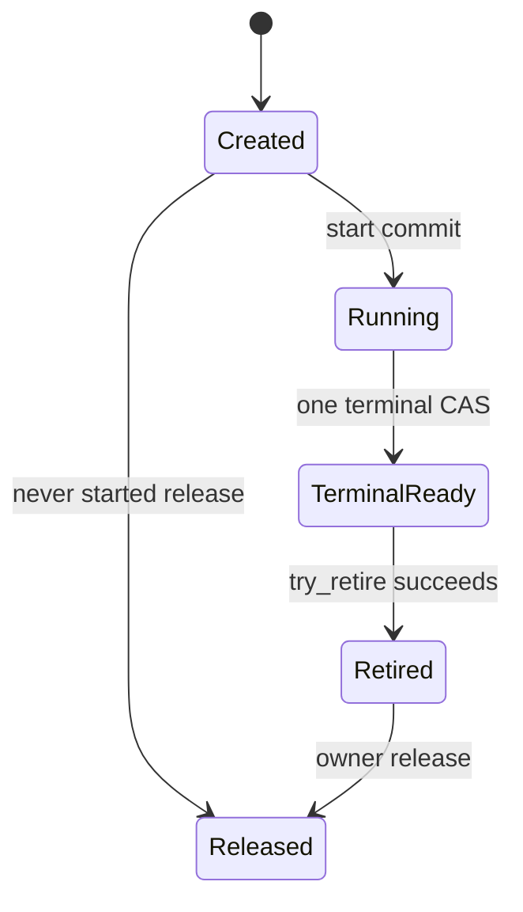

# C-ASYNC-001：异步操作、取消、结果与退休

版本：0.1.0；D06 / R09、R08、R07。作者：interop_design。状态：**review-ready；正式接受以registry为准；产品实施与生产验收未验证**。本文件作出v1实现选择，保留真实语言、AOT与生产验证义务。源码证据见[R09报告](../research/topics/R09/report.md)。

## 1. 公共编程模型与范围

普通I/O与长期native操作向应用返回`Task<T>`，接受`CancellationToken`，可以自然await和组合。同步引擎提供直接同步方法；不把同步工作强制包装为Task.Run。流式结果使用领域定义的有界`IAsyncEnumerable<T>`或Stream，由相应driver/server契约规定提前退出。

v1不池化`IValueTaskSource`或callback context。`ValueTask`只用于已有明确同步完成热路径及单次消费约束的API；采用前需证明收益并通过token/generation、迟到通知、重复await等测试。C#15新类型机制可以减少样板，但不能据语法断言无装箱或零分配。

```csharp
// Public API illustration; not yet compiled.
public Task<OwnedResult> ExecuteAsync(
    ReadOnlyMemory<byte> input, CancellationToken cancellationToken = default);

await using var engine = await Engine.OpenAsync(options, cancellationToken);
using OwnedResult result = await engine.ExecuteAsync(input, cancellationToken);
await result.CopyToAsync(destinationStream, cancellationToken);
```

取消后的操作可能仍等待native合作完成。数据库持久化效果另由领域结果表达，不能从Task状态推导提交/回滚。

OwnedResult按D07提供安全copy/read操作；上例不授予任意native-backed Memory的长期借用。具体结果若需要异步释放则实现IAsyncDisposable并使用await using，其拥有权、lease和预算由领域类型明确。

## 2. 关键决定

| 议题 | v1选择 | 理由与成本 |
| --- | --- | --- |
| 创建与开始 | create与start分开；先获得操作身份并初始化managed context | 处理同步完成与同步取消注册；增加一次FFI |
| 结果完成权 | accepted操作由native唯一终态通知决定；cancel只请求停止 | 避免把请求取消伪装为native已停止或事务未发生 |
| managed结果容器 | TaskCompletionSource<T>，RunContinuationsAsynchronously | 多await自然；不在外来线程内联应用continuation；每操作有分配 |
| 结果所有权 | terminal通知只复制固定状态，结果通过一次typed take取得 | 明确转移时点；额外一次FFI与managed协调 |
| 资源回收 | native try_retire + managed setup/cancel/control/callback屏障 | Task结果与资源生命周期可独立观测 |
| 性能优化 | 同步快路径、批处理优先；暂不context/ValueTaskSource池化 | 减少ABA、复用与版本负担；以后凭端到端证据引入 |

## 3. 互操作形状

所有名称由生成器加Engine前缀；本文件的公共状态值由[D08](error-v0.1.md)定义，表布局与调用约定由D02定义，Buffer遵从D07。

```c
typedef struct nw_operation nw_operation;
typedef uint32_t (NW_CDECL *nw_on_terminal_fn)(
    uintptr_t cookie, uint32_t terminal_status,
    const nw_error_info_v1 *borrowed_error);

typedef struct nw_operation_callbacks_v1 {
    uint32_t struct_size;
    uint32_t flags;                 /* v1 = 0 */
    uintptr_t cookie;
    nw_on_terminal_fn on_terminal;
} nw_operation_callbacks_v1;

uint32_t NW_CDECL nw_operation_create(
    nw_engine *, const nw_parameters_v1 *, nw_operation **out_operation,
    nw_error_info_v1 *out_error);
uint32_t NW_CDECL nw_operation_start(
    nw_operation *, const nw_operation_callbacks_v1 *, nw_error_info_v1 *);
uint32_t NW_CDECL nw_operation_request_cancel(nw_operation *);
uint32_t NW_CDECL nw_operation_take_result(
    nw_operation *, nw_result_v1 *out_result, nw_error_info_v1 *out_error);
uint32_t NW_CDECL nw_operation_try_retire(nw_operation *);
void NW_CDECL nw_operation_release(nw_operation *);
```

`nw_parameters_v1`和`nw_result_v1`是各操作的生成typed结构，不是统一动态对象或通用variant。参数所有权在ABI描述中逐字段指定。create可以复制参数或取得明确owner lease，但在失败时必须回滚已取得的拥有权，out_operation为null。

`borrowed_error`为可选固定记录，回调入口在返回前复制；不得缓存其指针。native在终态发布前冻结结果及错误记录，release/acquire同步由Engine实现。callback不携带任意拥有result，避免“已adopt但callback最后返回失败”产生双重责任。

## 4. native操作状态机



cancel_requested是正交标志，可在Created、Running或TerminalReady出现；它不单独产生Task终态。失败的start保持Created且没有回调/工作留存；一旦start提交，任何随后业务失败走TerminalReady而不能再把start报告为未接管。

native job与callback都持有内部state引用。terminal提交一次：冻结结果、记录状态、排队或同步调用on_terminal。等待callback返回和其他访问该cookie/输入的work结束后，try_retire才能成功。native不能在持有回调或take_result需要的锁时调用managed。

## 5. managed三个独立维度

| 维度 | 状态 | 含义 |
| --- | --- | --- |
| setup | Allocated / Registering / Starting / Settled | Settled带StartSkipped、StartRejected或StartAcceptedReturned；注册另带Registered或NoRegistration哨兵，不能等待从未开始的步骤 |
| application result | Pending / Succeeded / Faulted / Canceled | TCS唯一发布，不代表所有内存已回收 |
| cleanup | NotRequested / Closing / CancelDrained / NativeRetired / Reclaimed | 真正关闭的可观察进度 |

每个操作有固定context、setup lease、control-call计数、native-callback计数和一项cleanup队列成员身份。计数的获取与Closing检查必须原子；不得用“读bool，再++”作为并发实现。外部业务/取消准入与协调器独占的lifetime capability分开：Closing拒绝新的普通调用，协调器仍可为已有操作执行take_result、try_retire和release。该内部能力不能逃逸给应用或被其他线程绕过准入使用，其每次native调用仍受owner保护并记入在途计数。

## 6. 启动算法及失败补偿

1. 参数检查；已取消token可直接返回Task.FromCanceled，不创建native操作。同步参数异常与异步操作失败在API文档中区分。在native接管前预留operation、in-flight bytes和完成/清理slot配额；容量不足按领域策略立即拒绝，或先进入同样有界且尚未持有大payload的准入等待。
2. 获取Engine准入/调用lease，调用create。成功后立即把拥有指针放入预分配的SafeHandle；创建失败不分配callback cookie并归还预算。
3. 创建并完全初始化context、TCS、结果/错误状态、计数和Normal GCHandle。此阶段失败须释放所有已取得资源；setup lease保护尚未发布的状态。
4. 设置Registering，然后`token.UnsafeRegister(static state => state.RequestCancel(), context)`。回调可能在此调用返回前同步运行，必须只访问已经初始化的context。它可设置cancel_requested，并在取得control-call lease后调用允许Created状态的native request_cancel。
5. 赋值CancellationTokenRegistration并发布registration_ready。若取消已被观察且尚未调用start，可放弃start，记录本地Canceled；没有native业务被接受。否则进入Starting并持有start调用lease。
6. 调用start。同步on_terminal合法；它只登记终态并通知managed完成协调器，不能释放setup/start拥有权。
7. start返回OK表示已接管；非OK必须意味着完全未接管且没有callback。失败时发布相应Faulted并安排未启动清理。finally标记StartReturned、归还start/setup lease，并唤醒协调器。

注册失败、GCHandle分配失败、native create/start拒绝等逐个有补偿路径；不得让“catch里再调用可能抛出的方法”破坏最终释放。native若已回调却返回start失败，记为CONTRACT_VIOLATION并隔离该Engine，不执行可能双free的未接管清理。

setup由单一执行者持有setup lease，所有正常、取消和可补偿失败出口都经过同一finally发布**不会再进行后续setup**的Settled状态。`registration_ready`表示已发布真实registration，或已发布NoRegistration且永不再注册；`start_settled`表示已发布StartSkipped（从未进入native）、StartRejected（已返回且未接管）或StartAcceptedReturned（已返回且接管）。清理检查这些明确结果，不要求每条失败路径都真的调用Register/start。Closing与setup推进在同一协议下协调，不能先按NoRegistration清理，随后setup又创建注册。

| 失败/取消位置 | 已拥有的资源 | 必须发布/执行的补偿 |
| --- | --- | --- |
| 预算、参数、create前失败 | 尚无native/context，可能只有预算 | 同步归还预算/输入临时副本；不启动通用cleanup |
| create失败 | out_operation=null | callee回滚其部分分配，caller归还预算；无callback cookie |
| create成功，但context/TCS/GCHandle准备未完整发布 | Created native owner和部分managed资源；没有注册/start | 直接按初始化日志逐项回滚；release Created owner，free仅已实际分配的cookie；不得等待context的未建立promise |
| context完整，确定未进入Register便放弃 | context与Created owner | 发布NoRegistration、StartSkipped及本地失败/取消；NoRegistration视为已drained |
| Register在可证明未安装callback的阶段失败 | context、Created owner | 发布NoRegistration与StartSkipped；同上清理；该“未安装”必须由所选运行时实现/契约验证 |
| Register成功后观察预取消、关闭或其他setup失败 | 真实registration、context与Created owner | 发布Registered与StartSkipped，外部DisposeAsync排空registration，再释放Created owner |
| start返回拒绝 | registration、context；native保证无义务 | 发布StartRejected；Faulted并走外部registration drain与Created release |
| start返回OK，含同步terminal | registration、native accepted义务 | 发布StartAcceptedReturned；按终态/retire协议清理，不按失败初始化回滚 |
| 无法判定Register是否留存callback，或start是否接管 | 可能有未知义务 | 记录Indeterminate/CONTRACT_VIOLATION并隔离，保留owner与预算；不能伪造NoRegistration/StartSkipped或cleanup成功 |

内部CancellationToken delegate为无用户代码、无分配依赖的受控入口，普通异常必须在其内部锁存，不允许异常从delegate逃出令UnsafeRegister的同步调用变成不明接管。运行时致命异常仍遵循D08。初始化日志、状态哨兵和最终发布本身须在真实故障注入中验证；本轮有限模型包含skip-start，但不包含所有分配/注册失败分支。

## 7. 取消与结果线性化

CancellationToken回调不调用TCS.TrySetCanceled。它原子设置cancel_requested；在控制准入仍开放且handle存在时取得control lease，调用非阻塞、幂等的request_cancel，然后finally归还lease。request_cancel返回OK仅表示请求被记录/已不需要动作。

native终态CAS决定成功、取消或失败。取消已请求仍可能返回Success，例如业务已完成；native确认合作停止可发布CANCELED。TIMEOUT独立映射为TimeoutException，不能仅检查caller token的当前值覆盖native结果。Owner关闭拒绝新操作，已接受操作按领域关闭策略请求停止；原生取消无caller token时Task可以带默认token结束。

数据库提交响应丢失时，DOMAIN_ERROR的领域结果可以包含`Effect=Unknown`；即使用户token同时取消也不得改写为“确定回滚”。native本地静默与这种知识状态分别保留。

## 8. 结果接管与Task发布

on_terminal只检查并复制固定记录，以一次原子发布登记terminal_notice。重复通知是native契约缺陷；managed保留第一次结果，诊断并poison，不能把重复通知当第二个owner。callback内不执行应用continuation。

context预先拥有一个不分配的terminal latch，分别记录`notice_claimed`、`native_status/error_snapshot`、`notice_received`和`binding_failure`。只要cookie能安全解析，入口先以CAS取得notice_claimed的唯一写权限；重复通知只记录独立契约错误，不覆盖第一份latch或第二次发布Task。取得权限后保存native status，再校验/复制允许的固定error字段；普通检查/复制后处理异常不能让context永远停在“没有通知”。catch在同一预分配latch写binding_failure，finally以release发布notice_received并唤醒已预留的协调slot，返回CALLBACK_FAILED；协调器以acquire读取已完整发布的字段。通知队列满只改slot标志，由共享扫描重试；不依赖此时分配新的Task、Exception或queue node。

native收到terminal callback的CALLBACK_FAILED时只记录桥接投递失败并继续自己的callback退出/retire；**不得再提交第二个业务终态或重发另一终态**。协调器看到binding_failure后发布managed Faulted，保留原native状态、可用error快照与领域effect信息；native已成功或效果Unknown不能被改写为“未执行/已回滚”。未接管结果仍由native owner清理；如需领域恢复身份，使用已预存的operation/recovery ID，不能依赖失败时临时解码大payload。Task异常对象在callback外建立；若运行时已无法建立任何可观察失败结果，进入D08的致命/隔离策略，不能报告成功。

上述latch不是对任意失效cookie、不可读native指针或致命运行时错误的恢复承诺；这些属于契约破坏/fatal路径。合法callback的固定字段复制和no-throw退出必须有独立故障注入；模型暂不覆盖binding-failure latch。

managed完成协调器从callback以外运行。若终态成功，先准备托管结果包装及结果预算，再以内部lifetime capability和调用lease执行按操作生成的take_result。native原子把结果从Ready变为Taken：成功时把owner移到out_result并将自身对应字段归零；失败时out_result保持空，native保留原owner。第二次take返回INVALID_STATE且不交出资源。take前包装分配失败时native仍拥有结果；take后转换失败时managed包装负责释放，再发布Faulted。typed take须保持这种失败原子性；禁止先移出owner，再执行可能失败且没有补偿的分配。

非成功结果按D08转换；需要丰富领域错误时使用领域定义的一次take_error/typed结果，遵从同一转移协议。未取走的结果由operation最终release释放。TCS使用RunContinuationsAsynchronously，但其他线程可以在callback返回前执行continuation，因此不能依赖该选项充当回收屏障。

普通Task可在native退休之前完成；返回给应用的拥有结果必须已从operation独立接管，不可随随后operation释放失效。结果转移是正交状态，native已经Retired但尚未Released时仍允许一次take；Retired不意味着已销毁结果。

用户从不await、丢弃Task或应用continuation抛出，都不能阻止operation cleanup。Engine的有界活跃操作集合/协调器保持context强根，自动处理终态并推进清理，Reclaimed后移除强根。成功返回的独立OwnedResult仍遵循应用Dispose责任与其非阻塞最终释放后备；忽略Task不能承诺确定地释放这个已转移给Task结果的资源，相关held-result预算必须独立计量。

## 9. 清理算法

完成/失败、Owner关闭和用户请求关闭都会合并到同一cleanup请求。每个context只允许一个活跃清理执行者：

1. 请求所需stop并关闭普通control-call准入，保持协调器专用的take/retire/release能力。若stop尚未送出，协调器以内部能力送出非阻塞stop；不能因准入关闭而丢失关闭请求。
2. 等待setup Settled和registration_ready/start_settled；NoRegistration立即满足managed drain，StartSkipped/StartRejected没有native接管义务。Indeterminate进入隔离，不能等一个永不发布的正常事件或假定其已完成。
3. 对Registered分支，从native callback及CancellationToken回调以外调用并await registration.DisposeAsync，令取消注册与在途取消callback真实结束；NoRegistration无需调用它。
4. 等待已经取得的普通control-call lease归零。协调器串行处理terminal_notice、take或放弃结果、发布Task，并保持owner直到结果处理结束；这可以在native退休前完成。Owner关闭早于终态时，不得因普通准入关闭而拒绝内部take。不允许并发的另一协调器回收正在take_result的handle。
5. 对未启动操作使用Created无接管路径；对accepted操作轮询非阻塞try_retire，只有OK表示native不再访问context、输入或调用回调。
6. 确认managed callback计数为0、所有native调用已返回且结果已发布或按失败路径处置；在一次Reclaimed状态转换中释放GCHandle、未转移结果、输入lease及operation owner。顺序不得使某个释放回调访问已经free的context。
7. 完成独立cleanup promise；成功的DisposeAsync等待此promise。

实际实现可以在保持上述偏序的前提下重叠不冲突的等待，例如native退休与取消排空。关键条件是最终release前全部成立，且任何等待都不持有业务锁。

## 10. 清理推进、失败和资源预算

每个异步Engine有一个按需激活的managed完成/清理协调器。每个操作在native接受前预留一个已计入Engine上限的slot；活跃集合与排队容量由同一上限约束。通知对每个操作去重，队列饱和时只更新已经预留的slot标志并唤醒共享扫描，不能丢终态，也不能让外来callback阻塞等待入队。PENDING重试合并到Engine单一计时源，采用有上限退避。通知只能加速重试，不能代替最终retire检查；不为每次PENDING无界创建Task或计时器。

bounded queue加无界的awaiting writers或持有大payload的待入队Task并不构成有界系统。准入等待者数、等待者持有bytes和已接受操作分别有上限；超过上限必须产生可观察拒绝。配额释放点是Reclaimed，或结果独立转移时转账到held-result预算，不能在Task先完成时偷偷归还仍被native占用的bytes。

Engine必须配置最大accepted operations和in-flight bytes；已公开完成但尚未退休的操作仍占用预算。长期不推进时报告阶段、年龄、callback/control计数、retire状态和隔离原因，并停止或限制新业务准入。`CloseAsync`等待可由调用方取消，但保留后台owner；无论超时多久，都不得以释放仍可能被访问的内存换取“关闭成功”。

native执行器已经损坏或无法再证明静默时，Engine进入隔离，清理promise报告不能完成的原因或继续等待；进程重启/隔离策略交宿主。代码不允许伪造retire成功。同步Engine不需要上述队列或线程。

## 11. 禁止的捷径

- cancel callback直接TrySetCanceled后free cookie。
- 在native callback、取消callback或持锁状态中同步等待drain。
- 对未知GCHandle做`Target != null`检查来“防止”复用。
- 凭Task完成、CancellationTokenRegistration.Unregister的bool或native queue长度为0推断全部静默。
- 用`ValueTask`或pool作为未经测量的默认性能承诺。
- 将线程池continuation排队、源码测试存在或Python模型通过写成AOT/竞态实现已验证。

## 12. 成本与演进

基线含create/start/take/retire/release控制调用、一个GCHandle、context/TCS与可能的input copy，额外调度使callback保持简短。对高吞吐短操作应优先提供批量或同步API。记录FFI次数、复制字节、分配、P50/P99、cleanup延迟、未退休bytes与线程数。

只有完整负载显示桥接成本显著时，才评估单调用启动、内联拥有结果转移、ValueTaskSource池化或原生完成队列；每种优化必须保留同步完成、版本、迟到通知和退役证明。ABI v1能力集合不强迫所有Engine支持异步profile。

## 13. 验证与正式任务

| ID | 关键用例/反例 | Delivery |
| --- | --- | --- |
| AS-01 | 未取消、预取消、注册内同步取消、注册与Cancel并发 | A07、A19、A20 |
| AS-02 | create/GCHandle/TCS/Register逐阶段失败、NoRegistration、StartSkipped/Rejected、Indeterminate隔离、同步终态先于start返回 | A07、A20 |
| AS-03 | cancel与Success/Failure竞争，重复终态，owner关闭重入；terminal复制/锁存/唤醒故障仍有单一managed结果且不篡改native effect | A07、A18、A20 |
| AS-04 | terminal已发布但start/cancel/take/control lease仍在途 | A07、A19、A20 |
| AS-05 | take一次、take后managed转换失败、未取result release、Closing后内部take、丢弃Task仍清理operation | A04、A07、A20 |
| AS-06 | native工作停滞、协调队列/等待者饱和、通知合并、执行器故障和超时等待 | A08、A18、B22 |
| AS-07 | 多await、continuation线程、ExecutionContext/AsyncLocal语义 | A07、A14、A15 |
| AS-08 | win-x64/linux-x64 AOT、长时间取消/恢复和资源归零 | A14、A15、A21、B22 |

有限模型位于[R09实验目录](../research/topics/R09/)，其模型结果仅支撑声明范围的抽象状态。正式实现必须把CAS、memory ordering、GC roots与native引用计数映射到模型事件，加入Loom/Coyote或等价调度测试、属性与模糊测试；工具是否适用按R15/R16决定，不能通过列工具名称完成验收。

## 14. 设计问题关闭范围

Q05的v1Task/ValueTask/池化选择已有明确决定；Q04的async完成、取消与回收协议已有具体偏序和不变量。独立审查通过后可关闭这些设计研究问题，并保留AS/CB/LT系列实际验证。R12执行器公平性与特殊线程profile、R10具体Buffer映射、R15弱内存模型进一步补证，不阻止当前协议草案被审查或不相关文档推进。

