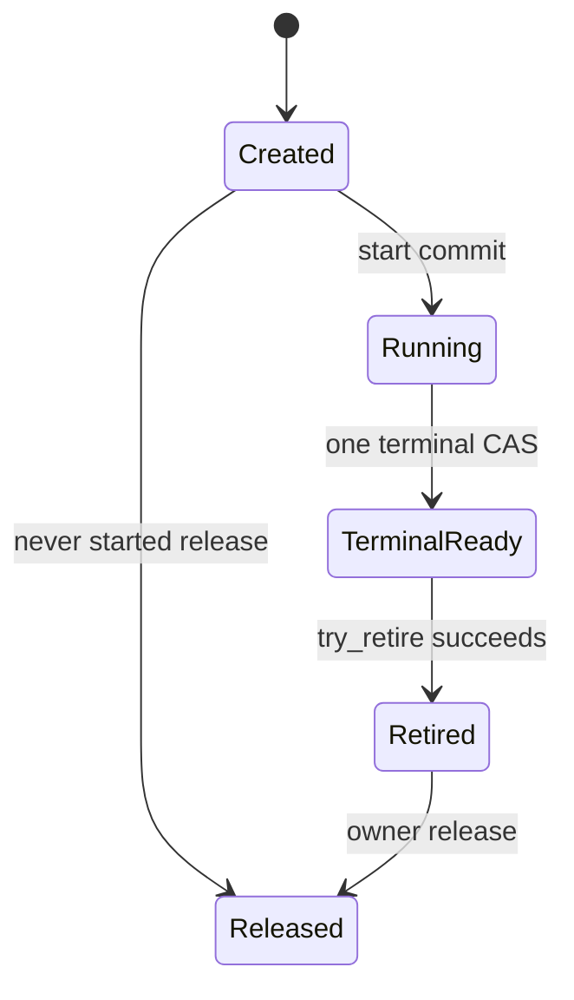

# C-ASYNC-001: Asynchronous operations, cancellation, results and retirement

Version: 0.3.0; D06 / R09, R08, R07. Author: interop_design. Status: **research/design candidate completed; the registry records the exact reviewed version, content hash and acceptance state; product validation remains in the Delivery phase**. This document makes the v1 implementation choices while retaining validation obligations in the actual languages, AOT and production. See the [R09 report](../research/topics/R09/report.md) for source evidence.

## 1. Public programming model and scope

Ordinary I/O and long-running native operations return `Task<T>` to the application, accept `CancellationToken`, and support natural await and composition. Synchronous engines provide direct synchronous methods; synchronous work is not forcibly wrapped in Task.Run. Streaming results use domain-defined bounded `IAsyncEnumerable<T>` or Stream, with early exit specified by the corresponding driver/server contract.

v1 does not pool `IValueTaskSource` or callback contexts. `ValueTask` is used only for APIs with an established synchronous-completion hot path and single-consumption constraints; adoption requires demonstrated benefit and passing tests for tokens/generations, late notifications, repeated await and related cases. New C# 15 type mechanisms can reduce boilerplate, but syntax alone cannot establish the absence of boxing or allocations.

```csharp
// Public API illustration; not yet compiled.
public Task<OwnedResult> ExecuteAsync(
    ReadOnlyMemory<byte> input, CancellationToken cancellationToken = default);

await using var engine = await Engine.OpenAsync(options, cancellationToken);
using OwnedResult result = await engine.ExecuteAsync(input, cancellationToken);
await result.CopyToAsync(destinationStream, cancellationToken);
```

An operation after cancellation may still be waiting for native cooperation to complete. Database persistence effects are expressed separately by domain results; commit/rollback cannot be inferred from Task state.

OwnedResult provides safe copy/read operations under D07; the example above does not grant a long-lived borrow of arbitrary native-backed Memory. A concrete result requiring asynchronous release implements IAsyncDisposable and uses await using; its domain type explicitly defines ownership, leases and budget.

## 2. Key decisions

| Topic | v1 choice | Rationale and cost |
| --- | --- | --- |
| Creation and start | Separate create from start; acquire operation identity and initialize the managed context first | Handles synchronous completion and synchronous cancellation registration; adds one FFI call |
| Authority to complete the result | The single native terminal notification determines an accepted operation; cancel only requests stop | Avoids representing a cancellation request as proof that native work stopped or a transaction did not occur |
| Managed result container | TaskCompletionSource<T>, RunContinuationsAsynchronously | Natural multiple awaits; no inline application continuations on foreign threads; allocations per operation |
| Result ownership | Terminal notification copies only fixed status; a one-time typed take retrieves the result | Explicit transfer point; one extra FFI call and managed coordination |
| Resource reclamation | Native try_retire + managed setup/cancel/control/callback barriers | Task outcome and resource lifetime are independently observable |
| Performance optimization | Prioritize synchronous fast paths and batching; no context/ValueTaskSource pooling for now | Reduces ABA, reuse and versioning burdens; introduce later based on end-to-end evidence |

## 3. Interop shape

The generator prefixes all names with the Engine name; [D08](error-v0.1.md) defines the public status values in this document, D02 defines table layout and calling convention, and Buffer follows D07.

```c
typedef struct nw_operation nw_operation;
typedef uint32_t (NW_CDECL *nw_on_terminal_fn)(
    uintptr_t cookie, uint32_t terminal_status,
    const nw_error_info_v1 *borrowed_error);

typedef struct nw_operation_callbacks_v1 {
    uint32_t struct_size;
    uint32_t flags;                 /* v1 = 0 */
    uintptr_t cookie;
    nw_on_terminal_fn on_terminal;
} nw_operation_callbacks_v1;

uint32_t NW_CDECL nw_operation_create(
    nw_engine *, const nw_parameters_v1 *, nw_operation **out_operation,
    nw_error_info_v1 *out_error);
uint32_t NW_CDECL nw_operation_start(
    nw_operation *, const nw_operation_callbacks_v1 *, nw_error_info_v1 *);
uint32_t NW_CDECL nw_operation_request_cancel(nw_operation *);
uint32_t NW_CDECL nw_operation_take_result(
    nw_operation *, nw_result_v1 *out_result, nw_error_info_v1 *out_error);
uint32_t NW_CDECL nw_operation_try_retire(nw_operation *);
void NW_CDECL nw_operation_release(nw_operation *);
```

`nw_parameters_v1` and `nw_result_v1` are generated typed structures for each operation, not a unified dynamic object or general-purpose variant. Parameter ownership is specified field by field in the ABI description. create may copy parameters or acquire explicit owner leases, but on failure it must roll back ownership already acquired and leave out_operation null.

`borrowed_error` is an optional fixed record that the callback entry point copies before returning; its pointer must not be cached. Native code freezes the result and error record before publishing the terminal state, with release/acquire synchronization implemented by the Engine. The callback does not carry an arbitrary owned result, avoiding the conflicting responsibilities of “already adopted, but the callback ultimately returns failure.”

## 4. Native operation state machine



cancel_requested is an orthogonal flag that may occur in Created, Running or TerminalReady; it does not independently produce a terminal Task state. A failed start remains Created with no retained callbacks/work; once start commits, any subsequent business failure goes through TerminalReady and start cannot again be reported as ownership not taken over.

Both native jobs and callbacks hold internal state references. The terminal state commits once: freeze the result, record the status, and enqueue or synchronously invoke on_terminal. try_retire can succeed only after the callback returns and other work accessing that cookie/input ends. Native code must not call managed code while holding a lock needed by the callback or take_result.

## 5. Three independent managed dimensions

| Dimension | States | Meaning |
| --- | --- | --- |
| setup | Allocated / Registering / Starting / Settled | Settled carries StartSkipped, StartRejected or StartAcceptedReturned; registration additionally carries a Registered or NoRegistration sentinel, so steps never started are not awaited |
| application result | Pending / Succeeded / Faulted / Canceled | Single publication by the TCS; does not mean all memory has been reclaimed |
| cleanup | NotRequested / Closing / CancelDrained / NativeRetired / Reclaimed | Observable progress toward actual closure |

Each operation has a stable context, a setup lease, a control-call count, a native-callback count and one cleanup-queue membership. Count acquisition and the Closing check must be atomic; “read bool, then ++” is not a concurrency implementation. External business/cancellation admission is separate from the coordinator's exclusive lifetime capability: Closing rejects new ordinary calls, while the coordinator may still perform take_result, try_retire and release for existing operations. This internal capability must not escape to applications or be used by other threads to bypass admission; every native call through it remains protected by an owner and counted as in flight.

## 6. Startup algorithm and failure compensation

1. Validate parameters; an already cancelled token may return Task.FromCanceled directly without creating a native operation. API documentation distinguishes synchronous argument exceptions from asynchronous operation failures. Before native takeover, reserve quotas for the operation, in-flight bytes and completion/cleanup slot; insufficient capacity causes immediate rejection under the domain policy, or first enters an equally bounded admission wait that does not yet hold a large payload.
2. Acquire Engine admission/a call lease and call create. On success, immediately place the owned pointer in a preallocated SafeHandle; creation failure does not allocate a callback cookie and returns the budget.
3. Create and fully initialize the context, TCS, result/error state, counts and Normal GCHandle. Failure at this stage must release all acquired resources; the setup lease protects state not yet published.
4. Set Registering, then call `token.UnsafeRegister(static state => state.RequestCancel(), context)`. The callback may run synchronously before this call returns and must access only an already initialized context. It may set cancel_requested and, after acquiring a control-call lease, call native request_cancel, which permits the Created state.
5. Assign CancellationTokenRegistration and publish registration_ready. If cancellation has been observed and start has not yet been called, start may be skipped and local Canceled recorded; no native business operation has been accepted. Otherwise enter Starting and hold the start-call lease.
6. Call start. Synchronous on_terminal is legal; it only records the terminal state and notifies the managed completion coordinator, and cannot release setup/start ownership.
7. start returning OK means takeover occurred; non-OK must mean complete non-takeover with no callback. On failure, publish the corresponding Faulted result and schedule never-started cleanup. In finally, mark StartReturned, return the start/setup leases and wake the coordinator.

Registration failure, GCHandle allocation failure, native create/start rejection and similar cases each have compensation paths; “calling another potentially throwing method inside catch” must not break final release. If native code has already called back but returns start failure, record CONTRACT_VIOLATION and isolate that Engine; do not perform cleanup for non-takeover that might double-free.

One executor owns setup through the setup lease, and all normal, cancellation and compensatable-failure exits pass through the same finally to publish Settled, meaning **no further setup will occur**. `registration_ready` means that a real registration has been published, or NoRegistration has been published and registration will never occur later; `start_settled` means publication of StartSkipped (never entered native code), StartRejected (returned without takeover) or StartAcceptedReturned (returned with takeover). Cleanup checks these explicit outcomes rather than requiring every failure path to actually call Register/start. Closing and setup progression are coordinated under the same protocol; cleanup must not proceed as NoRegistration and then allow setup to create a registration afterward.

| Failure/cancellation location | Resources already owned | Required publication/compensation |
| --- | --- | --- |
| Budget, parameters, failure before create | No native/context yet; possibly only budget | Return budget/temporary input copies synchronously; do not start general cleanup |
| create failure | out_operation=null | Callee rolls back partial allocations; caller returns budget; no callback cookie |
| create succeeds, but context/TCS/GCHandle preparation is not fully published | Created native owner and partial managed resources; no registration/start | Roll back item by item directly from the initialization log; release the Created owner and free only an actually allocated cookie; do not wait on a context promise not yet established |
| Context complete; abandon after establishing Register has not been entered | Context and Created owner | Publish NoRegistration, StartSkipped and local failure/cancellation; NoRegistration counts as drained |
| Register fails at a point where no callback is provably installed | Context, Created owner | Publish NoRegistration and StartSkipped; clean up as above; “not installed” must be verified against the selected runtime implementation/contract |
| Precancellation, shutdown or another setup failure observed after successful Register | Real registration, context and Created owner | Publish Registered and StartSkipped, externally drain the registration through DisposeAsync, then release the Created owner |
| start returns rejection | Registration, context; native code guarantees no obligations | Publish StartRejected; Faulted followed by external registration drain and Created release |
| start returns OK, including synchronous terminal notification | Registration, native accepted obligations | Publish StartAcceptedReturned; clean up through the terminal/retire protocol, not initialization-failure rollback |
| Cannot determine whether Register retained a callback or start performed takeover | Potentially unknown obligations | Record Indeterminate/CONTRACT_VIOLATION and isolate; retain owner and budget; do not fabricate NoRegistration/StartSkipped or cleanup success |

The internal CancellationToken delegate is a controlled entry point with no user code and no allocation dependency; ordinary exceptions must be latched inside it rather than escaping the delegate and making synchronous UnsafeRegister takeover indeterminate. Fatal runtime exceptions still follow D08. The initialization log, state sentinels and final publication themselves must be verified through actual fault injection; this round's finite model includes skip-start but not every allocation/registration failure branch.

## 7. Cancellation and result linearization

The CancellationToken callback does not call TCS.TrySetCanceled. It atomically sets cancel_requested; if control admission remains open and the handle exists, it acquires a control lease, calls nonblocking, idempotent request_cancel, then returns the lease in finally. request_cancel returning OK means only that the request was recorded or no further action is needed.

The native terminal-state CAS determines success, cancellation or failure. Success may still be returned after cancellation is requested, for example when the business operation has already completed; native confirmation of cooperative stop may publish CANCELED. TIMEOUT maps independently to TimeoutException; the native result must not be overwritten merely by checking the caller token's current value. Owner closure rejects new operations and requests stop for accepted operations under the domain shutdown policy; when native cancellation has no caller token, the Task may end with the default token.

If a database commit response is lost, the DOMAIN_ERROR domain result may include `Effect=Unknown`; even if the user token is cancelled concurrently, this must not be rewritten as “definitely rolled back.” Native local quiescence and this knowledge state remain separate.

## 8. Result takeover and Task publication

on_terminal only validates and copies the fixed record, registering terminal_notice through one atomic publication. Duplicate notification is a native contract defect; managed code keeps the first result, diagnoses and poisons, and must not treat a duplicate as a second owner. Application continuations do not execute inside the callback.

The context already owns a nonallocating terminal latch that separately records `notice_claimed`, `native_status/error_snapshot`, `notice_received` and `binding_failure`. Provided the cookie can be safely resolved, the entry point first acquires exclusive write authority for notice_claimed through CAS; duplicate notifications only record a separate contract error and do not overwrite the first latch or publish the Task again. After acquiring authority, store native status, then validate/copy permitted fixed error fields; ordinary exceptions during validation/copy postprocessing must not leave the context permanently in “no notification.” catch writes binding_failure into the same preallocated latch; finally publishes notice_received with release semantics, wakes the reserved coordination slot, and returns CALLBACK_FAILED; the coordinator reads fully published fields with acquire semantics. A full notification queue only changes slot flags for a shared scan to retry; this path does not rely on allocating a new Task, Exception or queue node.

When native code receives CALLBACK_FAILED from the terminal callback, it only records bridge-delivery failure and continues its own callback exit/retire; **it must not commit a second business terminal state or resend another terminal state**. On observing binding_failure, the coordinator publishes managed Faulted while retaining the original native status, available error snapshot and domain effect information; native success or an Unknown effect must not be rewritten as “not executed/rolled back.” Results not taken over remain the native owner's cleanup responsibility; if a domain recovery identity is needed, use the previously stored operation/recovery ID rather than relying on decoding a large payload at failure time. The Task exception object is created outside the callback; if the runtime can no longer construct any observable failure result, enter D08's fatal/isolation policy rather than report success.

This latch is not a recovery guarantee for arbitrary invalid cookies, unreadable native pointers or fatal runtime errors; those are contract-violation/fatal paths. Fixed-field copying and nonthrowing exit for a valid callback require independent fault injection; the model does not yet cover the binding-failure latch.

The managed completion coordinator runs outside callbacks. On a successful terminal state, first prepare the managed result wrapper and result budget, then execute the operation-specific generated take_result using the internal lifetime capability and a call lease. Native code atomically changes the result from Ready to Taken: on success, move the owner into out_result and zero its corresponding fields; on failure, out_result remains empty and native code retains the original owner. A second take returns INVALID_STATE and transfers no resource. If wrapper allocation fails before take, native code still owns the result; if conversion fails after take, the managed wrapper releases it before publishing Faulted. Typed take must preserve this failure atomicity; moving the owner out before performing a fallible allocation without compensation is prohibited.

Nonsuccess results are converted under D08; rich domain errors use a domain-defined one-time take_error/typed result under the same transfer protocol. Any untaken result is released by the operation's final release. TCS uses RunContinuationsAsynchronously, but other threads can execute continuations before the callback returns, so that option cannot serve as a reclamation barrier.

An ordinary Task may complete before native retirement; an owned result returned to the application must already have been independently taken over from the operation and must not become invalid when the operation is later released. Result transfer is an orthogonal state: one take is still permitted when native state is Retired but not yet Released; Retired does not mean the result has been destroyed.

A user never awaiting, discarding the Task or throwing in an application continuation must not prevent operation cleanup. The Engine's bounded active-operation set/coordinator strongly roots the context, automatically processes terminal states and advances cleanup, then removes the strong root after Reclaimed. An independently owned result returned successfully still follows the application's Dispose responsibility and its nonblocking final-release fallback; ignoring the Task cannot promise deterministic release of a resource already transferred into the Task result, and the associated held-result budget must be accounted for separately.

## 9. Cleanup algorithm

Completion/failure, Owner closure and user-requested closure coalesce into the same cleanup request. Each context permits only one active cleanup executor:

1. Request any required stop and close ordinary control-call admission while retaining the coordinator's dedicated take/retire/release capability. If stop has not yet been sent, the coordinator sends nonblocking stop through the internal capability; closing admission must not lose the shutdown request.
2. Wait for setup Settled and registration_ready/start_settled; NoRegistration immediately satisfies managed drain, and StartSkipped/StartRejected carry no native takeover obligations. Indeterminate enters isolation rather than waiting for a normal event that will never be published or assuming it already completed.
3. For Registered, call and await registration.DisposeAsync outside both native callbacks and CancellationToken callbacks so that cancellation registration and in-flight cancellation callbacks actually end; NoRegistration does not need to call it.
4. Wait for acquired ordinary control-call leases to reach zero. The coordinator serially processes terminal_notice, takes or abandons the result, publishes the Task and retains the owner until result processing ends; this may complete before native retirement. If Owner closure precedes the terminal state, closure of ordinary admission must not reject internal take. A second concurrent coordinator must not reclaim the handle while take_result is running.
5. Use the Created non-takeover path for never-started operations; for accepted operations, poll nonblocking try_retire, where only OK means native code no longer accesses the context or inputs or invokes callbacks.
6. Confirm that the managed callback count is 0, all native calls have returned, and the result has been published or handled through the failure path; in one Reclaimed transition, release the GCHandle, untransferred result, input leases and operation owner. Ordering must not allow a release callback to access an already freed context.
7. Complete the separate cleanup promise; successful DisposeAsync waits for this promise.

The actual implementation may overlap nonconflicting waits, such as native retirement and cancellation drain, while preserving the partial order above. The key requirements are that all conditions hold before final release and that no wait holds a business lock.

## 10. Cleanup progress, failure and resource budgets

Each asynchronous Engine has a managed completion/cleanup coordinator activated on demand. Before native acceptance, each operation reserves a slot charged against the Engine limit; the same limit bounds both the active set and queue capacity. Notifications are deduplicated per operation; when the queue is saturated, only the already reserved slot flags are updated and a shared scan is awakened, without losing terminal states or making foreign callbacks block while waiting to enqueue. PENDING retries coalesce into one timer source per Engine with capped backoff. Notifications only accelerate retries and do not replace the final retire check; Tasks or timers must not be created without bound for every PENDING.

A bounded queue plus unbounded awaiting writers or Tasks awaiting enqueue while holding large payloads is not a bounded system. Admission-waiter count, bytes held by waiters and accepted operations each have limits; exceeding them must produce an observable rejection. Quota is released at Reclaimed, or transferred into the held-result budget when the result transfers independently; Task completion must not silently return bytes still occupied by native code.

An Engine must configure maximum accepted operations and in-flight bytes; operations publicly completed but not yet retired still consume budget. On prolonged lack of progress, report phase, age, callback/control counts, retire state and isolation reason, and stop or restrict new business admission. A caller may cancel its `CloseAsync` wait, but the background owner remains; regardless of timeout duration, memory that might still be accessed must never be released in exchange for “shutdown success.”

If the native executor is damaged or quiescence can no longer be proven, the Engine enters isolation, and the cleanup promise reports why it cannot complete or continues waiting; process restart/isolation policy belongs to the host. Code must not fabricate successful retirement. Synchronous Engines do not require these queues or threads.

## 11. Prohibited shortcuts

- Calling TrySetCanceled directly from the cancel callback and then freeing the cookie.
- Synchronously waiting for drain in a native callback, cancellation callback or while holding a lock.
- Checking `Target != null` on an unknown GCHandle to “prevent” reuse.
- Inferring complete quiescence from Task completion, the bool returned by CancellationTokenRegistration.Unregister, or a native queue length of 0.
- Using `ValueTask` or pooling as an unmeasured default performance promise.
- Reporting thread-pool continuation enqueueing, the existence of test source or passing Python models as verified AOT/race implementation.

## 12. Cost and evolution

The baseline includes create/start/take/retire/release control calls, one GCHandle, context/TCS and possible input copies; additional scheduling keeps callbacks short. High-throughput short operations should prioritize batch or synchronous APIs. Record FFI counts, copied bytes, allocations, P50/P99, cleanup latency, unretired bytes and thread counts.

Evaluate single-call start, inline owned-result transfer, ValueTaskSource pooling or a native completion queue only when a complete workload shows significant bridge cost; each optimization must preserve proofs for synchronous completion, versioning, late notifications and retirement. The ABI v1 capability set does not force every Engine to support the asynchronous profile.

## 13. Verification and formal tasks

| ID | Key case/counterexample | Delivery |
| --- | --- | --- |
| AS-01 | Uncancelled, precancelled, synchronous cancellation during registration, registration concurrent with Cancel | A07, A19, A20 |
| AS-02 | Failure at each create/GCHandle/TCS/Register stage, NoRegistration, StartSkipped/Rejected, Indeterminate isolation, synchronous terminal notification before start returns | A07, A20 |
| AS-03 | cancel races with Success/Failure, duplicate terminal state, owner-close reentrancy; terminal copy/latch/wakeup failures still yield a single managed result without altering the native effect | A07, A18, A20 |
| AS-04 | Terminal state published while start/cancel/take/control leases remain in flight | A07, A19, A20 |
| AS-05 | Take once, managed conversion failure after take, release of untaken result, internal take after Closing, operation cleanup despite discarding the Task | A04, A07, A20 |
| AS-06 | Native work stalls, coordination queue/waiters saturate, notification coalescing, executor failure and timed-out waits | A08, A18, B22 |
| AS-07 | Multiple awaits, continuation threads, ExecutionContext/AsyncLocal semantics | A07, A14, A15 |
| AS-08 | win-x64/linux-x64 AOT, long-running cancellation/recovery and resource counts returning to zero | A14, A15, A21, B22 |

The finite model is in the [R09 experiment directory](../research/topics/R09/); its results support only abstract states within the declared scope. The formal implementation must map CAS, memory ordering, GC roots and native reference counts to model events, and add Loom/Coyote or equivalent scheduling tests, property tests and fuzz tests; R15/R16 determine tool applicability, and merely listing tool names does not complete acceptance.

## 14. Scope of design-question closure

Q05 has explicit v1 decisions for Task/ValueTask/pooling; Q04 has a concrete partial order and invariants for asynchronous completion, cancellation and reclamation. After independent review passes, these design research questions may close while retaining actual AS/CB/LT-series validation. Further evidence for R12 executor fairness and special-thread profiles, R10 concrete Buffer mapping and R15 weak-memory models does not prevent review of the current protocol draft or progress on unrelated documentation.

## 15. Completion recheck and version constraints (2026-11-13)

The [R09 completion report](../research/topics/R09/report.md) continues to use the already successful finite retirement model without rerunning it merely to inflate evidence; it adds pinned .NET 11 `ManualResetValueTaskSourceCore` and UniFFI future/scheduler source, plus the [actual normal/AOT probe](../../verification/interop-completion/linux/result.json). The latter actually covers synchronous/foreign-native-thread completion, precancellation, synchronous callbacks during registration, late cancellation not changing success, rejection of duplicate terminal/take, result release after conversion throws, and failed retirement while a callback is in flight. It verifies the specified control boundaries and does not implement the entire product coordinator.

v1 prefers Task and asynchronous continuations; ValueTask pooling must await concrete measurements and additional proof. The short version and Reset of `ManualResetValueTaskSourceCore` do not prove that an old native cookie is quiescent, nor permit token-wraparound detection alone to guarantee unlimited reuse. The current .NET 11 Runtime Async feature status and compilation configuration follow the latest R01/D01 evidence; historical “preview” descriptions must not remain current restrictions and do not change this protocol's native quiet obligations.

Cleanup notifications use [D09](concurrency-v0.1.md)'s bounded mailbox and single retry source; checking dirty and clearing scheduled must be atomic. Design acceptance is separate from A07/A19/A20 implementation tests: this specification already defines every state to implement, failure atomicity and the release partial order; the formal implementation will map actual CAS, GC roots, native references and platform behavior to these invariants item by item.


### Committed target evidence

The [CI readback](../../verification/interop-completion/ci-evidence-read.json) verifies source `7ea84e11ee19e6dad4503a5872eb27c6c7f44e80`, run `43388468172`: actual Windows/Linux normal and Native AOT main interop execution (10,528/10,529 assertions respectively), Roslyn generation checks and static metadata restrictions. This supports the stated research slice; product conformance remains separately assigned. Supplemental panic/invalid-UCO/generator comparison runs are Linux-only.
