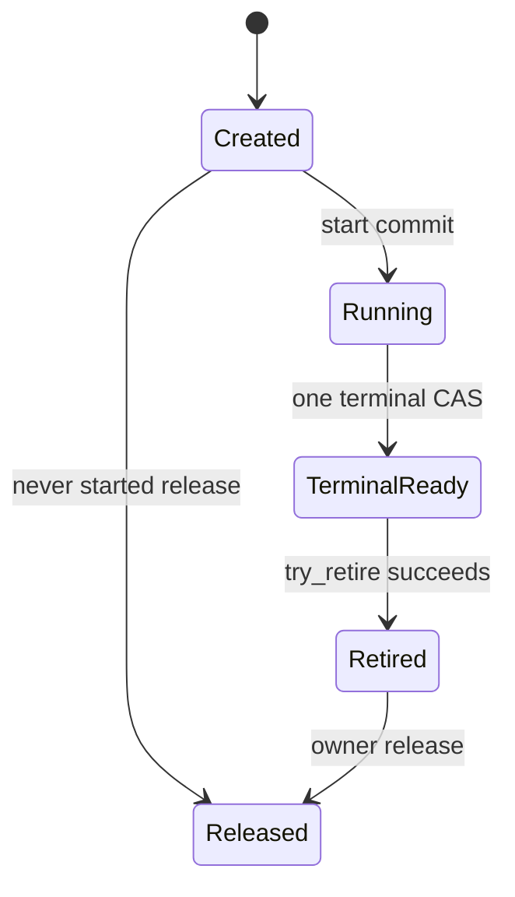

# C-ASYNC-001: Asynchronous operations, cancellation, results and retirement

Version: 0.3.0; D06 / R09, R08, R07. Author: interop_design. Status: **Research/design candidate complete; the registry records the exact reviewed version, content hash and acceptance status; product verification remains in Delivery**. This file makes the v1 implementation choices while retaining actual-language, AOT and production-verification obligations. See [the R09 report](../research/topics/R09/report.md) for source evidence.

## 1. Public programming model and scope

Ordinary I/O and long-running native operations return `Task<T>` to applications, accept `CancellationToken`, and support natural await and composition. Synchronous engines provide direct synchronous methods; synchronous work is not forcibly wrapped in Task.Run. Streaming results use domain-defined bounded `IAsyncEnumerable<T>` or Stream, with early-exit behavior specified by the corresponding driver/server contract.

v1 does not pool `IValueTaskSource` or callback contexts. `ValueTask` is used only for APIs with an established synchronous-completion hot path and a single-consumption constraint; adoption requires demonstrated benefits and passing tests for tokens/generations, late notifications, repeated await and related cases. New C#15 type mechanisms can reduce boilerplate, but syntax alone cannot establish no boxing or zero allocation.

```csharp
// Public API illustration; not yet compiled.
public Task<OwnedResult> ExecuteAsync(
    ReadOnlyMemory<byte> input, CancellationToken cancellationToken = default);

await using var engine = await Engine.OpenAsync(options, cancellationToken);
using OwnedResult result = await engine.ExecuteAsync(input, cancellationToken);
await result.CopyToAsync(destinationStream, cancellationToken);
```

A canceled operation may still be waiting for native cooperation to complete. Durable database effects are expressed separately through domain results; commit/rollback cannot be inferred from Task status.

OwnedResult provides safe copy/read operations under D07; the example does not grant long-term borrowing of arbitrary native-backed Memory. A concrete result requiring asynchronous release implements IAsyncDisposable and uses await using, with its ownership, leases and budgets specified by the domain type.

## 2. Key decisions

| Issue | v1 choice | Rationale and cost |
| --- | --- | --- |
| Creation and start | Separate create from start; first obtain the operation identity and initialize managed context | Handles synchronous completion and synchronous cancellation registration; adds one FFI call |
| Authority to complete the result | The sole native terminal notification decides the outcome of an accepted operation; cancel only requests stop | Avoids representing a cancellation request as native execution having stopped or a transaction not having occurred |
| managed result container | TaskCompletionSource<T>, RunContinuationsAsynchronously | Natural multiple-await support; application continuations do not run inline on foreign threads; per-operation allocations |
| Result ownership | Terminal notification copies only fixed status; result is obtained through one typed take | Explicit transfer point; one additional FFI call and managed coordination |
| Resource reclamation | native try_retire + managed setup/cancel/control/callback barriers | Task result and resource lifetime are independently observable |
| Performance optimization | Prioritize synchronous fast paths and batching; no context/ValueTaskSource pooling for now | Reduces ABA, reuse and versioning burdens; introduce later based on end-to-end evidence |

## 3. Interop shape

The generator adds Engine prefixes to all names; [D08](error-v0.1.md) defines this file's public status values, D02 defines table layout and calling conventions, and buffers follow D07.

```c
typedef struct nw_operation nw_operation;
typedef uint32_t (NW_CDECL *nw_on_terminal_fn)(
    uintptr_t cookie, uint32_t terminal_status,
    const nw_error_info_v1 *borrowed_error);

typedef struct nw_operation_callbacks_v1 {
    uint32_t struct_size;
    uint32_t flags;                 /* v1 = 0 */
    uintptr_t cookie;
    nw_on_terminal_fn on_terminal;
} nw_operation_callbacks_v1;

uint32_t NW_CDECL nw_operation_create(
    nw_engine *, const nw_parameters_v1 *, nw_operation **out_operation,
    nw_error_info_v1 *out_error);
uint32_t NW_CDECL nw_operation_start(
    nw_operation *, const nw_operation_callbacks_v1 *, nw_error_info_v1 *);
uint32_t NW_CDECL nw_operation_request_cancel(nw_operation *);
uint32_t NW_CDECL nw_operation_take_result(
    nw_operation *, nw_result_v1 *out_result, nw_error_info_v1 *out_error);
uint32_t NW_CDECL nw_operation_try_retire(nw_operation *);
void NW_CDECL nw_operation_release(nw_operation *);
```

`nw_parameters_v1` and `nw_result_v1` are generated typed structures for each operation, not a unified dynamic object or generic variant. Parameter ownership is specified field by field in the ABI description. create may copy parameters or acquire an explicit owner lease, but on failure it must roll back acquired ownership and leave out_operation null.

`borrowed_error` is an optional fixed record that the callback entry point copies before returning; its pointer must not be cached. Native code freezes the result and error record before terminal publication, with release/acquire synchronization implemented by the Engine. The callback carries no arbitrary owned result, avoiding conflicting responsibilities when “the result has been adopted but the callback ultimately returns failure.”

## 4. Native operation state machine



cancel_requested is an orthogonal flag that may occur in Created, Running or TerminalReady; it does not independently produce a terminal Task state. A failed start leaves the operation Created without retained callbacks/work; once start commits, every subsequent business failure goes through TerminalReady, and start cannot subsequently report that responsibility was not accepted.

Native jobs and callbacks both hold internal state references. Terminal state commits once: freeze the result, record status, and queue or synchronously invoke on_terminal. try_retire can succeed only after the callback returns and other work accessing that cookie/input ends. Native code must not call managed code while holding locks needed by the callback or take_result.

## 5. Three independent managed dimensions

| Dimension | States | Meaning |
| --- | --- | --- |
| setup | Allocated / Registering / Starting / Settled | Settled carries StartSkipped, StartRejected or StartAcceptedReturned; registration separately carries a Registered or NoRegistration sentinel, without waiting for steps that never began |
| application result | Pending / Succeeded / Faulted / Canceled | Single TCS publication; does not mean all memory has been reclaimed |
| cleanup | NotRequested / Closing / CancelDrained / NativeRetired / Reclaimed | Observable progress of actual closure |

Each operation has a fixed context, setup lease, control-call count, native-callback count and one cleanup-queue membership. Counter acquisition and the Closing check must be atomic; “read bool, then ++” is not a concurrent implementation. External business/cancellation admission is separate from the coordinator's exclusive lifetime capability: Closing rejects new ordinary calls, while the coordinator may still perform take_result, try_retire and release for existing operations. This internal capability must not escape to applications or be used by other threads to bypass admission; each of its native calls is still owner-protected and counted as in flight.

## 6. Start algorithm and failure compensation

1. Validate arguments; an already-canceled token may directly return Task.FromCanceled without creating a native operation. API documentation distinguishes synchronous argument exceptions from asynchronous operation failures. Before native code accepts responsibility, reserve operation, in-flight-byte and completion/cleanup-slot quotas; if capacity is insufficient, reject immediately according to domain policy, or first enter admission waiting that is also bounded and does not yet retain a large payload.
2. Acquire Engine admission/a call lease and invoke create. On success, immediately place the owned pointer into a preallocated SafeHandle; creation failure does not allocate a callback cookie and returns the budget.
3. Create and fully initialize the context, TCS, result/error state, counters and Normal GCHandle. Failure at this stage must release all acquired resources; the setup lease protects state that has not yet been published.
4. Set Registering, then call `token.UnsafeRegister(static state => state.RequestCancel(), context)`. The callback may run synchronously before this call returns and must access only the already-initialized context. It may set cancel_requested and, after acquiring a control-call lease, invoke native request_cancel, which permits Created state.
5. Assign CancellationTokenRegistration and publish registration_ready. If cancellation has been observed and start has not yet been called, start may be skipped and local Canceled recorded; no native business operation was accepted. Otherwise enter Starting and hold a start-call lease.
6. Call start. Synchronous on_terminal is legal; it only records terminal state and notifies the managed completion coordinator, without releasing setup/start ownership.
7. start returning OK means responsibility was accepted; non-OK must mean no responsibility was accepted and no callback occurred. On failure, publish the corresponding Faulted result and schedule never-started cleanup. In finally, mark StartReturned, return start/setup leases and wake the coordinator.

Registration failure, GCHandle allocation failure, native create/start rejection and other failures each have compensation paths; “calling another potentially throwing method inside catch” must not defeat final release. If native code has already called back but returns start failure, record CONTRACT_VIOLATION and isolate that Engine; do not execute the ownership-not-transferred cleanup path, which could double-free.

A single setup executor holds the setup lease, and every normal, cancellation and compensable-failure exit passes through the same finally to publish a Settled state meaning **no further setup will occur**. `registration_ready` means a real registration has been published, or NoRegistration has been published and registration will never occur; `start_settled` means StartSkipped (native code was never entered), StartRejected (returned without accepting responsibility) or StartAcceptedReturned (returned after accepting responsibility) has been published. Cleanup checks these explicit outcomes without requiring every failure path to actually call Register/start. Closing and setup progress are coordinated under the same protocol; cleanup must not assume NoRegistration and then allow setup to create a registration afterward.

| Failure/cancellation location | Resources already owned | Required publication/compensation |
| --- | --- | --- |
| Budget, argument or pre-create failure | No native/context yet; possibly budget only | Synchronously return budgets/temporary input copies; do not start generic cleanup |
| create failure | out_operation=null | Callee rolls back its partial allocations; caller returns budgets; no callback cookie |
| create succeeded but context/TCS/GCHandle preparation is not fully published | Created native owner and partial managed resources; no registration/start | Roll back directly item by item using the initialization log; release the Created owner, free only an actually allocated cookie; do not wait for context promises that were never established |
| Context complete; abandon with certainty before entering Register | Context and Created owner | Publish NoRegistration, StartSkipped and local failure/cancellation; NoRegistration counts as drained |
| Register fails at a stage provably before callback installation | Context, Created owner | Publish NoRegistration and StartSkipped; clean up as above; “not installed” must be verified against the selected runtime implementation/contract |
| Pre-cancellation, closure or another setup failure observed after Register succeeds | Real registration, context and Created owner | Publish Registered and StartSkipped; externally drain registration with DisposeAsync, then release the Created owner |
| start returns rejection | Registration, context; native code guarantees no obligations | Publish StartRejected; publish Faulted and follow external registration drain and Created release |
| start returns OK, including synchronous terminal notification | Registration and native accepted obligations | Publish StartAcceptedReturned; clean up through the terminal/retire protocol, not failed-initialization rollback |
| Cannot determine whether Register retained a callback or start accepted responsibility | Potentially unknown obligations | Record Indeterminate/CONTRACT_VIOLATION and isolate, retaining owner and budgets; do not fabricate NoRegistration/StartSkipped or cleanup success |

The internal CancellationToken delegate is a controlled entry point with no user code or allocation dependency; ordinary exceptions must be latched internally and must not escape the delegate, making UnsafeRegister's synchronous invocation indeterminate as to responsibility. Fatal runtime exceptions still follow D08. The initialization log, state sentinels and final publication themselves require verification through actual fault injection; this round's finite model includes skip-start but not every allocation/registration failure branch.

## 7. Cancellation and result linearization

The CancellationToken callback does not call TCS.TrySetCanceled. It atomically sets cancel_requested; while control admission remains open and a handle exists, it acquires a control lease, calls non-blocking, idempotent request_cancel and returns the lease in finally. request_cancel returning OK means only that the request has been recorded/no action is needed anymore.

The native terminal CAS decides success, cancellation or failure. Success may still be returned after cancellation was requested, for example when the business operation has already completed; native confirmation of cooperative stop may publish CANCELED. TIMEOUT maps separately to TimeoutException, and the caller token's current value alone must not overwrite the native result. Owner closure rejects new operations and requests stop for accepted operations according to the domain closure policy; native cancellation without a caller token may end the Task with the default token.

When a database commit response is lost, the domain result of DOMAIN_ERROR may include `Effect=Unknown`; even simultaneous user-token cancellation must not rewrite this as “confirmed rollback.” Native local quiescence and this knowledge state remain separate.

## 8. Result ownership acquisition and Task publication

on_terminal only validates and copies the fixed record, registering terminal_notice through one atomic publication. Duplicate notifications are a native contract defect; managed code preserves the first result, diagnoses and poisons, without treating the duplicate as a second owner. The callback does not execute application continuations.

The context owns a preallocated terminal latch that performs no allocation, separately recording `notice_claimed`, `native_status/error_snapshot`, `notice_received` and `binding_failure`. As long as the cookie can be safely resolved, the entry point first uses CAS to acquire sole write authority through notice_claimed; duplicate notifications only record a separate contract error, without overwriting the first latch or publishing the Task a second time. After acquiring authority, save native status, then validate/copy the permitted fixed error fields; an ordinary validation/copy-postprocessing exception must not leave the context permanently at “no notification.” catch writes binding_failure to the same preallocated latch, and finally release-publishes notice_received, wakes the reserved coordination slot and returns CALLBACK_FAILED; the coordinator acquire-reads the fully published fields. A full notification queue only changes slot flags for retry by the shared scanner; it does not depend on allocating a new Task, Exception or queue node at that point.

When native code receives CALLBACK_FAILED from the terminal callback, it only records bridge-delivery failure and continues its own callback exit/retire; **it must not commit a second business terminal state or send another terminal state again**. On observing binding_failure, the coordinator publishes managed Faulted while preserving the original native status, available error snapshot and domain effect information; native success or an Unknown effect must not be rewritten as “not executed/rolled back.” The native owner still cleans up results whose ownership has not been acquired; any required domain recovery identity uses a prestored operation/recovery ID and must not depend on decoding a large payload during failure. Task exception objects are created outside the callback; if the runtime can no longer construct any observable failure result, enter D08's fatal/isolation policy rather than report success.

The latch above is not a recovery promise for arbitrary invalid cookies, unreadable native pointers or fatal runtime errors; these belong to contract-violation/fatal paths. Fixed-field copying and no-throw exit for a valid callback require independent fault injection; the model does not yet cover the binding-failure latch.

The managed completion coordinator runs outside the callback. For a successful terminal state, first prepare the managed result wrapper and result budget, then use the internal lifetime capability and a call lease to execute the operation-specific generated take_result. Native code atomically moves the result from Ready to Taken: on success, move the owner to out_result and zero the corresponding native field; on failure, out_result remains empty and native code retains the original owner. A second take returns INVALID_STATE without yielding resources. If wrapper allocation fails before take, native code still owns the result; if conversion fails after take, the managed wrapper releases it before Faulted is published. Typed take must preserve this failure atomicity; moving the owner out and then performing a fallible allocation without compensation is prohibited.

Non-success results are converted under D08; rich domain errors use a domain-defined one-time take_error/typed result following the same transfer protocol. Results not taken are freed by the operation's final release. TCS uses RunContinuationsAsynchronously, but other threads may execute continuations before the callback returns, so this option cannot serve as a reclamation barrier.

An ordinary Task may complete before native retirement; an owned result returned to the application must already have been acquired independently from the operation and must not become invalid when the operation is subsequently released. Result transfer is orthogonal state: one take is still permitted when native state is Retired but not yet Released; Retired does not mean the result has been destroyed.

Failure to await, discarding the Task or an application continuation throwing must not prevent operation cleanup. The Engine's bounded active-operation set/coordinator holds the context as a strong root, automatically processes terminal state and advances cleanup, then removes the strong root after Reclaimed. An independent OwnedResult returned successfully still follows the application's Dispose responsibility and its non-blocking final-release fallback; ignoring the Task cannot promise deterministic release of this resource already transferred to the Task result, and the associated held-result budget must be accounted for independently.

## 9. Cleanup algorithm

Completion/failure, Owner closure and user-requested closure coalesce into the same cleanup request. Each context permits only one active cleanup executor:

1. Request the required stop and close ordinary control-call admission while preserving the coordinator's exclusive take/retire/release capability. If stop has not yet been sent, the coordinator sends non-blocking stop through the internal capability; the closure request must not be lost because admission closed.
2. Wait for setup Settled and registration_ready/start_settled; NoRegistration immediately satisfies managed drain, and StartSkipped/StartRejected has no native accepted obligations. Indeterminate enters isolation rather than waiting for a normal event that will never be published or assuming it has completed.
3. For the Registered branch, call and await registration.DisposeAsync outside both native callbacks and CancellationToken callbacks, actually ending cancellation registration and any cancellation callback in flight; NoRegistration does not call it.
4. Wait for previously acquired ordinary control-call leases to reach zero. The coordinator serially processes terminal_notice, takes or abandons the result, publishes the Task and holds the owner until result processing ends; this may complete before native retirement. If Owner closure precedes terminal state, closed ordinary admission must not reject internal take. Another concurrent coordinator must not reclaim a handle while take_result is using it.
5. For never-started operations, use the Created path without accepted obligations; for accepted operations, poll non-blocking try_retire. Only OK means native code no longer accesses context/input or invokes callbacks.
6. Confirm the managed callback count is 0, all native calls have returned, and the result has been published or disposed of through the failure path; in one transition to Reclaimed, release the GCHandle, untransferred result, input leases and operation owner. Release ordering must not allow any release callback to access a context that has already been freed.
7. Complete the independent cleanup promise; successful DisposeAsync waits for this promise.

An actual implementation may overlap non-conflicting waits, such as native retirement and cancellation drain, while preserving the partial order above. The key conditions are that all hold before final release and no wait holds a business lock.

## 10. Cleanup progress, failure and resource budgets

Each asynchronous Engine has an on-demand managed completion/cleanup coordinator. Every operation reserves a slot charged to the Engine limit before native acceptance; the active set and queue capacity are bounded by the same limit. Notifications are deduplicated per operation. When the queue is saturated, only the already-reserved slot flags are updated and the shared scanner is awakened; terminal state must not be lost, nor may a foreign callback block waiting to enqueue. PENDING retries coalesce into a single Engine timing source with bounded backoff. Notifications only accelerate retries and cannot replace the final retire check; do not create unbounded Tasks or timers for each PENDING result.

A bounded queue plus unbounded awaiting writers or enqueue-waiting Tasks holding large payloads does not make a bounded system. Admission-waiter count, bytes held by waiters and accepted operations have separate limits; exceeding a limit must produce observable rejection. Quotas are released at Reclaimed, or transferred to the held-result budget when result ownership transfers independently; bytes still held by native code must not be silently returned when the Task completes first.

The Engine must configure maximum accepted operations and in-flight bytes; operations whose completion is already public but which have not retired still consume budget. During prolonged lack of progress, report phase, age, callback/control counts, retire status and isolation reason, and stop or limit new business admission. The caller may cancel the `CloseAsync` wait, but the background owner is retained; no timeout duration permits freeing memory that may still be accessed in exchange for “successful closure.”

If the native executor is damaged or quiescence can no longer be proven, the Engine enters isolation, and the cleanup promise reports why it cannot complete or continues waiting; process restart/isolation policy belongs to the host. Code must not fabricate successful retirement. Synchronous Engines do not require these queues or threads.

## 11. Prohibited shortcuts

- A cancel callback directly calls TrySetCanceled and then frees the cookie.
- Synchronously waiting for drain in a native callback, cancellation callback or while holding a lock.
- Checking `Target != null` on an unknown GCHandle to “prevent” reuse.
- Inferring full quiescence from Task completion, CancellationTokenRegistration.Unregister's bool or a native queue length of 0.
- Using `ValueTask` or a pool as an unmeasured default performance promise.
- Presenting ThreadPool continuation enqueueing, the existence of source tests or a passing Python model as verification of the AOT/race implementation.

## 12. Cost and evolution

The baseline includes create/start/take/retire/release control calls, one GCHandle, context/TCS and a possible input copy; additional scheduling keeps callbacks short. Prefer batch or synchronous APIs for high-throughput short operations. Record FFI calls, bytes copied, allocations, P50/P99, cleanup latency, unretired bytes and thread counts.

Evaluate single-call start, inline owned-result transfer, ValueTaskSource pooling or native completion queues only when full workloads show significant bridging cost; every optimization must preserve synchronous-completion, versioning, late-notification and retirement proofs. The ABI v1 capability set does not force all Engines to support the asynchronous profile.

## 13. Verification and formal tasks

| ID | Key cases/counterexamples | Delivery |
| --- | --- | --- |
| AS-01 | No cancellation, pre-cancellation, synchronous cancellation within registration, registration concurrent with Cancel | A07, A19, A20 |
| AS-02 | Per-stage create/GCHandle/TCS/Register failures, NoRegistration, StartSkipped/Rejected, Indeterminate isolation, synchronous terminal state before start returns | A07, A20 |
| AS-03 | Cancel races with Success/Failure, duplicate terminal states, Owner-closure reentrancy; terminal copy/latch/wakeup failures still yield one managed result without altering native effect | A07, A18, A20 |
| AS-04 | Terminal state published while start/cancel/take/control leases remain in flight | A07, A19, A20 |
| AS-05 | One take, managed conversion failure after take, untaken-result release, internal take after Closing, operation cleanup despite discarded Task | A04, A07, A20 |
| AS-06 | Stalled native work, saturated coordinator queue/waiters, notification coalescing, executor failure and timed-out waits | A08, A18, B22 |
| AS-07 | Multiple await, continuation threads, ExecutionContext/AsyncLocal semantics | A07, A14, A15 |
| AS-08 | win-x64/linux-x64 AOT, long-duration cancellation/recovery and resource return to zero | A14, A15, A21, B22 |

The finite model resides in the [R09 experiment directory](../research/topics/R09/); its results support only abstract states within the declared scope. Formal implementation must map CAS, memory ordering, GC roots and native reference counts to model events and add Loom/Coyote or equivalent scheduling tests, property tests and fuzzing. R15/R16 determines tool applicability; listing tool names does not complete acceptance.

## 14. Scope of design-question closure

Q05's v1 Task/ValueTask/pooling choice has an explicit decision; Q04's asynchronous-completion, cancellation and reclamation protocol has a concrete partial order and invariants. These design research questions may close after independent review passes, while retaining the actual AS/CB/LT verification series. R12 executor fairness and specialized thread profiles, R10 concrete buffer mappings and R15 weak-memory models provide further evidence without preventing review of the current protocol draft or progress on unrelated documents.

## 15. Completion review and version constraints for this round (2026-11-13)

[The R09 completion report](../research/topics/R09/report.md) continues to use the already successful finite retirement model without rerunning it merely to add volume; it adds pinned source for .NET 11 `ManualResetValueTaskSourceCore`, UniFFI future/scheduler, and the [actual normal/AOT probe](../../verification/interop-completion/linux/result.json). The latter actually covers synchronous/foreign-native-thread completion, pre-cancellation, synchronous callbacks during registration, late cancellation not altering success, rejection of duplicate terminal/take, result release after conversion throws, and failed retirement while a callback is in flight. It verifies the specified control boundaries without implementing the entire product coordinator.

v1 prefers Task and asynchronous continuations; ValueTask pooling must await concrete measurements and additional proof. The short version and Reset in `ManualResetValueTaskSourceCore` do not prove that an old native cookie is quiescent, nor permit token-wraparound detection alone to guarantee unlimited reuse. The current .NET 11 Runtime Async feature status and compilation configuration follow the latest R01/D01 evidence; historical “preview” descriptions must not remain current restrictions and do not change this protocol's native quiet obligations.

Cleanup notifications use [D09](concurrency-v0.1.md)'s finite mailbox and single retry source; checking dirty and clearing scheduled must be atomic. Design acceptance is separate from A07/A19/A20 implementation tests: this specification already defines every required implementation state, failure atomicity and release partial order; formal implementation then maps actual CAS, GC roots, native references and platform behavior to these invariants item by item.


### Committed target evidence

The [CI readback](../../verification/interop-completion/ci-evidence-read.json) verifies source `7ea84e11ee19e6dad4503a5872eb27c6c7f44e80`, run `43388468172`: actual Windows/Linux normal and Native AOT main interop execution (10,528/10,529 assertions respectively), Roslyn generation checks and static metadata restrictions. This supports the stated research slice; product conformance remains separately assigned. Supplemental panic/invalid-UCO/generator comparison runs are Linux-only.
