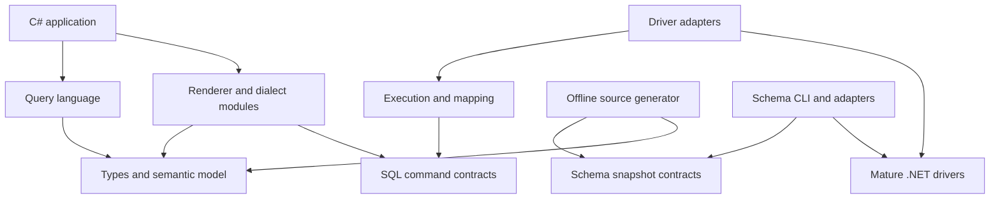

# Architecture and decisions

Status: proposed, version 0.1.0. This document selects the architecture; it does
not announce installable packages or a completed replacement product. Normative
module boundaries are in [contracts.md](contracts.md). Source findings are in the
[language](language-model.md), [dialect](dialects-and-generation.md) and
[execution](execution-aot.md) reviews.

## Product boundary

Korda.Orm expresses SQL directly and strongly in C#. It supports static and
runtime-composed queries without a database connection, code emission, JDBC,
ADO.NET or a native query compiler in its language/runtime dependencies. Its
language includes scalar/row expressions, relations, aliases, projections,
predicates, joins, subqueries, CTEs, set operations, windows, DML and declared
database-specific expressions. This is not an object tracking or LINQ translation
framework. Entities, records and DTOs are useful result/input types, not the only
way to represent SQL.

The mature reference is the pinned jOOQ OSS implementation. Each supported
operation retains its source/semantic case mapping; an API spelling alone is
insufficient. Implementation is phased by operation families, not restricted
permanently to CRUD. Parser/translator and optional Dapper.AOT bridging are
separate follow-on capabilities with their own acceptance scope.

Execution consumes a rendered command contract. It does not visit AST nodes,
translate Fluent calls, discover DTO members at runtime, implement a protocol,
manage a second connection pool, or schedule database work through a new worker
runtime. Mature drivers retain those responsibilities. SQLite's driver-owned
native dependency is compatible with this decision.

## Dependency direction

The arrows below mean a module consumes a lower-level contract. Tooling and
execution may depend on the language model; the reverse edges are forbidden.

The model includes pure SQL types and result/parameter descriptors. A dialect's
SQL type declaration or cast is independent of the provider's serialization
codec. Shared command descriptors may physically reside in the small model
assembly. This does not require an assembly for every box.

| Module family | Owns | Forbidden dependency / separate responsibility |
| --- | --- | --- |
| Types/model | SQL identity, facets, logical slots, relation identity, expression metadata | Drivers, connections, generator runtime, hosting |
| Query/expressions/DML | Typed composition, scope and contextual validation, immutable snapshots | Database scheduling, provider binding, query execution |
| Rendering | Traversal, scoped names, atomic SQL/layout/result production | Opening connections or fetching generated keys |
| Dialects | Profile capabilities, faithful SQL lowerings and explicit rejections | Driver object models and silent loss of semantics |
| Schema | Deterministic, versioned schema snapshot and names/types | Live database access during normal compilation |
| Generator | Offline snapshot to typed metadata; known DTO/binder/projector generation | Network calls, database discovery inside Roslyn, runtime reflection fallback |
| Schema tool/adapters | Explicit discovery command, credentials handled locally, snapshot generation | Requiring discovery for every build or for handwritten metadata |
| Execution | Invocation lifecycle, generated/manual binding and projection contracts | AST interpretation, SQL parameter-name parsing or a new task scheduler |
| Driver adapters | Npgsql/SQLite/MySqlConnector parameter/reader types, provider capabilities and metadata access | Reimplementing driver pooling/protocol; depending on unrelated providers |
| Verification/tooling | Semantic corpus, selected AOT consumers, package/API checks and integration | Product work in document CI or ordinary benchmark execution |

## Decisions and rejected alternatives

### ORM-ADR-01: retain SQL semantics, split Java coupling

Select a source-informed semantic rewrite instead of a mechanical Java port.
jOOQ's query/type classes mix rendering with execution/binding concerns and its
QOM is experimental. Copying those dependencies would contradict standalone DSL
use. Preserve source-backed rules and semantic cases, reusing only upstream tests
actually available in the authorized source, while making query snapshots immutable and
provider codecs separate. A mutable private builder is an implementation option
if freezing detaches all mutable state.

The stable asset is the supported SQL behavior and typed public API. Internal AST
representation, visitor implementation, pooling and node storage remain private
choices measured during implementation. Do not expose every internal node or
generate a large arity/interface hierarchy merely to resemble Java.

### ORM-ADR-02: export one atomic template, bind values separately

Rendering returns SQL, ordered typed occurrences and a result descriptor from
the same traversal. It either succeeds completely or returns a diagnostic; no
partial template is executable. `RenderedTemplate` contains no request values.
`BoundCommand` associates a template with typed per-invocation arguments.

This avoids separate SQL/parameter traversals disagreeing after a rewrite, and
allows fixed shapes to reuse SQL without retaining requests. Repeated slots,
list cardinality and rewrites remain explicit. An execution package need not know
that the template originated from Fluent SQL.

### ORM-ADR-03: generated/manual typed execution by default

Use the Dapper.AOT source patterns for typed parameter access, command reuse and
per-reader shape validation followed by typed row reads. The default Korda
generator emits against Korda's own small contracts, so the query model does not
depend on Dapper interception or unstable upstream runtime APIs. Narrow source
adaptations require provenance and notices.

Direct Dapper.AOT integration is useful for statically typed call sites, including
some runtime SQL strings. It is not selected as the universal engine because
dynamic layouts, unsupported overloads and runtime template objects have distinct
boundaries. A future bridge must demonstrate its supported shapes, emitted code,
diagnostics and measured cost before becoming a product dependency.

### ORM-ADR-04: profile-specific capability checks before execution

Separate SQL grammar/semantic capability from driver transport/type capability.
A pure render profile declares database family, tested version range, relevant
extensions/settings and placeholder policy. Execution validates that its actual
provider/server can honor that profile. It does not infer support from a provider
name or silently remove clauses.

Represent support as native, equivalent lowering with preconditions, explicit
unsupported, or planned/unverified. Only the first two are executable. Commercial
jOOQ transformation stubs are not available implementation. A generated SQL string
is not proof of server semantics. Initial validation targets PostgreSQL and SQLite;
MySQL/MariaDB dialect and adapter work can start concurrently against shared
contracts. Each profile earns support through its own database/AOT matrix.

`RETURNING` initially supports native single-command behavior only. jOOQ's
multi-command/generated-key fallbacks need a separate execution-plan contract
covering atomicity, triggers, row identity and round trips before adoption. They
are not hidden in the renderer or advertised as an equivalent string rewrite.

### ORM-ADR-05: AOT is a constraint, not a static-query restriction

Use .NET 11.0.0 / SDK 11.0.100 / C# 15, confirmed from official release metadata
and the installed research SDK. Runtime SQL composition remains supported; runtime
IL emission and unregistered reflection materialization do not. Generated or manual
metadata makes all participating CLR types and converters reachable to AOT.

Unknown runtime projection shapes can use a separately designed explicit row
model; they cannot conjure a new typed DTO after compilation. Measure generic
specialization, code size and startup alongside throughput and allocation. Zero
GC is not a blanket architecture promise: strings, DTOs and driver parameters
have real costs.

### ORM-ADR-06: independent implementation before replacement

Build new modules beside the existing product under distinct `src/Orm/` and
`tests/Orm/` ownership. Preserve the old public products until the new system has
passed independent acceptance. No hidden adapter to the old C++ executor is a
prerequisite. API/source compatibility with the old Fluent is not assumed.

The later sequence is acceptance, reviewed migration/cutover, then deletion.
Cutover requires a migration guide, deliberate package/API version policy,
representative business equivalence, rollback to a published prior version and
explicit authorization. Retirement removes only proven-unused old modules,
registrations and native assets; shared infrastructure with other consumers must
remain. None of these product actions occur in this research task.

## Proposed packages and development experience

Package names are design candidates, not an install command for an available
release. Publish complete usable products; internal modules stay independently
buildable/testable without publishing each as a tiny package.

| Candidate public product | Contents and dependency boundary |
| --- | --- |
| `Korda.Orm` | Pure language/model/rendering and the declared built-in dialect modules; no database driver or live connection requirement |
| `Korda.Orm.PostgreSql` | PostgreSQL execution/metadata adapter and Npgsql; normal dependency on the matching core product |
| `Korda.Orm.Sqlite` | SQLite adapter and Microsoft.Data.Sqlite including its declared native runtime assets; no PostgreSQL/MySQL driver |
| `Korda.Orm.MySql` | MySqlConnector adapter for independently tested MySQL/MariaDB profiles; no PostgreSQL/SQLite driver |
| `Korda.Orm.Generators` | Optional analyzer/source-generation tooling; no runtime database discovery |
| `Korda.Orm.Schema` | Explicit local schema tool with selected discovery adapters; no requirement that ordinary consumers install it |

The packaging task may adjust these products when dependency closure and consumer
experiments justify a simpler boundary. Core must always remain independently
usable. A physical package bundling multiple internal dialects does not make them
one semantic module: build/check selection follows registered module inputs, and
package validation separately follows the actual shipped inputs.

A normal developer can write metadata or run the schema tool locally, compile
the application, publish `linux-x64` Native AOT, and run it. GitHub CI is optional
for that workflow. No Java, Rust or C++ query toolchain is required by a product
consumer; Java is used only by the maintained upstream conformance oracle. AOT's
normal native linker and the SQLite driver's own native library are distinct
requirements.

## Public API and engineering policy

Follow `Korda.<Domain>` naming and documented ownership, nullability, cancellation,
thread safety, compatibility and XML/API reference requirements. Reuse applicable
guidance from the existing C# standard; its mandatory native-engine mappings,
historical task IDs and accepted contract snapshots do not apply to this direction.
`ORM-C01` through `ORM-C06` are this direction's own contract set.

Use `Task<T>` for ordinary asynchronous execution and `IAsyncEnumerable<T>` for
streaming; inherit `ValueTask` where the enumerator/disposal contracts require it.
Avoid sync-over-async and hidden `Task.Run` database wrappers. Provider-specific
limitations, including SQLite's synchronous async facade, are documented rather
than concealed. Optional DI/Options/Logging integrations depend inward; pure SQL
does not import Hosting or Logging. Disabled diagnostics avoid SQL/value formatting,
and values/credentials are not logged by default.

Public API checks compare compiled signatures and XML against reviewed baselines.
Changing a nullability/default/exception/cancellation contract needs review even
if a binary comparison passes. Candidate snippets remain clearly labelled until
compiled against the actual implementation. Every feature's reference includes
its SQL semantics, supported profiles, AOT behavior, costs and limitations.

## Parallel delivery and CI

The foundation task freezes only the contracts needed for independent work,
project boundaries and test fixtures. Type/query/expression/DML, rendering,
four dialects, schema, generator, execution, three driver adapters and verification
can then proceed in separate worktrees. Start dependencies do not require every
implementation collaborator to finish. Acceptance dependencies require real
composition before a module can be accepted.

The Plan graph is the scheduling authority. Each packet owns specific paths;
shared registry/API-baseline edits have an integration owner. No universal registry
or project file becomes a file that every parallel agent edits uncoordinated.
Use the existing product registry's actual source/test/dependency selection and
package input rules; do not create a competing dispatcher or put path routing in
YAML. Ordinary documentation selects no product checks. Provider leaf changes
select that provider and actual consumers; shared model changes select all real
dependents. Performance campaigns remain explicit local/manual work.
