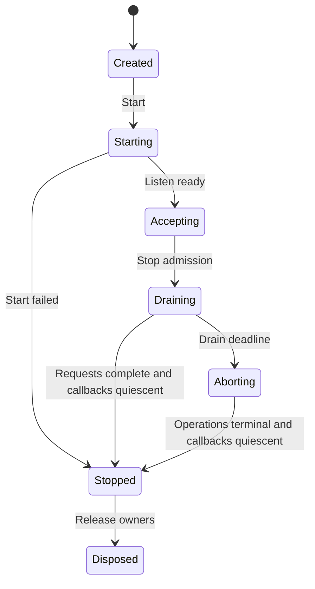

# D18 — Required Rust Server: Handler, Body and resource lifecycle

Contract C-SERVER-001. Design revision **0.3.0 design candidate**. Research inputs R26/R27/R29;
cross-contract D02/D04–D09/D13–D15/D19/D20. Acceptance is recorded in the registry
against this exact content and independent review. API fragments below are design
pseudocode unless explicitly linked to an executed fixture. No product task is executed.

## 1. Architecture and domain responsibilities

NativeWeave Server **uses a Rust engine** for network I/O, HTTP parsing and protocol,
connection/stream management, runtime, native resource handling, streaming and
backpressure. C# owns business Handlers, typed application declarations, DI scopes,
Fluent registration, static DTO metadata and async/await. Kestrel is only the R26
functional/performance/developer-cost comparator and is not a product Host option.
This corrects the prior optional-Rust, dual-host and managed-protocol-only design.

Initial native composition: Tokio1.54.1 + Hyper1.12.0/hyper-util0.1.21 + Tower0.5.3,
with Axum0.8.9 used where native routing/composition earns its dependency. rustls0.23.46
owns TLS. Protocol packages reuse Tonic0.14.9 and rmcp3.10.0 through native public
services (D19). Database remains independent and mandatory-Rust when referenced.
Each engine owns its runtime configuration/lifetime; sharing an explicitly owned
runtime is an optional optimization, never a mandatory global Core runtime.

One compiled ForeignService serves many C# routes through immutable runtime descriptors
and Handler IDs. Adding a C# Handler or DTO reuses maintainer-precompiled Rust assets.
The adapter does not reimplement HTTP/TLS in managed code, emulate arbitrary ASP.NET
middleware or expose a parallel general-purpose runtime. HTTP/3, QUIC, WebSocket,
CONNECT and protocol extensions are explicit future capabilities; unsupported features
fail configuration. No throughput or memory superiority is asserted from language choice.

## 2. Source-backed selection and alternatives

Read [R27](../research/topics/R27/source-driven-server.md),
[R28](../research/topics/R28/report.md), [R29](../research/topics/R29/report.md) and
[source-inspection](../../verification/server-completion/source-inspection.json) for
exact versions, commits, paths, coverage and executable limits.

| Candidate | Native capability and integration implication | Decision |
|---|---|---|
| Tokio + Hyper/hyper-util + Tower | public Service/Body/connection seam; runtime registrations avoid per-handler Rust compilation | initial required host implementation design |
| Axum | mature native routing, extraction and Tower composition; no need to mirror every extractor in C# | reuse selectively within that host; no second HTTP engine |
| Actix Web/Server | mature HTTP + per-worker limits and Rc/!Send affinity; dispatch must return to owner worker | valid alternative if later capability evidence justifies separate package; not first implementation |
| Pingora | mature proxy upstream/filter model; application-handler bridge would add unnecessary proxy assumptions | reserve for proxy-specific Engine; do not force into general application Server |
| Hyper C API | unstable/client-focused surface without stable full Server promise | do not adopt as the public NativeWeave ABI; wrap Rust public APIs |
| Kestrel Native AOT | strong managed behavioral and cost reference; five new Windows/Linux AOT comparator cases | comparator only, never product Host |

This is a source/fit decision, not a benchmark winner. A controlled fork is allowed by
the project method, but no necessary missing public capability has been demonstrated
for this initial seam. The selected dependency set resolves one Tokio/Hyper/http/Bytes
family in the research Cargo.lock; Tonic/rmcp services use that native runtime rather
than starting additional runtimes. Domain adapters retain private upstream types.

## 3. C# application and native operation surface

Design example (not compiled product API):

```csharp
var app = NativeServer.CreateBuilder()
    .UseRust(options => options.Budget = ServerBudgetOptions.ReferenceSmall)
    .UseJson(ApiJsonContext.Default)
    .Build();
app.MapGet("/health/ready", static (request, cancel) => Responses.Text("ok"));
app.MapPost<CreateItemRequest, CreateItemResponse>("/items", Items.CreateAsync);
await app.RunAsync(cancellationToken);
```

Ordinary `dotnet build`/`dotnet run` select the installed native runtime asset; explicit
RID publishing produces Native AOT. The C# NuGet consumer requires no Rust toolchain
or per-route generated native code. Static registration is the normal path; source
generators may produce descriptors/serializers and diagnostics, but runtime typed
Fluent registration is valid when it supplies all required metadata without reflection.

| Boundary operation (semantic signature) | Contract |
|---|---|
| `server_create(config, routes, registration)` | validate size/version/limits; copy immutable descriptors; do not invoke user callbacks before successful Start |
| `server_start(server, operation)` | Core two-phase async; failure unwinds listener/runtime owners; success transfers server running lease |
| `request_dispatch(cookie, handler_id, request_ticket)` | reverse callback borrows only fixed notification fields and enqueues bounded managed work; it does not transfer request/header owners |
| `request_take_context(request_ticket, out_request, out_headers)` | outside the reverse callback, the admitted dispatcher takes the typed request/header owners exactly once, then creates scope and invokes the Handler outside native locks |
| `request_read_create/start(max_bytes)` | at most one pending read; reserve byte credit first; success exposes owned chunk/EOF through Core take_result |
| `response_begin(status, headers)` | validate status/header bytes; exactly one headers-commit transition; content-length/framing stays native |
| `response_write_create/start(chunk)` | async input is copied/retained under explicit budget, never an escaping borrowed Span; acknowledgment is not proof the client consumed data |
| `response_finish(trailers)` / `request_abort(reason)` | terminal competition has one winner; native protocol validates trailer legality; later callbacks still retire safely |
| `server_close(deadline)` | closes admission, drains/aborts operations and reports Stopped or ClosePending; never frees callback roots on timeout |

These names specify implementation semantics, not a second Core ABI. Layout, status,
ErrorRecord, opaque-handle ownership, cancellation registration and create/start/take/
retire are governed by the existing D02/D04–D09 contracts. Domain operation tables have
size/version/capability negotiation. Native private IDs may carry generations without
introducing a universal Core registry.

Native request/header storage remains owned and charged while a dispatch ticket is queued.
The registered callback root and admitted-delivery lease survive callback return. The ticket
is a validated native identifier, not an owning pointer. `request_take_context` is a typed
take under that existing operation lease: success transfers both named owners; failure
initializes both outputs empty and leaves cleanup with native state. Rejected enqueue,
cancel before take, duplicate take and dispatcher shutdown converge on exactly one native
cleanup path. A queued ticket cannot authorize dereferencing a retired pointer, and no
callback return value transfers an owned buffer. These rules follow D05/D06's separation
between notification, result transfer and two-sided retirement.

The managed request provides owned/leased body reads and bounded writes with natural
ValueTask/async APIs. A PipeReader/PipeWriter compatibility facade may be added only
if it preserves AdvanceTo/Flush lifetime and budgets; it is not the semantic owner.
One pending read and one pending write per request are the initial contract. DTO
serialization uses explicit JsonTypeInfo; a raw native pointer cannot back arbitrary
ReadOnlyMemory across await without a lease. Handler completion, response-body end,
backing-buffer release and callback retirement are separate events.

`ReferenceSmall` is an initial test profile, not a performance promise: 512 connections,
32 HTTP2 streams/connection, 256 active/retiring requests, 128 metadata waiters,
64MiB managed/native application-payload budgets configured separately, 4MiB/request/side,
32KiB max chunk and 32KiB headers. JSON cap is 1MiB; larger attachment routes declare
their own finite limit and stream in chunks. TLS/socket/allocator/GC/protocol buffers
are separately accounted/observed; the payload cap is not a process RSS bound. The
1MiB buffered JSON limit fits within the per-request budget with bounded copy/serializer
headroom; actual allocated capacity is charged. A single allocation/decoded body whose
required peak exceeds the route's absolute budget fails before enqueueing, rather than
waiting forever for credit that this request can never receive. Streaming attachment
total length and concurrently retained bytes are separate limits.

## 4. Normal operation, errors, half-close and cancellation

| Event | Required behavior | Observable acceptance |
| --- | --- | --- |
| Request headers received | Parse/authenticate and apply admission by route and identity; obtain a request slot before reading the business body | Excess requests do not create DB sessions or accumulate body data |
| Normal processing | Pull body chunks with available credit, advance after consumption; continue the response according to flush backpressure | Slow clients do not cause unlimited queued bytes |
| Body EOF / `poll_frame(None)` | Record EndObserved for that Body; this alone does not establish the exact transport termination reason, peer consumption or release of all byte owners; the handler may continue responding according to known protocol state | Normal upload completion does not cause false cancellation; reset/truncation is verified separately through available transport signals |
| TCP half-close/stream reset | Determined by the protocol transport; do not treat every socket EOF as normal body completion | HTTP/1 and HTTP/2 verified separately, without affecting unrelated streams |
| Error before headers are committed | Consistently map to a bounded error response; do not leak internal exceptions, SQL or secrets | Correct status-code/error-code correlation with traces |
| Error after headers are committed | Terminate the stream/connection and record terminal state; do not append a second JSON error body | Client observes truncation/protocol error, and server does not falsely claim success |
| Request cancellation/deadline reached | Signal cancellation intent, stop new business work/new reads and writes; wait for terminal operation state and release | Cancellation does not overwrite completion that won first; DB Commit Unknown is retained |
| Early response with unconsumed body | Rust host must use a bounded native drain or close the connection | Do not read an attacker's body without limit; no message-boundary corruption in the next HTTP/1 request |

A cancellation token is a notification, not proof that threads stopped, native callbacks can no longer enter, remote work did not execute or a transaction rolled back. The HTTP request deadline includes admission waiting, reading, database waiting and response; calculate remaining time from one monotonic starting point, and give suboperations the smaller of that remaining time and their own limit. Each chunk must not reset the overall deadline. Once database COMMIT is admitted, use the database contract's independent commit deadline and Unknown outcome; the HTTP token cannot preemptively declare successful cancellation.

## 5. Budget and backpressure invariants

Define `A` as the active-request limit, `Q` as the limit on metadata-only waiting requests and `C` as the active-connection limit; `Gm/Gn` are managed/native application-payload credits, `Br` is per-request credit and `K` is maximum chunk size. All counters and length conversions use checked arithmetic; conversion from native `size_t` to managed lengths must not truncate.

1. Acquire the corresponding `G` and `Br` credits **before** creating, copying, pinning or retaining any budget-managed buffer; queued waiters hold only metadata with fixed bounds, not bodies. Waiter count is also bounded by `Q`. Reject as early as possible when admission is unavailable, rather than fully buffering the body before rejection.
2. Credit follows the buffer owner's lifetime; moving from queue to handler does not return it, and transferring ownership does not charge it twice. Clones or nonempty slices that still share an owner retain the charge for the entire backing allocation, without prematurely returning credit based on a slice's visible length; empty slices and deep copies follow their actual ownership relationships. Return credit only after the last owner release/ack. Count queue items, application-payload bytes and native-retained bytes separately.
3. Across-boundary copying keeps old/new buffers alive simultaneously, and both sides are charged; “the source was submitted for asynchronous writing” does not mean it was released. Reads and writes each reserve temporary credit for one bounded chunk to avoid deadlock from exhausting the global budget while waiting for copy credit; holding half the resources must not allow unbounded waiting for the other half.
4. FIFO/tenant-fair waiting occurs only in bounded small-metadata queues; cancellation removes waiters and returns every reservation. Operations needing both global and per-request quotas use one coordinator or a rollback-capable try-acquire; cyclic resource holding that causes deadlock is prohibited.
5. Reject global saturation with 503 and tenant rate/quota exhaustion with 429; provide a bounded Retry-After where applicable. If an HTTP/2 request is identifiable, reject only its stream unless the entire connection violates protocol or connection budget. The pre-accept TCP backlog is an OS resource, configured/measured separately.
6. After logical admission closes, previously issued queue permits, producers waiting for byte credit and transferred byte owners continue to be accounted for independently. `Receiver::close` does not revoke old permits or automatically cancel their byte-credit waits. The closure coordinator must explicitly cancel/drain those waits; if they remain Pending at the deadline, retain roots, budgets and the module owner rather than report resource retirement solely because the channel is closed or Body EOF occurred.

Logically, charged payloads satisfy `managed_accounted <= Gm`, `native_accounted <= Gn` and `per_request <= Br` at every instant, with at most `(A + Q)` metadata instances. Charged slots in A include Closing/retirement-pending requests: application Task or Body termination must not prematurely return slots still carrying owner/cleanup metadata. Any future separate retirement queue requires its own explicit finite quota and a corresponding revision of this bound, rather than moving pending-cleanup items out of the ledger. This does not imply an RSS bound: GC heap pages not yet returned, ArrayPool retention, native allocator fragmentation, thread stacks, kernel send/receive buffers, TLS, HTTP/2 windows and log exporters all need independent bounds or observation. Kestrel comparator has unlimited default connections, reinforcing the need for explicit native connection/stream/request limits.

In the minimum implementable version, the Rust adapter permits one bounded copy for both receive and send, using managed-owned slabs and Rust-owned chunks. Do not allow native pointers to escape across `await` through ordinary `ReadOnlyMemory` representations. Add a zero-copy capability with explicit leases only after separate lifetime proof, generator escape diagnostics and verification of actual benefit; the default safe path remains unchanged.

## 6. Rust Adapter and ABI boundary

Core's versioned ABI, handles, errors, owned buffers, asynchronous operations and quiescence are the sole authority; this section defines call semantics without introducing conflicting structs. The Server Engine extension table declares capability/version/size and returns Core status for each operation; exceptions or Rust unwinding do not propagate across the ABI.

Specifically reuse D05/D06/D08 opaque handles, `SafeHandle`, managed admission gates and the 24-byte `ErrorRecord`; async uses two-phase create/start. `on_terminal(cookie,status,error)` only immediately copies the fixed error and cannot transfer an owned body/result; the completion coordinator outside the callback obtains an owned chunk through one `take_result` call (native code retains it on failure). `Task` completion is separate from resource retirement; retire also waits for start to return, cancellation registration to complete DisposeAsync outside the callback, call/callback leases to reach zero and native code to permanently prohibit future callbacks. Every body operation here follows this same protocol, without a separate weakened Server release path.

| Conceptual operation | Ownership and linearization point |
| --- | --- |
| `server_start(created_server, operation)` | `server_create` has synchronously validated and copied config; the Engine owns the listener after successful Core Start, while failure releases created resources |
| `request_headers(request_handle, owned_headers)` | Server Engine holds the native request owner; Core SafeHandle, admission gates and lease protocols protect private opaque pointers/managed wrappers; if the domain truly needs request-ID reuse, the Server internally carries a generation, without creating a global Core generational table; a transferred bounded header blob is released only once |
| `request_read(request, max_bytes, operation)` | Pull; `max_bytes <= reserved_credit`; completion returns an owned chunk or EOF; only one pending read per request |
| `response_write(request, bytes, operation)` | Borrowed bytes are valid only in the synchronous entry point; asynchronous retention requires copying within that entry point to an already-budgeted owned chunk before returning; completion means the backend accepted/processed the write, not that the client application read it |
| `response_complete(request)` | Commit end-of-stream once; only one terminal state wins the race with abort, without resurrecting the request |
| `request_abort(request, reason)` | Idempotent cancellation intent; completion notification and callback quiescence are separate |
| `server_drain(deadline)` / `server_abort()` | Prohibit new admission and close the listener first; wait for/cancel existing operations; release callback context/runtime only after quiescence |

Rust owns Tokio runtime; managed-handler continuations are dispatched to a managed scheduler, without synchronously blocking Tokio workers in FFI callbacks waiting for `Task.Result`. Callbacks perform only bounded validation, state updates and notification enqueueing; do not invoke arbitrary managed user code while holding native internal locks. No mutable `HttpContext` is shared across requests, and no cross-language thread-local assumptions apply. Resource cleanup must continue after panic maps to an error/failed terminal state; process-level faults from which safe continuation is impossible follow host isolation policy, without treating panic as HTTP 200.

## 7. Shutdown state machine



`StopAsync` is idempotent, with multiple callers waiting for the same shutdown result; this instance does not restart after stopping. Draining first sets readiness=false, then closes application admission and stops new connections/requests, allowing admitted work to finish within the remaining deadline. Request streams, database sessions/transactions, background outbox workers and diagnostic exporters each have explicit owners. Timeout enters Aborting, sends cancellation/reset and waits for release; do not prematurely free a context with a callback in progress to meet the deadline. If native code cannot achieve quiescence, shutdown fails, records unreleased resources and leaves handling to process exit, without reusing their addresses or unloading the dynamic library. Exporters flush last with a separate small budget and cannot prolong business shutdown indefinitely.

Each TLS ingress is owned by exactly one layer. Rust host uses native rustls for handshake, certificates, ALPN and close-notify, with its buffers charged to the budget. Proxy termination requires explicit trusted-proxy, forwarded-header and actual-identity boundaries; do not blindly trust arbitrary `X-Forwarded-*`. Certificate reload must not leave dangling references in active handshakes. HTTP/1.1 and HTTP/2 undergo separate profile acceptance; HTTP/3, QUIC and platform-crypto differences are independent capabilities and cannot be inferred from HTTP/2 success.

## 8. Cost model, builds and acceptance

A request's minimum fixed cost includes route metadata, an admission lease and necessary cancellation/diagnostic state; costly tags are created only when diagnostics are actually listened to. The Kestrel comparison baseline has no Server FFI cost. NativeWeave Server request costs include at least metadata encoding, one dispatch, read/write chunk notifications and possible copies in both directions; `crossings ≈ O(1 + request_bytes/K + response_bytes/K)`. Larger K reduces crossings but increases per-request resident memory and cancellation-response latency, so measure it under equivalent workloads. Comparing only empty handler loops or Rust with TLS disabled against C# with TLS enabled is prohibited.

Future product acceptance commands (not executed as product work; new research fixture executions are separately linked below):

```text
dotnet publish samples/ReferenceService/ReferenceService.csproj -c Release -r linux-x64 -p:PublishAot=true -p:TreatWarningsAsErrors=true
dotnet publish samples/ReferenceService/ReferenceService.csproj -c Release -r win-x64 -p:PublishAot=true -p:TreatWarningsAsErrors=true
cargo test --locked -p nativeweave-server-engine
cargo build --locked --release -p nativeweave-server-engine
```

Run actual published binaries on Windows/Linux separately; declare TLS/certificate-chain behavior, socket close/reset, Linux glibc/musl package profiles and CPU architectures individually, without promoting one Linux x64 success to universal support. Resolve each Trim/AOT warning or provide a precise bounded justification; global suppression/whole-assembly rooting is not accepted as a production pass.

| Existing Codex task | Inputs and required evidence outputs |
| --- | --- |
| B15 | C# application/Handler surface, static route/JSON registration, actionable AOT diagnostics, independent native NuGet consumption; no Kestrel product host |
| B16 | Byte-credit property tests; capacity/size/overflow fuzzing; bounded waiters; slow upload/download, cancellation, half-close, unread body, post-complete write, errors after headers committed |
| B17 | Independent native engine/package; capability rejection; same portable-handler comparison; callback reentrancy/panic/abort/quiescence, memory ownership and copy counts |
| B20 | Admission/close/abort interleaving models; drain deadline; in-flight COMMIT Unknown during service shutdown; exporter faults must not block business work |
| B22/B23/B24 | Resource trends during 24-hour steady state and 72-hour release soak, fault injection, separate RSS/GC/native/socket categories, equivalent performance and platform compatibility; thresholds based on a frozen baseline, with regressions explained |

This round selects the required Rust host: Tokio + Hyper/hyper-util + Tower, producing reviewable engine boundaries, budget invariants and a shutdown protocol. Actual scheduling fairness, combined-budget deadlocks, platform RSS behavior and Server AOT runtime remain open acceptance items in the tasks above. Independent reviewers should focus adversarially on “credit before allocation,” “charging both copies while copying,” “old permits are not automatically revoked by closure,” “DB Unknown is not rewritten by shutdown cleanup,” and “release only after callback quiescence,” accepting scoped designs on actual evidence without promoting finite fixtures into complete product proofs.

## 9. Exact increment from this source-lifecycle research

This revision continues the existing work at Design `c7e123a74405a92dc3de1ef450355b08d1c05ceb` / Plan `04c2f043c0ec60a2d49dd3ca8ea4ad1c8c888d89` for R27/R29/D18; old input versions and reviews serve only as historical provenance and do not accept these new content hashes.

[The Body retirement protocol](body-retirement-protocol.md) provides the selected source call chains, candidate Create/Start/Take/Release/Close operation semantics and SR-LIFE-001–004. The previously added [six experiments](../../experiments/server-retained-bytes/README.md) actually use Bytes/Tokio/Hyper Body traits to verify final nonempty-slice release, external frames surviving Body EOF, reserved permits surviving close, and slot restoration after byte-wait cancellation. Linux execution was completed and independently rerun by another agent; subsequent CI platform results are recorded under their respective exact commits and raw records.

Hyper H2's `NO_ERROR` → `None` remains at the pinned-source-reading evidence level only; the earlier retained-bytes fixture disabled transport features and did not execute the HTTP/2 network path. That old fixture did not implement a C# handler bridge, TLS, global/per-request budget coordinator or callback retirement; this round's independent protocol fixture separately has finite HTTP1/HTTP2/TLS execution, and the two coverage batches must not be conflated. Public APIs support the current Adapter seam; no fork is justified; if the product needs exact termination reasons not exposed by public Body, first define a separate capability and actually available signals, then decide on an adapter or upstream extension.

## Source-driven native Server seam — D18 / B17

Reuse Hyper Service/Body/connection drivers, Tower/Axum routing and Tokio scheduling through one compiled ForeignService. C# handler IDs/routes are runtime registrations, not generated Rust per handler. Do not port the HTTP/TLS core into C# or treat Hyper's unstable client C FFI as a stable server ABI. Actix worker-affine and Pingora proxy-specific routes remain alternatives. Kestrel AOT remains the managed baseline; see [R27](../research/topics/R27/source-driven-server.md).

Tower's response-future permit does not cover response-body lifetime. A body/stream lease remains charged until body and callback retirement. Hyper H2 protocol credit does not reclaim Bytes retained by managed consumers; retained-byte accounting is independent. Tokio shutdown_timeout is not quiescence; Pending close retains roots, owners and budget.

Callbacks enqueue bounded dispatcher work, never block native polling on Task.Result or execute arbitrary application handlers synchronously in reverse callbacks. Complete native Future exactly once; ordinary application HTTP errors should become responses rather than unnecessary Service errors that abort a connection. TLS fatal errors stop reads, with separate handshake/TLS/application queue limits. B16/B17/B20/B22 test slow/aborted bodies, trailers, huge chunks, completion/cancel/close races, callback roots and pool-held database streams. The finite R27 model is not a production Server or performance test.

## 10. Current native transport and protocol research execution

The new `experiments/server-completion` fixture executes real Hyper loopback HTTP1/HTTP2, Tonic byte-codec framing/negative cases, runtime rmcp tool metadata, and rustls handshake/ALPN/certificate rejection/close-notify. Its ephemeral test TLS identity is generated in memory and never persisted. The Kestrel comparator is actually published and executed as Native AOT on Linux and Windows. Exact source hashes, commands, exits and dependency trees are in `verification/server-completion/`. These scoped engine tests do not claim a C# Server product bridge or complete protocol-over-TLS end-to-end conformance. Core native-thread/C# NativeAOT callback retirement is independently exercised by `verification/interop-completion/`; future B15–B20 integrate those proven boundaries.


### Verified Windows/Linux research CI

CI run [43388468172](https://github.com/IzuSharp/NativeWeave-Design/actions/runs/43388468172)
tested source `7ea84e11ee19e6dad4503a5872eb27c6c7f44e80`. Protocol13/13 and
Kestrel Native AOT5/5 passed on both Windows2022 and Ubuntu24.04. Their actual
run manifests, stdout/stderr and source snapshots are retained under
`verification/completion-ci/43388468172/`; author checks of each raw log/input hash and
exact Windows LF-to-CRLF conversion are recorded in
`verification/server-completion/ci-verification.json`. This extends platform coverage
for these same distinct cases, not their product/FFI/soak scope or independent review.
