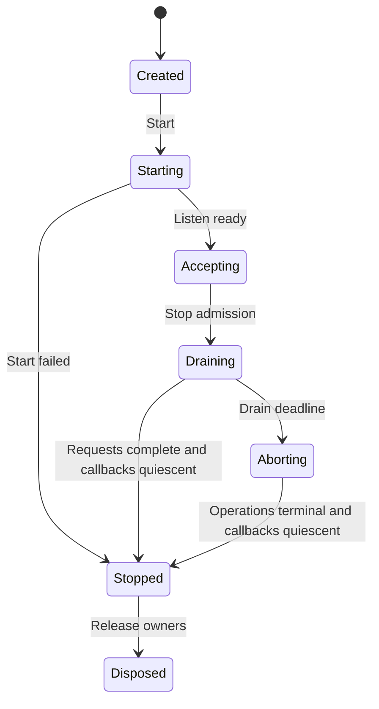

# D18 — Required Rust Server: Handler, Body and resource lifecycle

Contract C-SERVER-001. Design revision **0.3.0 design candidate**. Research inputs R26/R27/R29;
cross-contract D02/D04–D09/D13–D15/D19/D20. Acceptance is recorded in the registry
against this exact content and independent review. API fragments below are design
pseudocode unless explicitly linked to an executed fixture. No product task is executed.

## 1. Architecture and domain responsibilities

NativeWeave Server **uses a Rust engine** for network I/O, HTTP parsing and protocol,
connection/stream management, runtime, native resource handling, streaming and
backpressure. C# owns business Handlers, typed application declarations, DI scopes,
Fluent registration, static DTO metadata and async/await. Kestrel is only the R26
functional/performance/developer-cost comparator and is not a product Host option.
This corrects the prior optional-Rust, dual-host and managed-protocol-only design.

Initial native composition: Tokio1.54.1 + Hyper1.12.0/hyper-util0.1.21 + Tower0.5.3,
with Axum0.8.9 used where native routing/composition earns its dependency. rustls0.23.46
owns TLS. Protocol packages reuse Tonic0.14.9 and rmcp3.10.0 through native public
services (D19). Database remains independent and mandatory-Rust when referenced.
Each engine owns its runtime configuration/lifetime; sharing an explicitly owned
runtime is an optional optimization, never a mandatory global Core runtime.

One compiled ForeignService serves many C# routes through immutable runtime descriptors
and Handler IDs. Adding a C# Handler or DTO reuses maintainer-precompiled Rust assets.
The adapter does not reimplement HTTP/TLS in managed code, emulate arbitrary ASP.NET
middleware or expose a parallel general-purpose runtime. HTTP/3, QUIC, WebSocket,
CONNECT and protocol extensions are explicit future capabilities; unsupported features
fail configuration. No throughput or memory superiority is asserted from language choice.

## 2. Source-backed selection and alternatives

Read [R27](../research/topics/R27/source-driven-server.md),
[R28](../research/topics/R28/report.md), [R29](../research/topics/R29/report.md) and
[source-inspection](../../verification/server-completion/source-inspection.json) for
exact versions, commits, paths, coverage and executable limits.

| Candidate | Native capability and integration implication | Decision |
|---|---|---|
| Tokio + Hyper/hyper-util + Tower | public Service/Body/connection seam; runtime registrations avoid per-handler Rust compilation | initial required host implementation design |
| Axum | mature native routing, extraction and Tower composition; no need to mirror every extractor in C# | reuse selectively within that host; no second HTTP engine |
| Actix Web/Server | mature HTTP + per-worker limits and Rc/!Send affinity; dispatch must return to owner worker | valid alternative if later capability evidence justifies separate package; not first implementation |
| Pingora | mature proxy upstream/filter model; application-handler bridge would add unnecessary proxy assumptions | reserve for proxy-specific Engine; do not force into general application Server |
| Hyper C API | unstable/client-focused surface without stable full Server promise | do not adopt as the public NativeWeave ABI; wrap Rust public APIs |
| Kestrel Native AOT | strong managed behavioral and cost reference; five new Windows/Linux AOT comparator cases | comparator only, never product Host |

This is a source/fit decision, not a benchmark winner. A controlled fork is allowed by
the project method, but no necessary missing public capability has been demonstrated
for this initial seam. The selected dependency set resolves one Tokio/Hyper/http/Bytes
family in the research Cargo.lock; Tonic/rmcp services use that native runtime rather
than starting additional runtimes. Domain adapters retain private upstream types.

## 3. C# application and native operation surface

Design example (not compiled product API):

```csharp
var app = NativeServer.CreateBuilder()
    .UseRust(options => options.Budget = ServerBudgetOptions.ReferenceSmall)
    .UseJson(ApiJsonContext.Default)
    .Build();
app.MapGet("/health/ready", static (request, cancel) => Responses.Text("ok"));
app.MapPost<CreateItemRequest, CreateItemResponse>("/items", Items.CreateAsync);
await app.RunAsync(cancellationToken);
```

Ordinary `dotnet build`/`dotnet run` select the installed native runtime asset; explicit
RID publishing produces Native AOT. The C# NuGet consumer requires no Rust toolchain
or per-route generated native code. Static registration is the normal path; source
generators may produce descriptors/serializers and diagnostics, but runtime typed
Fluent registration is valid when it supplies all required metadata without reflection.

| Boundary operation (semantic signature) | Contract |
|---|---|
| `server_create(config, routes, registration)` | validate size/version/limits; copy immutable descriptors; do not invoke user callbacks before successful Start |
| `server_start(server, operation)` | Core two-phase async; failure unwinds listener/runtime owners; success transfers server running lease |
| `request_dispatch(cookie, handler_id, request_ticket)` | reverse callback borrows only fixed notification fields and enqueues bounded managed work; it does not transfer request/header owners |
| `request_take_context(request_ticket, out_request, out_headers)` | outside the reverse callback, the admitted dispatcher takes the typed request/header owners exactly once, then creates scope and invokes the Handler outside native locks |
| `request_read_create/start(max_bytes)` | at most one pending read; reserve byte credit first; success exposes owned chunk/EOF through Core take_result |
| `response_begin(status, headers)` | validate status/header bytes; exactly one headers-commit transition; content-length/framing stays native |
| `response_write_create/start(chunk)` | async input is copied/retained under explicit budget, never an escaping borrowed Span; acknowledgment is not proof the client consumed data |
| `response_finish(trailers)` / `request_abort(reason)` | terminal competition has one winner; native protocol validates trailer legality; later callbacks still retire safely |
| `server_close(deadline)` | closes admission, drains/aborts operations and reports Stopped or ClosePending; never frees callback roots on timeout |

These names specify implementation semantics, not a second Core ABI. Layout, status,
ErrorRecord, opaque-handle ownership, cancellation registration and create/start/take/
retire are governed by the existing D02/D04–D09 contracts. Domain operation tables have
size/version/capability negotiation. Native private IDs may carry generations without
introducing a universal Core registry.

Native request/header storage remains owned and charged while a dispatch ticket is queued.
The registered callback root and admitted-delivery lease survive callback return. The ticket
is a validated native identifier, not an owning pointer. `request_take_context` is a typed
take under that existing operation lease: success transfers both named owners; failure
initializes both outputs empty and leaves cleanup with native state. Rejected enqueue,
cancel before take, duplicate take and dispatcher shutdown converge on exactly one native
cleanup path. A queued ticket cannot authorize dereferencing a retired pointer, and no
callback return value transfers an owned buffer. These rules follow D05/D06's separation
between notification, result transfer and two-sided retirement.

The managed request provides owned/leased body reads and bounded writes with natural
ValueTask/async APIs. A PipeReader/PipeWriter compatibility facade may be added only
if it preserves AdvanceTo/Flush lifetime and budgets; it is not the semantic owner.
One pending read and one pending write per request are the initial contract. DTO
serialization uses explicit JsonTypeInfo; a raw native pointer cannot back arbitrary
ReadOnlyMemory across await without a lease. Handler completion, response-body end,
backing-buffer release and callback retirement are separate events.

`ReferenceSmall` is an initial test profile, not a performance promise: 512 connections,
32 HTTP2 streams/connection, 256 active/retiring requests, 128 metadata waiters,
64MiB managed/native application-payload budgets configured separately, 4MiB/request/side,
32KiB max chunk and 32KiB headers. JSON cap is 1MiB; larger attachment routes declare
their own finite limit and stream in chunks. TLS/socket/allocator/GC/protocol buffers
are separately accounted/observed; the payload cap is not a process RSS bound. The
1MiB buffered JSON limit fits within the per-request budget with bounded copy/serializer
headroom; actual allocated capacity is charged. A single allocation/decoded body whose
required peak exceeds the route's absolute budget fails before enqueueing, rather than
waiting forever for credit that this request can never receive. Streaming attachment
total length and concurrently retained bytes are separate limits.

## 4. 正常、异常、半关闭与取消

| 事件 | 必需行为 | 可观察验收 |
| --- | --- | --- |
| 收到请求 headers | 解析/鉴权、按 route 与身份做 admission；先拿请求槽，之后才读业务 body | 超额请求不建立 DB session、不积攒 body |
| 正常处理 | 拉取有 credit 的 body chunk，消费后 advance；响应按 flush 的背压继续 | slow client 不导致无限 queued bytes |
| body EOF / `poll_frame(None)` | 记录该 Body 的 EndObserved；不能仅凭此推断精确 transport 终止原因、对端消费或全部 byte owner 释放；handler 可按已知协议状态继续响应 | 正常上传结束不误取消；reset/截断由可用 transport 信号分别验证 |
| TCP 半关闭/stream reset | 由该协议 transport 判定；不能把所有 socket EOF 当 body 正常完成 | HTTP/1 与 HTTP/2 分别验证，无跨 stream 误伤 |
| headers 尚未提交时出错 | 统一映射有界错误 response；不得泄漏内部 exception、SQL、secret | 状态码/错误码与 trace 关联正确 |
| headers 已提交后出错 | 终止该 stream/connection，记录终态；不能追加第二个 JSON 错误正文 | 客户端观察截断/协议错误，服务端不假称成功 |
| 请求取消/期限到达 | 发出取消意图，停止新业务/新读写；等待操作终态与释放 | 取消不覆盖先获胜的完成；DB Commit Unknown 保留 |
| 未消费 body 提前响应 | Rust host must use a bounded native drain or close the connection | 不无限读攻击者 body；下一个 HTTP/1 请求不串包 |

取消 token 是通知，不能证明线程停止、native callback 不再进入、远端未执行或事务回滚。HTTP 请求 deadline 包括 admission 等待、读取、数据库等待及响应；从单一 monotonic 起点计算剩余时间，子操作取剩余时间与自己的上限的较小者。每个 chunk 不能重置总 deadline。数据库 COMMIT 一旦入线，采用数据库契约的独立 commit deadline 与 Unknown 结果，不由 HTTP token 抢先宣告取消成功。

## 5. 预算与背压不变量

定义 `A` 为活动请求上限，`Q` 为仅 metadata 的等待请求上限，`C` 为活动连接上限；`Gm/Gn` 为 managed/native 应用 payload credit，`Br` 为每请求 credit，`K` 为 chunk 最大尺寸。所有计数及长度转换使用 checked 算术；native `size_t` 到 managed 长度不能截断。

1. 创建、复制、pin、retain 任何受预算管理的 buffer **之前**，取得相应 `G` 与 `Br` credit；排队等待只持固定上限 metadata，不持 body。等待者数量也受 `Q` 限制。失去 admission 就尽早拒绝，不能先将 body 收满后拒绝。
2. credit 绑定 buffer owner 生命周期；从队列移至 handler 不归还，转移所有权不重复增加 credit。仍共享 owner 的 clone 或非空 slice 保留整个 backing allocation 的 charge，不按 slice 可见长度提前归还；空 slice 和深拷贝按真实 owner 关系处理。只有最后 owner release/ack 后归还。排队条目数、应用 payload byte 数、native retained byte 数分别计数。
3. 跨边界复制时旧/新 buffer 同时存活，两侧都记账；不能将“源已提交给异步写”当作源已释放。读/写各保留一个有界 chunk 的临时 credit，避免拿满全局预算后等待复制 credit 的死锁；已拿一半资源时不得无限等待另一半。
4. FIFO/租户公平等待只在有界小 metadata 队列中进行；取消移除 waiter 并归还所有 reservation。对既要全局又要请求配额的操作使用统一协调器或可回滚的 try-acquire，禁止循环占有导致死锁。
5. 全局满时拒绝为 503、租户速率/配额拒绝为 429；适用时提供有界 Retry-After。若 HTTP/2 请求已可识别，仅拒绝其 stream，除非整个连接违反协议或连接预算。接受前的 TCP backlog 是 OS 资源，单独配置/测量。
6. 关闭逻辑准入后，已发出的 queue permit、正在等待 byte credit 的 producer 和已转交的 byte owner 继续独立记账。`Receiver::close` 不撤销旧 permit，也不自动取消其 byte-credit wait。关闭协调器须显式取消/排空这些等待；期限届满仍 Pending 时保留 roots、budget 和 module owner，不能仅以 channel closed 或 Body EOF 报告资源退休。

逻辑上，受计费 payload 在任意时刻满足 `managed_accounted <= Gm`、`native_accounted <= Gn`、`per_request <= Br`，metadata 至多 `(A + Q)` 份。这里 A 的计费槽包含 Closing/retirement-pending 请求：应用 Task 或 Body 终结不能提前归还仍承担 owner/cleanup metadata 的槽。若未来使用独立 retirement 队列，必须另有明确有限额度并相应修订此上界，不能把待清理项移出账本。它不推导 RSS：GC heap 尚未归还页、ArrayPool 保留、native allocator 碎片、线程栈、内核收发缓冲、TLS、HTTP/2 window、日志 exporter 都需要独立上限或观测。Kestrel comparator has unlimited default connections, reinforcing the need for explicit native connection/stream/request limits。

在最低可实现版本，Rust adapter 接收/发送均允许一次有界 copy，使用 managed owned slabs 与 Rust owned chunks。不得让 native 指针映射成可跨 `await` 逃逸的普通 `ReadOnlyMemory`。只有完成单独生命周期证明、生成器逃逸诊断及真实收益验证后，才增加显式 lease 的 zero-copy capability；不改变默认安全路径。

## 6. Rust Adapter 与 ABI 边界

Core 的版本化 ABI、handle、error、owned buffer、async operation 与 quiescence 是唯一权威；此处是调用语义，不另行定义相冲突的 struct。Server Engine 扩展表声明 capability/version/size，并为每个操作返回 Core status；不跨 ABI 传播异常或 Rust unwind。

具体复用 D05/D06/D08 的 opaque handle、`SafeHandle`、managed admission gate 与 24-byte `ErrorRecord`；async 采用 create/start 两阶段。`on_terminal(cookie,status,error)` 只立即复制固定错误，不能转移 owned body/result；callback 外的完成协调器调用一次 `take_result` 才取得 owned chunk（失败仍由 native 持有）。`Task` 完成与资源 retire 分离；retire 还要等待 start 返回、取消注册在 callback 外完成 DisposeAsync、call/callback leases 清零及 native 永禁未来回调。此处每个 body operation 都遵守同一协议，不能另设 Server 的弱化版释放路径。

| 概念操作 | 所有权及线性化点 |
| --- | --- |
| `server_start(created_server, operation)` | `server_create` 已同步校验并复制 config；Core Start 成功后 listener 由 Engine 持有，失败释放已建资源 |
| `request_headers(request_handle, owned_headers)` | request native owner 由 Server Engine 持有；私有 opaque pointer / managed wrapper 按 Core SafeHandle、准入 gate 与 lease 协议保护；若领域确需复用 request ID，则由 Server 内部附带 generation，不建立 Core 全局代际表；有界 header blob 转交后只释放一次 |
| `request_read(request, max_bytes, operation)` | pull；`max_bytes <= reserved_credit`；完成返回 owned chunk 或 EOF；每请求仅一项 pending read |
| `response_write(request, bytes, operation)` | borrowed bytes 只在同步入口有效；需要异步保存则入口内复制到已获预算的 owned chunk，再返回；完成表示 backend 接受/处理写入，不证明客户端应用已读 |
| `response_complete(request)` | 一次提交 end-of-stream；与 abort 竞争只有一个终态，不复活请求 |
| `request_abort(request, reason)` | 幂等取消意图；完成通知与 callback quiescence 分开 |
| `server_drain(deadline)` / `server_abort()` | 先禁止新 admission，关闭 listener；等待/取消已有操作；仅 quiescence 后释放 callback context/runtime |

Rust owns Tokio runtime；managed handler 的 continuation 调度到 managed scheduler，不在 FFI callback 中同步阻塞 Tokio worker 等待 `Task.Result`。callback 只做有界验证、更新状态和排队通知；不得持 native 内部锁调用任意 managed 用户代码。无跨请求共用可变 `HttpContext`，无跨语言 thread-local 假设。Panic 转错误/故障终态后必须继续资源清理；无法安全继续的进程级故障由宿主隔离策略处理，不把 panic 当 HTTP 200。

## 7. 关闭状态机



`StopAsync` 幂等，多调用者等待同一关闭结果；停止后本实例不 restart。Draining 首先 readiness=false，然后关闭应用 admission、停止新连接/新请求，允许已获准工作在剩余 deadline 内完成。请求流、数据库 session/transaction、background outbox worker、diagnostic exporter 各有明确 owner。超时进入 Aborting，发取消/reset 并等待释放；不能为赶上 deadline 提前 free 正在 callback 的 context。若 native 不能达成 quiescence，关闭结果为失败，记录未释放资源并交由进程退出处理，不继续复用其地址或卸载动态库。Exporter 最后使用单独小预算 flush，不能无限延长业务关闭。

TLS 每个入口只由一个层负责。Rust host uses native rustls for handshake, certificates, ALPN and close-notify，并在预算中计其缓冲。代理终止必须显式配置可信代理、转发头及真实身份边界；不盲信任意 `X-Forwarded-*`。证书重载与活跃握手不得悬空引用。HTTP/1.1 与 HTTP/2 分 profile 验收，HTTP/3、QUIC、平台 crypto 差异独立 capability，不由 HTTP/2 成功推断。

## 8. 成本模型、构建与验收

请求最低固定成本为 route metadata、admission lease、必要的取消/诊断状态；仅当实际监听诊断才创建高成本 tags。The Kestrel comparison baseline has no Server FFI cost. NativeWeave Server 的请求成本至少含 metadata 编码、一次 dispatch、读/写 chunk notification 和可能的双向 copy；`crossings ≈ O(1 + request_bytes/K + response_bytes/K)`。较大 K 降低 crossing 数但提高每请求驻留内存及取消响应延迟，应按等价负载测量。禁止只比较 handler 空循环或关闭 TLS 的 Rust 与开启 TLS 的 C#。

Future product acceptance commands (not executed as product work; new research fixture executions are separately linked below)：

```text
dotnet publish samples/ReferenceService/ReferenceService.csproj -c Release -r linux-x64 -p:PublishAot=true -p:TreatWarningsAsErrors=true
dotnet publish samples/ReferenceService/ReferenceService.csproj -c Release -r win-x64 -p:PublishAot=true -p:TreatWarningsAsErrors=true
cargo test --locked -p nativeweave-server-engine
cargo build --locked --release -p nativeweave-server-engine
```

Windows/Linux 各在真实发布二进制上运行；TLS/证书链、socket close/reset、Linux glibc/musl 包 profile、CPU 架构逐项声明，不能把一次 Linux x64 成功升级为全部支持。Trim/AOT warning 需逐条消除或有精确有界说明，不接受全局 suppression/全程序集 root 作为生产通过。

| 既有 Codex task | 输入与必须输出的证据 |
| --- | --- |
| B15 | C# application/Handler surface, static route/JSON registration, actionable AOT diagnostics, independent native NuGet consumption; no Kestrel product host |
| B16 | byte-credit 属性测试；capacity/size/overflow fuzz；有界 waiter；慢上传/下载、取消、半关闭、未读 body、post-complete write、headers committed 错误 |
| B17 | 独立 native engine/package；能力拒绝；同一 portable handler 对照；callback 重入/panic/abort/quiescence、内存所有权及复制计数 |
| B20 | admission/close/abort 交错模型；drain deadline；服务停止时 in-flight COMMIT Unknown；导出器故障不得阻塞业务 |
| B22/B23/B24 | 24 小时稳态与 72 小时 release soak 的资源趋势、故障注入、RSS/GC/native/socket 分项、等价性能和平台兼容；阈值基于冻结基线，回归需解释 |

本轮选择 required Rust host: Tokio + Hyper/hyper-util + Tower；形成可审查的引擎边界、预算不变量与关闭协议。真实调度公平、组合预算死锁、RSS 平台行为和 Server AOT runtime 仍是上述任务的开放验收项。独立 reviewer 应重点攻击“分配前 credit”“复制时双份记账”“旧 permit 不因关闭自动撤销”“DB Unknown 不被关闭清理改写”“callback quiescence 后才释放”，按实际证据接受局部设计，不将有限 fixture 升级为完整产品证明。

## 9. 本次 source-lifecycle 研究的精确增量

本修订继续 Design `c7e123a74405a92dc3de1ef450355b08d1c05ceb` / Plan `04c2f043c0ec60a2d49dd3ca8ea4ad1c8c888d89` 的现有 R27/R29/D18；旧输入版本与 review 仅作为历史来源，不接受本次新内容哈希。

[Body retirement 协议](body-retirement-protocol.md)给出选定源码调用链、候选 Create/Start/Take/Release/Close 操作语义和 SR-LIFE-001–004。此前新增[六项实验](../../experiments/server-retained-bytes/README.md)实际使用 Bytes/Tokio/Hyper Body trait，验证末次非空 slice 释放、外部 frame 越过 Body EOF、已预留 permit 越过 close，以及取消 byte wait 恢复 slot 等行为。Linux 已执行并由不同 agent 独立复跑；后续 CI 平台结果按各自精确提交和原始记录登记。

Hyper H2 的 `NO_ERROR` → `None` 只达到固定源码阅读级别；此前 retained-bytes fixture 关闭 transport features，没有执行 HTTP/2 网络路径。该旧fixture没有实现 C# handler bridge、TLS、全局/请求预算协调器或 callback retirement；本次独立protocol fixture另有HTTP1/HTTP2/TLS有限执行，不能混同两批覆盖。Public APIs support the current Adapter seam; no fork is justified；如产品需要公共 Body 不暴露的精确终止原因，先定义单独 capability 与实际可用信号，再决定 adapter 或上游扩展。

## Source-driven native Server seam — D18 / B17

Reuse Hyper Service/Body/connection drivers, Tower/Axum routing and Tokio scheduling through one compiled ForeignService. C# handler IDs/routes are runtime registrations, not generated Rust per handler. Do not port the HTTP/TLS core into C# or treat Hyper's unstable client C FFI as a stable server ABI. Actix worker-affine and Pingora proxy-specific routes remain alternatives. Kestrel AOT remains the managed baseline; see [R27](../research/topics/R27/source-driven-server.md).

Tower's response-future permit does not cover response-body lifetime. A body/stream lease remains charged until body and callback retirement. Hyper H2 protocol credit does not reclaim Bytes retained by managed consumers; retained-byte accounting is independent. Tokio shutdown_timeout is not quiescence; Pending close retains roots, owners and budget.

Callbacks enqueue bounded dispatcher work, never block native polling on Task.Result or execute arbitrary application handlers synchronously in reverse callbacks. Complete native Future exactly once; ordinary application HTTP errors should become responses rather than unnecessary Service errors that abort a connection. TLS fatal errors stop reads, with separate handshake/TLS/application queue limits. B16/B17/B20/B22 test slow/aborted bodies, trailers, huge chunks, completion/cancel/close races, callback roots and pool-held database streams. The finite R27 model is not a production Server or performance test.

## 10. Current native transport and protocol research execution

The new `experiments/server-completion` fixture executes real Hyper loopback HTTP1/HTTP2, Tonic byte-codec framing/negative cases, runtime rmcp tool metadata, and rustls handshake/ALPN/certificate rejection/close-notify. Its ephemeral test TLS identity is generated in memory and never persisted. The Kestrel comparator is actually published and executed as Native AOT on Linux and Windows. Exact source hashes, commands, exits and dependency trees are in `verification/server-completion/`. These scoped engine tests do not claim a C# Server product bridge or complete protocol-over-TLS end-to-end conformance. Core native-thread/C# NativeAOT callback retirement is independently exercised by `verification/interop-completion/`; future B15–B20 integrate those proven boundaries.


### Verified Windows/Linux research CI

CI run [43388468172](https://github.com/IzuSharp/NativeWeave-Design/actions/runs/43388468172)
tested source `7ea84e11ee19e6dad4503a5872eb27c6c7f44e80`. Protocol13/13 and
Kestrel Native AOT5/5 passed on both Windows2022 and Ubuntu24.04. Their actual
run manifests, stdout/stderr and source snapshots are retained under
`verification/completion-ci/43388468172/`; author checks of each raw log/input hash and
exact Windows LF-to-CRLF conversion are recorded in
`verification/server-completion/ci-verification.json`. This extends platform coverage
for these same distinct cases, not their product/FFI/soak scope or independent review.
