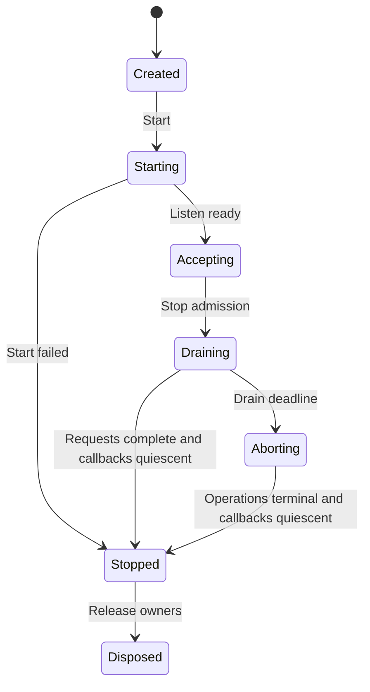

# D18 — Server 生命周期、流与资源预算

| 项目 | 值 |
| --- | --- |
| 契约 | C-SERVER-001，0.1.0 |
| 输入任务 | R26、R27、R29；交叉接口 R07/R08/R12/R17/R21、D05/D06/D07/D13/D14/D15 |
| 基线 | Design `1f7d89aa754647a6a530fa34a49acc4b0f5d9997`；Plan `da9e4a6337a5af0ec3d5e40a4695a2760d6ac5f5` |
| 决定状态 | 设计规范 0.1.0；接受状态由 registry 中相同内容哈希与独立 Review 确定；所有代码样例未编译；产品实现、Native AOT 和生产验收尚未完成 |
| 日期 | 2026-11-12 |

## 1. 需求与边界

默认 Server 使用 .NET 11 Kestrel、ASP.NET Core Minimal API、静态 endpoint 与序列化元数据。普通应用保留 C# `Task`、`async/await`、依赖注入、`HttpContext`、`PipeReader` / `PipeWriter` 体验。仅使用此路径的应用不需要任何 NativeWeave 原生运行时。Native AOT 是发布条件，不以 JIT 单元测试代替。

可选 Rust Server 是独立 Engine 包：拥有自己的网络执行器、HTTP 实现和可选 TLS，实现经过能力协商的 portable handler 子集。它不模拟整个 ASP.NET Core feature collection，不承诺任意 middleware、gRPC 或 MCP 包可以无修改迁移。gRPC/MCP 初始正式设计采用 [D19](protocols-and-observability.md) 的 managed Kestrel profile。未来 Engine 不要求修改 Core，Server 专用 capability 也不能进入所有 Engine 的强制基类。

非目标：本轮实现 HTTP 栈；默认开启 HTTP/3、WebSocket、CONNECT、动态插件或任意运行时路由发现；声称 Rust 一定更快；将 HTTP 取消解释为数据库回滚。

## 2. 源码依据与候选比较

精确证据、blob、阅读范围与限制见 [R26](../research/topics/R26/report.md)、[R27](../research/topics/R27/report.md)、[R29](../research/topics/R29/report.md)。本规范没有执行上游 C#/Rust 测试。

| 决策依据 | 已读实现 | 对本设计的约束 |
| --- | --- | --- |
| Kestrel 生命周期 | .NET 11 `KestrelServerImpl.StopAsync` → `TransportManager.StopTransportsAsync`：先 unbind/等待 accept loop，再 close connections，失败再 abort，最后 dispose transport | graceful 是有阶段的关闭；不能仅设置 cancellation 后就释放 callback/context |
| 写入完成 | `HttpResponsePipeWriter` 的 Open/Aborted/Closed 检查及 `HttpResponsePipeWriterTests` | complete 后写入是错误；abort 与本地 writer 生命周期不是同一布尔值 |
| 静态路由 | `RequestDelegateGenerator.Initialize` 按 endpoint syntax 建模、发 diagnostic、仅对无 diagnostic 的 endpoint 生成 interceptor/helper | 生成失败要显式诊断；不得悄悄依赖动态反射回退 |
| 有界通道 | Tokio 1.54.1 `Sender.send(value)` 在 `reserve().await` 时仍持有 value | 需要在分配前获取字节 credit，且限制等待者；仅 channel capacity 不够 |
| Rust drain | Hyper 1.12.0 HTTP/1 graceful 要继续 poll connection；Axum 0.8.9 停 accept 后等待连接任务结束 | 必须有外层 monotonic drain deadline；不能 drop future 就声称 graceful |
| ABI 选择 | Hyper Cargo 标记 C API unstable / no semver | NativeWeave 自己的版本化 Adapter 隔离 Hyper；不直接把 Hyper FFI 当稳定 Core ABI |

Kestrel 是已选择默认方案。裸 sockets 只用于确有特殊协议的独立 Engine，不能以减少抽象为由重新承担 HTTP 安全和兼容成本。Rust/Tokio/Hyper 的架构扩展口保留，但是否发布为推荐后端由 B17/B23 的等价端到端证据决定；在此之前不作吞吐、延迟或内存收益承诺。Q15 的设计问题可按此决定关闭，性能适用范围保留为明确验收义务。

## 3. 公共 API 与最常见路径

以下是设计草案，未编译或运行。`AddNativeWeaveServer`、`ServerBudgetOptions` 为候选 API；其余框架 API 仍须 B15 在固定 SDK 上编译核验。生成器只补充 NativeWeave 所需预算、契约和诊断，不再复制 RDG 路由绑定系统。

```csharp
var builder = WebApplication.CreateSlimBuilder(args);
builder.Services.ConfigureHttpJsonOptions(options =>
    options.SerializerOptions.TypeInfoResolverChain.Insert(0, ApiJsonContext.Default));
builder.Services.AddNativeWeaveServer(options =>
{
    options.Budget = ServerBudgetOptions.ReferenceSmall;
    options.Shutdown.DrainTimeout = TimeSpan.FromSeconds(30);
});
var app = builder.Build();
app.MapGet("/health/ready", static () => TypedResults.Ok(new ReadyResponse(true)));
app.MapPost("/items", WorkItemEndpoints.CreateAsync);
await app.RunAsync();

[JsonSerializable(typeof(ReadyResponse))]
[JsonSerializable(typeof(CreateItemRequest))]
[JsonSerializable(typeof(CreateItemResponse))]
internal partial class ApiJsonContext : JsonSerializerContext;
```

`ReferenceSmall` 是可复现参考应用配置，不是所有部署的性能保证：最大连接 512、HTTP/2 每连接 stream 32、活动应用请求 256、仅 metadata 的等待请求 128、受管应用流缓冲总额 64 MiB、每请求受管流缓冲上限 256 KiB、每块最大 32 KiB、headers 总大小 32 KiB。JSON endpoint 的解码 body 最大 1 MiB；附件 endpoint 单独声明最大 64 MiB，仍按块流动，不一次占有 64 MiB。升级连接 profile 默认关闭。启动时对乘加、最小合法 HTTP 配置、队列/credit 关系做 checked 验证；配置不能暗中钳制为另一个值。

这些数值是本项目选择的初始实验 profile。B23 必须按实际硬件、TLS、HTTP 版本、数据库池和租户配额调整并记录；原生、GC、socket、TLS、HTTP/2 protocol buffers 另计，64 MiB 不是进程 RSS 上限。

### Portable handler

```csharp
public delegate ValueTask WeaveRequestHandler(
    WeaveHttpContext context, CancellationToken cancellationToken);

// 签名示意；具体构造与只读字段由生成器及能力契约确定。
public abstract class WeaveHttpContext
{
    public abstract WeaveRequest Request { get; }
    public abstract WeaveResponse Response { get; }
    public abstract RequestBudget Budget { get; }
    public abstract CancellationToken RequestAborted { get; }
}
// Request.Body 是 PipeReader；Response.Body 是 PipeWriter。
// Header 值为有界、已验证并拥有内存的 managed 值，不含 Rust 地址。
```

只有 portable handler 显式要求的能力才可在两个后端互换。Kestrel 常规应用不强制增加这层对象。请求上下文不得在 handler 完成后逃逸到 detached task；后台业务必须先写入持久任务/队列并取得独立 scope、预算与生命周期。每次读取最多一个未消费 result；每次写入最多一个 pending flush。`AdvanceTo` / `FlushAsync` 均需在 finally/失败路径有对应处理；不可保留 `ReadOnlySequence` 至下一次 advance 后使用。

## 4. 正常、异常、半关闭与取消

| 事件 | 必需行为 | 可观察验收 |
| --- | --- | --- |
| 收到请求 headers | 解析/鉴权、按 route 与身份做 admission；先拿请求槽，之后才读业务 body | 超额请求不建立 DB session、不积攒 body |
| 正常处理 | 拉取有 credit 的 body chunk，消费后 advance；响应按 flush 的背压继续 | slow client 不导致无限 queued bytes |
| body EOF | 只表示请求输入结束；handler 可以继续生成响应 | 上传结束后响应正常完整；不误取消 |
| TCP 半关闭/stream reset | 由该协议 transport 判定；不能把所有 socket EOF 当 body 正常完成 | HTTP/1 与 HTTP/2 分别验证，无跨 stream 误伤 |
| headers 尚未提交时出错 | 统一映射有界错误 response；不得泄漏内部 exception、SQL、secret | 状态码/错误码与 trace 关联正确 |
| headers 已提交后出错 | 终止该 stream/connection，记录终态；不能追加第二个 JSON 错误正文 | 客户端观察截断/协议错误，服务端不假称成功 |
| 请求取消/期限到达 | 发出取消意图，停止新业务/新读写；等待操作终态与释放 | 取消不覆盖先获胜的完成；DB Commit Unknown 保留 |
| 未消费 body 提前响应 | Kestrel 使用其受限 drain；portable backend 必须有有界 drain 或关闭连接 | 不无限读攻击者 body；下一个 HTTP/1 请求不串包 |

取消 token 是通知，不能证明线程停止、native callback 不再进入、远端未执行或事务回滚。HTTP 请求 deadline 包括 admission 等待、读取、数据库等待及响应；从单一 monotonic 起点计算剩余时间，子操作取剩余时间与自己的上限的较小者。每个 chunk 不能重置总 deadline。数据库 COMMIT 一旦入线，采用数据库契约的独立 commit deadline 与 Unknown 结果，不由 HTTP token 抢先宣告取消成功。

## 5. 预算与背压不变量

定义 `A` 为活动请求上限，`Q` 为仅 metadata 的等待请求上限，`C` 为活动连接上限；`Gm/Gn` 为 managed/native 应用 payload credit，`Br` 为每请求 credit，`K` 为 chunk 最大尺寸。所有计数及长度转换使用 checked 算术；native `size_t` 到 managed 长度不能截断。

1. 创建、复制、pin、retain 任何受预算管理的 buffer **之前**，取得相应 `G` 与 `Br` credit；排队等待只持固定上限 metadata，不持 body。等待者数量也受 `Q` 限制。失去 admission 就尽早拒绝，不能先将 body 收满后拒绝。
2. credit 绑定 buffer owner 生命周期；从队列移至 handler 不归还，转移所有权不重复增加 credit。只有最后 owner release/ack 后归还。排队条目数、应用 payload byte 数、native retained byte 数分别计数。
3. 跨边界复制时旧/新 buffer 同时存活，两侧都记账；不能将“源已提交给异步写”当作源已释放。读/写各保留一个有界 chunk 的临时 credit，避免拿满全局预算后等待复制 credit 的死锁；已拿一半资源时不得无限等待另一半。
4. FIFO/租户公平等待只在有界小 metadata 队列中进行；取消移除 waiter 并归还所有 reservation。对既要全局又要请求配额的操作使用统一协调器或可回滚的 try-acquire，禁止循环占有导致死锁。
5. 全局满时拒绝为 503、租户速率/配额拒绝为 429；适用时提供有界 Retry-After。若 HTTP/2 请求已可识别，仅拒绝其 stream，除非整个连接违反协议或连接预算。接受前的 TCP backlog 是 OS 资源，单独配置/测量。

逻辑上，受计费 payload 在任意时刻满足 `managed_accounted <= Gm`、`native_accounted <= Gn`、`per_request <= Br`，metadata 至多 `(A + Q)` 份。它不推导 RSS：GC heap 尚未归还页、ArrayPool 保留、native allocator 碎片、线程栈、内核收发缓冲、TLS、HTTP/2 window、日志 exporter 都需要独立上限或观测。Kestrel 默认连接数为无限这一源码事实，正是部署必须显式设置 connection/stream/request 三类限制的原因。

在最低可实现版本，Rust adapter 接收/发送均允许一次有界 copy，使用 managed owned slabs 与 Rust owned chunks。不得让 native 指针映射成可跨 `await` 逃逸的普通 `ReadOnlyMemory`。只有完成单独生命周期证明、生成器逃逸诊断及真实收益验证后，才增加显式 lease 的 zero-copy capability；不改变默认安全路径。

## 6. Rust Adapter 与 ABI 边界

Core 的版本化 ABI、handle、error、owned buffer、async operation 与 quiescence 是唯一权威；此处是调用语义，不另行定义相冲突的 struct。Server Engine 扩展表声明 capability/version/size，并为每个操作返回 Core status；不跨 ABI 传播异常或 Rust unwind。

具体复用 D05/D06/D08 的 opaque handle、`SafeHandle`、managed admission gate 与 24-byte `ErrorRecord`；async 采用 create/start 两阶段。`on_terminal(cookie,status,error)` 只立即复制固定错误，不能转移 owned body/result；callback 外的完成协调器调用一次 `take_result` 才取得 owned chunk（失败仍由 native 持有）。`Task` 完成与资源 retire 分离；retire 还要等待 start 返回、取消注册在 callback 外完成 DisposeAsync、call/callback leases 清零及 native 永禁未来回调。此处每个 body operation 都遵守同一协议，不能另设 Server 的弱化版释放路径。

| 概念操作 | 所有权及线性化点 |
| --- | --- |
| `server_start(config, completion)` | config 被同步校验并复制/retain；成功后 listener 由 Engine 持有，失败释放已建资源 |
| `request_headers(request_handle, owned_headers)` | request native owner 由 Server Engine 持有；私有 opaque pointer / managed wrapper 按 Core SafeHandle、准入 gate 与 lease 协议保护；若领域确需复用 request ID，则由 Server 内部附带 generation，不建立 Core 全局代际表；有界 header blob 转交后只释放一次 |
| `request_read(request, max_bytes, operation)` | pull；`max_bytes <= reserved_credit`；完成返回 owned chunk 或 EOF；每请求仅一项 pending read |
| `response_write(request, bytes, operation)` | borrowed bytes 只在同步入口有效；需要异步保存则入口内复制到已获预算的 owned chunk，再返回；完成表示 backend 接受/处理写入，不证明客户端应用已读 |
| `response_complete(request)` | 一次提交 end-of-stream；与 abort 竞争只有一个终态，不复活请求 |
| `request_abort(request, reason)` | 幂等取消意图；完成通知与 callback quiescence 分开 |
| `server_drain(deadline)` / `server_abort()` | 先禁止新 admission，关闭 listener；等待/取消已有操作；仅 quiescence 后释放 callback context/runtime |

Rust owns Tokio runtime；managed handler 的 continuation 调度到 managed scheduler，不在 FFI callback 中同步阻塞 Tokio worker 等待 `Task.Result`。callback 只做有界验证、更新状态和排队通知；不得持 native 内部锁调用任意 managed 用户代码。无跨请求共用可变 `HttpContext`，无跨语言 thread-local 假设。Panic 转错误/故障终态后必须继续资源清理；无法安全继续的进程级故障由宿主隔离策略处理，不把 panic 当 HTTP 200。

## 7. 关闭状态机



`StopAsync` 幂等，多调用者等待同一关闭结果；停止后本实例不 restart。Draining 首先 readiness=false，然后关闭应用 admission、停止新连接/新请求，允许已获准工作在剩余 deadline 内完成。请求流、数据库 session/transaction、background outbox worker、diagnostic exporter 各有明确 owner。超时进入 Aborting，发取消/reset 并等待释放；不能为赶上 deadline 提前 free 正在 callback 的 context。若 native 不能达成 quiescence，关闭结果为失败，记录未释放资源并交由进程退出处理，不继续复用其地址或卸载动态库。Exporter 最后使用单独小预算 flush，不能无限延长业务关闭。

TLS 每个入口只由一个层负责。默认 Kestrel 终止 TLS；可选 Rust profile 则 native TLS 负责握手、证书、ALPN、close-notify，并在预算中计其缓冲。代理终止必须显式配置可信代理、转发头及真实身份边界；不盲信任意 `X-Forwarded-*`。证书重载与活跃握手不得悬空引用。HTTP/1.1 与 HTTP/2 分 profile 验收，HTTP/3、QUIC、平台 crypto 差异独立 capability，不由 HTTP/2 成功推断。

## 8. 成本模型、构建与验收

请求最低固定成本为 route metadata、admission lease、必要的取消/诊断状态；仅当实际监听诊断才创建高成本 tags。独立 Kestrel Server 路径不引入 Server FFI/原生 runtime 成本；若应用使用 Database，数据库底层的必需 Rust Engine 成本仍须计入，不能称整个应用 pure managed。Rust Server path 的请求成本至少含 metadata 编码、一次 dispatch、读/写 chunk notification 和可能的双向 copy；`crossings ≈ O(1 + request_bytes/K + response_bytes/K)`。较大 K 降低 crossing 数但提高每请求驻留内存及取消响应延迟，应按等价负载测量。禁止只比较 handler 空循环或关闭 TLS 的 Rust 与开启 TLS 的 C#。

候选命令（尚未执行；B15/B17 必须提供实际项目与日志）：

```text
dotnet publish samples/ReferenceService/ReferenceService.csproj -c Release -r linux-x64 -p:PublishAot=true -p:TreatWarningsAsErrors=true
dotnet publish samples/ReferenceService/ReferenceService.csproj -c Release -r win-x64 -p:PublishAot=true -p:TreatWarningsAsErrors=true
cargo test --locked -p nativeweave-server-engine
cargo build --locked --release -p nativeweave-server-engine
```

Windows/Linux 各在真实发布二进制上运行；TLS/证书链、socket close/reset、Linux glibc/musl 包 profile、CPU 架构逐项声明，不能把一次 Linux x64 成功升级为全部支持。Trim/AOT warning 需逐条消除或有精确有界说明，不接受全局 suppression/全程序集 root 作为生产通过。

| 既有 Codex task | 输入与必须输出的证据 |
| --- | --- |
| B15 | Minimal API 静态 route/JSON 编译、错误诊断、managed-only 不加载 native、Windows/Linux AOT HTTP1/2 真运行 |
| B16 | byte-credit 属性测试；capacity/size/overflow fuzz；有界 waiter；慢上传/下载、取消、半关闭、未读 body、post-complete write、headers committed 错误 |
| B17 | 独立 native engine/package；能力拒绝；同一 portable handler 对照；callback 重入/panic/abort/quiescence、内存所有权及复制计数 |
| B20 | admission/close/abort 交错模型；drain deadline；服务停止时 in-flight COMMIT Unknown；导出器故障不得阻塞业务 |
| B22/B23/B24 | 24 小时稳态与 72 小时 release soak 的资源趋势、故障注入、RSS/GC/native/socket 分项、等价性能和平台兼容；阈值基于冻结基线，回归需解释 |

本轮设计已足以决定默认宿主、可选引擎边界、预算算法与关闭协议；真实调度公平、RSS 平台行为和 AOT runtime 仍是上述任务的开放验收项。独立 reviewer 应重点攻击“分配前 credit”“复制时双份记账”“DB Unknown 不被关闭清理改写”“callback quiescence 后才释放”四项，不以尚未运行全产品为由重新打开所有设计决定。
