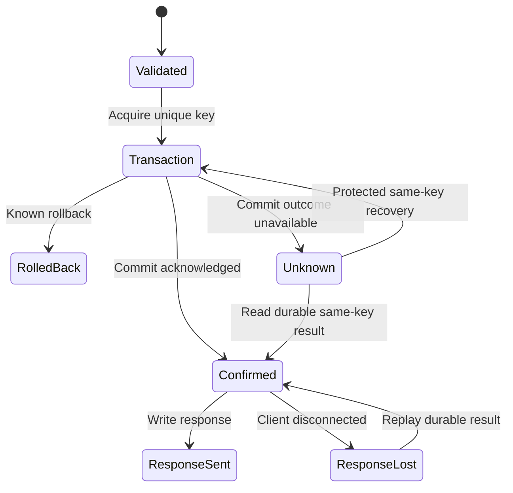

# D20 — 通用幂等任务参考服务与组合验收

| 项目 | 值 |
| --- | --- |
| 契约 | C-REFERENCE-001，0.1.0 |
| 输入任务 | R31；交叉 R16/R18/R19/R20/R21/R26/R27/R28/R29/R30 |
| 基线 | Design `1f7d89aa754647a6a530fa34a49acc4b0f5d9997`；Plan `da9e4a6337a5af0ec3d5e40a4695a2760d6ac5f5` |
| 状态 | 设计规范 0.1.0；接受状态由 registry 中相同内容哈希与独立 Review 确定；SQLite 研究原型五项检查已运行；C#/Rust代码样例未编译、产品/AOT/跨平台/压力验收未验证 |

## 1. 目标与非目标

参考服务提供租户内工作项、分页查询、附件流和事务 outbox；它验证 Server、Database、ORM、生成器、诊断、Packaging 作为完整工作负载时是否正确、简洁且有价值。它是 NativeWeave 的通用工程样例，不含 ArcForges 业务模型/依赖，不作为生产应用模板强迫下游采用某种业务 schema。

REST 是最小必需入口。可选 gRPC 与 MCP 调用同一 typed C# application service，分别接受 D19 协议验收；不复制三套事务逻辑。默认产品组合是 C# Kestrel + C# 最上层 LINQ/泛型/async/AOT 语法与 DTO 边界 + **必需的 Rust ORM / Database Engine**，分别提供 PostgreSQL 和 SQLite profile。C# Source Generator 捕获受支持语法、给出编译期诊断并编码版本化查询 IR；Rust 负责查询语义、SQL 生成、ORM、驱动、连接池、事务执行与数据库资源管理。具体 ORM 选型和查询权威遵循 [D14](../database/drivers.md)、[D15](../database/transactions-and-pooling.md) 与 [D16](../database/query-semantics.md)，本应用不再设一套 ORM。应用开发者不需要编写 Rust。可选 Rust Server 只替换网络宿主，并继续使用同一 C# application service 与 Rust DB 契约。

数据库底层必须 Rust 是产品范围约束。此前草稿的 Npgsql / Microsoft.Data.Sqlite 默认运行时路线已被替代；这些项目与 EF Core 仍可作为源码研究或独立等价基准，不能装入 NativeWeave 默认数据库执行路径。Kestrel 的独立无数据库示例可以不加载 native library，但本文件含数据库的参考应用不能声称 pure managed。所有数据库组合都必须通过阶段 A 的相关 ABI、ownership、callback/async、buffer、构建与实际 AOT 门禁；性能证据用来优化 Rust 路线并量化成本，不能凭一项基准静默改回托管数据库实现。

数据库规范选用 Rust SeaORM 路线；本应用服从其固定版本与能力子集。每个 schema-specific model Engine 把生成的 SeaORM `Entity` / `ActiveModel` / 静态 dispatcher 与 common Rust DB code 静态链接为一个 native module，跨模块只使用 NativeWeave C ABI，不能传递 Rust 内部 trait object、pool、transaction 或 allocator owner。定义新 schema 需要构建期 Rust toolchain，可由 CI 执行；C# Source Generator 不自行启动 Cargo。普通应用开发者仍只写 C# 模型/查询/业务代码，生成与构建负责 Rust 文件；消费已发布 native 资产或运行应用不需要 Rust toolchain。模型/IR/Engine 版本匹配和生成结果参与 B21/B24 验收。

## 2. 业务协议与数据模型

| 操作 | 约束与结果 |
| --- | --- |
| `POST /v1/items` | 必须有 Idempotency-Key；校验 title/字段大小与权限；成功返回原始 operation_id/item_id 和稳定 response；同 key 异 payload 为409 |
| `GET /v1/items?after=...&limit=...` | tenant过滤、上限100、稳定 keyset `(created_at,id)`；分页游标带版本并防篡改；不把 offset 当大数据默认 |
| `GET /v1/operations/{id}` | 必须检查 tenant/principal/操作权限；有持久记录则返回确认结果；无记录只报告未确认，不能证明未执行 |
| `PUT /v1/items/{id}/attachment` | 验证归属和写权限；body最大64MiB，分块32KiB；单独disk/byte/active-upload配额；绑定附件本身是幂等写 |
| `GET /v1/items/{id}/attachment` | 有授权DB引用才允许读取blob；断流释放reader；不允许凭全局hash绕过tenant权限 |
| outbox delivery | 稳定 event_id；至少一次；消费者用同 event_id 去重并在自身事务中处理 |

PostgreSQL 与 SQLite 的 schema 保留相同业务不变量，类型/时间/锁语法按 provider 显式适配。下面为逻辑 schema，非可直接跨 provider 执行的 DDL：

```sql
operations(
  scope, request_key, request_hash, operation_id,
  response_version, response_bytes, completed_at,
  PRIMARY KEY(scope, request_key), UNIQUE(operation_id));
items(
  tenant_id, item_id, operation_id UNIQUE, title, created_at, version,
  PRIMARY KEY(tenant_id, item_id));
outbox(
  event_id PRIMARY KEY, tenant_id, operation_id, payload_version, payload,
  delivery_state, attempt_count, available_at, lease_until);
attachments(
  tenant_id, item_id, content_hash, content_length, operation_id, version,
  PRIMARY KEY(tenant_id, item_id));
```

`scope` 来自认证后的 tenant + principal/调用主体 + endpoint语义版本，不信任客户端传入任意scope。Key 为1–128个允许的ASCII字符，不记录完整key到默认telemetry。`request_hash` 包含所有会改变业务效果的已验证字段、方法/语义版本；先验证输入，随后对固定版本的规范字节序列做 SHA-256。v1 采用固定字段顺序、长度前缀的UTF-8及明确整数编码；不试图建立适用于任意JSON的通用canonicalizer。未声明Unicode normalization就保持原字符串码点；日期/数值不依赖进程culture。C#与对照实现共享golden vectors。

提交结果、业务写和outbox必须同一数据库事务；不能先写 `InProgress` 行提交、再做业务写却仍声称单事务幂等。本版 operation 表只保存最终确认可重放的结果；长任务如需持久“处理中”状态，是另一个带租约和恢复规则的业务状态机，不能暗中混入本样例。

## 3. 幂等写算法与 PostgreSQL 并发细节

1. 验证身份/输入/限额，生成稳定 `operation_id`，取得request与DB admission；开启事务。
2. 尝试占有 `(scope,key)` 唯一记录；此事务中先准备结果record，再写 item 与 outbox。只有全部成功才 COMMIT。
3. 已存在记录时比较hash：相同则返回此前持久response；不同则409且不修改原记录。不得使用“冲突就更新payload”的upsert，否则不同请求会覆盖首次结果。
4. 成功COMMIT且收到确认才报告Created/ConfirmedCommitted。HTTP response写入失败不改变业务提交状态。

PostgreSQL v18 的实现选择是 `READ COMMITTED` 下：

```sql
INSERT INTO operations (...) VALUES (...)
ON CONFLICT (scope, request_key) DO NOTHING
RETURNING operation_id;
-- 若返回0行：用下一条SQL SELECT读取冲突记录，再比较request_hash。
```

该二次 SELECT 必须是下一条 statement。官方 [INSERT](https://www.postgresql.org/docs/18/sql-insert.html) 与 [Read Committed](https://www.postgresql.org/docs/18/transaction-iso.html#XACT-READ-COMMITTED) 明确：DO NOTHING 可因当前 INSERT snapshot 尚不可见的并发事务而不插入；RETURNING 仅返回实际插入/更新的行。故不能把“一个 CTE INSERT DO NOTHING UNION SELECT”当作总能读到冲突行的证明。下一条 statement 得到新snapshot；若因异常清理/删除/期限到达仍无行，保持未决或执行有界协议重试，不从无行推断旧事务回滚。本版 retention窗口内不删除operation，避免此竞态；一旦采用别的隔离级别，需要对应重试/快照规则并重新验收。

SQLite 用短 `BEGIN IMMEDIATE` writer admission 串行化先查再写；busy等待计入总deadline，并且writer等待者有界。它不声称与PostgreSQL并发锁粒度相同。上述 SQL 是 Rust ORM / engine 必须保持的语义 recipe；C# 最上层编码 typed query IR 与参数，Rust 完成语义验证、SQL 生成和执行，不能让 C# Source Generator 成为 SQL/ORM 的第二权威。原型不作为最终 API，也不证明 Rust driver 的真实执行。所有事务中不等待HTTP客户端读取，不调用外部service，不执行可能长期阻塞的blob传输。

Retention参考值为7天，客户端契约明确保证窗口；超窗重复提交不保证仍可重放。清理不得删除仍在恢复处理的记录，且要与outbox审计/恢复引用协调。不能以有限存储承诺永久exactly-once；若产品以后要求永久防重复，要增加持久墓碑/业务唯一键等明确成本和规则。

## 4. COMMIT Unknown、取消与恢复

公共名称遵循 [数据库事务规范](../database/transactions-and-pooling.md)：`WeaveDataSource.OpenSessionAsync`、`DataSession.BeginTransactionAsync`、`DataTransaction.CommitAsync`。本文件不建立第二种事务权威。

```csharp
// 设计草案，尚未编译；ExecuteCreateAsync编码typed IR，Rust ORM生成并执行参数化SQL。
// 返回已拥有的managed DTO；cleanupDeadline为事先配置的monotonic关闭期限。
var session = await dataSource.OpenSessionAsync(requestAborted);
try
{
    var tx = await session.BeginTransactionAsync(
        new TransactionOptions { RecoveryKey = operationId }, requestAborted);
    var result = await ExecuteCreateAsync(session, tx, command, requestAborted);
    try
    {
        // token只决定COMMIT发送前的admission；入线后等待独立commit deadline。
        await tx.CommitAsync(requestAborted);
        return result;
    }
    catch (CommitOutcomeUnknownException error)
    {
        return CreateOutcomeUnknown(operationId, command.IdempotencyKey,
            error.CorrelationId);
    }
}
finally
{
    // Session关闭准入并收拢已有tx/cursor；Pending时Engine继续持有所有lease/root/预算。
    CleanupResult cleanup = await session.CloseAsync(cleanupDeadline);
    RecordCleanupSnapshotNoThrow(cleanup); // 有界、非阻塞、不得覆盖业务/CommitUnknown结果。
}
```

`TransactionOptions.RecoveryKey` 是应用提供的opaque string，不触发框架自动建幂等表。`tx.Outcome` 在Dispose后仍可读；`InProgress/Committed/RolledBack/Unknown` 与协议响应状态区分。HTTP/gRPC/MCP请求取消不抢先覆盖COMMIT已入线后的Unknown结果。提交前明确未发出的取消，可回滚并向调用者报告取消；提交入线且未收到最终确认，只能报告Unknown。

参考 HTTP profile 采用上述显式有限等待关闭。`DataSession.CloseAsync(deadline)` 关闭新业务准入，并请求/加入已有 transaction/cursor 的终结与清理；返回 `CleanupResult(Status=Pending, ConnectionDisposition=Quarantined, LocalResourcesReleased=false)` 时可以结束响应等待，但不能声称资源已经释放。Engine/Session 的 native parent leases、managed roots 与预算继续保留，后台只完成已经准入的业务终态与 cleanup，不新开业务，不持有已结束的 `HttpContext` 或请求 DI scope。后续 `DisposeAsync` join 同一清理任务，不重新 rollback。需要确认本地安全的调用者可选择 `await using` / `DisposeAsync`；该 joining profile 在 native 不静默时不会因 deadline 假成功，因而不能用于承诺有限 HTTP 响应时间。本例不能在 `CloseAsync` 返回 Pending 后又隐式执行一个 `await using` join。DataSource 的有限关闭同样只有全子项 retire 后才允许实际销毁 runtime。

若HTTP连接尚可用，Unknown返回503、稳定错误码 `outcome_unknown`、operation_id和同scope授权的恢复URI，附有界重试提示；不返回“创建成功”，也不返回暗示任务已可靠入队的202。连接已断则客户端可能只知道原Idempotency-Key，仍可用相同key/hash重新请求。恢复先查询确认记录；未查到不证明原操作未提交，也不直接重放无保护写。相同key/hash走上述唯一键保护事务，原事务若仍在进行则由数据库唯一约束等待/裁定；最终只有一个业务效果。任何hash不一致立即拒绝。



上图“protected recovery”不是无条件重试整个外部业务流程。无幂等保护的写、外部邮件/付款/事件发布不能因为timeout自动重放。`Unknown -> RolledBack` 需要实际协议/恢复证据，不能由Dispose、pool return、一次查询无行或request token触发。

## 5. Outbox 与附件的真实原子性

Outbox payload 与item/result同事务。worker在有界batch中租约claim，事务结束后向外部发布，收到确认后再更新已交付；发布成功而标记失败会重复，消费者必须按稳定event_id去重。样例consumer oracle也持久去重，统计重复尝试与实际效果两个不同数。不要声称外部端到端exactly-once。worker重试有指数退避、上限和可观察失败状态；关闭先停止claim再等待当前publish deadline，无法判定的external outcome保持可重试而非丢弃。

附件先流式写有磁盘配额的临时文件、计算hash/长度并持久化，在同文件系统原子rename到不可变content-addressed路径后，才在数据库事务中提交附件引用及结果/outbox。失败可以留下无引用blob，不能留下引用未完成文件的DB成功记录。垃圾回收有宽限期与活跃上传/恢复保护，按可观察DB引用及staging manifest工作；只凭文件mtime删除不合格。Windows/Linux的rename/fsync/目录持久化差异由B22真实验证。

这不是跨DB与文件系统的分布式原子提交。磁盘丢失、复制拓扑和对象存储一致性属于选定storage profile验收；未来对象存储Adapter要在“durable blob先于DB引用”的协议下单独证明。每个tenant下载仍经过DB授权引用，不因为相同hash就跨tenant共享权限。单次上传不得占有DB连接直到body结束；短事务只负责确认引用。

## 6. 查询、资源与应用体验

常用列表要求调用者自然使用 C# 泛型/受支持 LINQ 风格组合；C# 生成器只负责语法捕获、诊断、查询 IR 编码与静态 DTO 边界，Rust ORM 负责查询语义、关系/工作单元、SQL 生成及物化所需的数据库操作。C# DTO 解码不能重新实现一套 ORM 语义。应用不写 Rust 或手工 FFI。动态过滤仅允许版本化模型/IR 声明的列与运算符，Rust 再次校验其能力并参数化值；不拼接任意 SQL。分页键 `(created_at,id)` 含确定tie-breaker；分页之间默认ReadCommitted，不承诺跨页全局快照。需要一致导出时使用独立snapshot/transaction profile、严格最长时限及stream租约，不让慢客户端永久占有pool。

Server profile沿用D18：256活动request、128 metadata waiter、应用stream buffers64MiB、chunk32KiB；数据库pool与upload/outbox并发分别设上限。默认连接pool不可大于数据库实际允许的应用预算；slow response先释放不再使用的DB lease。JSON固定DTO最多1MiB，分页最多100，附件64MiB以stream处理。所有数字是初始参考配置，性能验收冻结后才作为可复现实验输入，不作为通用推荐容量。

每个request/operation记录低基数结果、取消/Unknown、pool wait、bytes/copies、FFI crossings和最终lease归还；日志不记敏感body/key。已完成请求不得保留context/DI scope/GCHandle。热路径避免双重JSON序列化；幂等response保存明确schema version和字节上限，升级仍能重放旧版本或返回明确兼容处理，不能静默按新DTO错误解释旧bytes。

## 7. 本轮实际实验与限制

[R31研究脚本](../research/topics/R31/idempotency_experiment.py) 和 [原始结果](../research/topics/R31/experiment-result.json) 在本环境实际执行：Python3.12.14、SQLite3.53.1、Linux x64、WAL/synchronous=FULL，主进程exit0。五项assert通过：相同key/hash返回原结果；异hash无新增效果；4个独立连接并发只有1次事务效果；真实COMMIT之后模拟response loss可重放；子进程在COMMIT前实际 `os._exit(17)`，重开连接看到原事务未生效并可安全重试。最终operations/items/outbox各4行。

这证明的是最小SQLite研究原型中所测试的事务边界；不是NativeWeave C#/Rust实现、PostgreSQL并发、真实网络故障、Native AOT、OS断电或存储硬件durability证明。原型用固定字段JSON构造测试hash，没有验证本文v1长度前缀canonical bytes或跨语言golden vectors。脚本/hash/原始stdout/命令和限制登记在R31 evidence，不能把它提升为产品验证通过。

## 8. 完整负载、故障与性能矩阵

| 验证轴 | 精确场景/判定 |
| --- | --- |
| 幂等 | 首次/重放/异hash、同key并发、多tenant同key、恢复窗口、retention竞态；独立oracle统计业务效果和outbox |
| DB故障 | 连接断开于BEGIN/写/COMMIT发送前/发送后/确认丢失；PG重启、SQLite busy/磁盘满、pool reset失败；结果必须Confirmed/RolledBack/Unknown准确 |
| HTTP/协议 | 慢上传/下载、body超限、header已提交后错误、HTTP1半关闭/HTTP2reset、gRPCdecompression、MCP profile mismatch、SSE取消 |
| 资源 | 等待者满、managed/native byte cap、复制双份存活、pool等待、附件磁盘配额、exporter阻塞；无无界队列或最终泄漏 |
| 生命周期 | 启动部分失败、drain deadline、callback与Dispose竞争、COMMIT中宿主停止；CloseAsync Pending可结束响应等待但owner/预算仍保留，DisposeAsync只有本地安全才成功；outbox发布后崩溃、附件rename与DBcommit间崩溃 |
| AOT/平台 | net11 Windows/Linux 实际发布二进制；每个 DB profile 都加载必需的 Rust DB Engine，检查 ABI/版本拒绝、native 依赖、实例关闭与干净机器启动；可选 Rust Server 独立加入矩阵；native 模块保持至进程退出，不热卸载；无 native 加载仅是独立无 DB Server 包的验收项 |
| 安全 | tenant隔离、query injection、scope伪造、trace污染、超大压缩/JSON、认证遗漏、敏感日志/堆转储处理策略 |
| 长跑 | 初始30min稳态、24h回归、release72h soak；负载波动/连接 churn/取消与故障；资源返回稳定平台且无随请求数线性增长 |

模型/属性验证检查“一scope+key最多一个业务效果”“item/result/outbox原子存在”“所有owner最终释放或明确故障隔离”“同一操作终态不可逆”。模型需要明确调度公平、故障假设和有限边界；不将有限模型当所有真实线程调度证明。fuzz涵盖ABI长度、SQL/queryIR、HTTP/MCP输入；handle generation仅在领域确有可复用ID时验证，不假设Core有全局代际表。竞态测试采用可控barrier与真实多线程，不能仅sleep等待。锁/时间压力、long-run与Sanitizer/平台工具按组件能力分别运行，不能伪称跨语言统一工具已经捕获全部问题。

性能矩阵区分产品与外部对照：必需产品基线为 Kestrel + C# application/语法/DTO 边界 + Rust ORM / PostgreSQL 或 SQLite Engine；可选产品分支为 Rust Server + 相同 C# application service + 同一 Rust ORM / DB Engine。Kestrel + Npgsql / Microsoft.Data.Sqlite（及适用的 EF Core）是独立非产品托管对照，纯 Rust 参考实现是生态/跨语言成本对照；二者都不成为 NativeWeave 托管数据库后端。只有实际存在的组合才测，未实现格子写 not-run；所选产品组合必须先满足相同正确性标准。TLS/HTTP版本、DB版本/schema/index/isolation/pool、payload/数据量/cache命中、错误/取消比例、CPU限额、部署节点、日志采样与durability条件完全对齐。

冻结随机种子/数据集/查询golden result；采用固定到达率并记录排队时间，避免只报闭环客户端的遗漏尾延迟。输出吞吐、p50/p95/p99/p99.9与max、错误/Unknown率、CPU/op、allocated bytes/op、GC、managed heap、native allocated/retained、RSS、线程/handle/socket、FFI次数与copy bytes；给原始histogram、环境、warmup、重复运行及不确定性。性能门槛从B23冻结基线与实际产品要求产生，不编造“快30%”或对内存/开发效率隐性退让。若 Rust DB 的端到端成本不理想，公开证据并优化 batching、owned buffer、静态映射与调用粒度；数据库 Rust 约束保持。可选 Rust Server 若无端到端收益，仍保持 Kestrel 为默认宿主。

## 9. 既有 Codex 任务与验收交接

| 任务 | 可直接实施的输入与交付 |
| --- | --- |
| B21 | 本文业务schema、API/golden vectors、typed query、事务幂等/result/outbox、附件pipeline；C# app + 必需 Rust PostgreSQL/SQLite DB Engine 与可选协议 facade；无ArcForges依赖 |
| B22 | 独立oracle、COMMIT与网络断点、实际进程/数据库崩溃、回收/retention/附件fault、24h/72h资源证据；保留Unknown，不用重试掩盖错误 |
| B23 | 等价profile harness、锁定负载/硬件、原始结果/成本分解、基线回归门槛；无未测收益断言 |
| B24 | profile/RID/engine/协议兼容矩阵、干净机器AOT运行、独立包版本拒绝、SBOM/LICENSE/NOTICE、升级/回滚与最终验收 |

设计研究已决定幂等、Unknown恢复、组合场景和证据口径；剩余义务是明确产品实现与验收任务，不需要保持所有设计问题一直Open到产品完成。独立Review重点：PG snapshot反例、SQLite writer粒度、协议取消与COMMIT边界、外部outbox重复、blob先持久后引用、retention承诺、性能等价性与实验声明是否准确。
