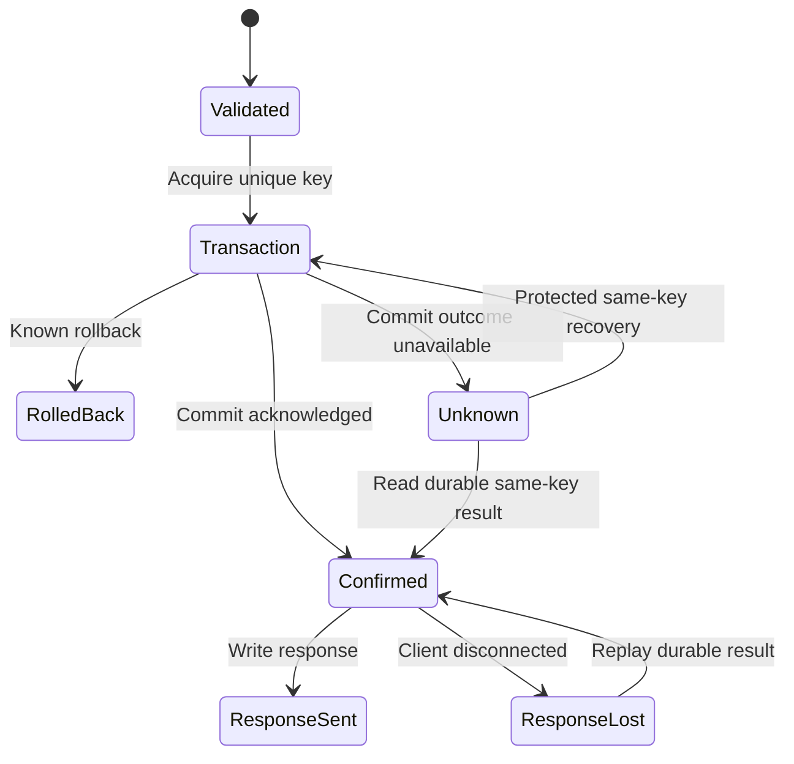

# D20 — Generic idempotent-work reference service and integrated acceptance

| Item | Value |
| --- | --- |
| Contract | C-REFERENCE-001, 0.4.0 |
| Input tasks | R31; cross-cutting R16/R18/R19/R20/R21/R26/R27/R28/R29/R30 |
| Baseline | Design `1f7d89aa754647a6a530fa34a49acc4b0f5d9997`; Plan `da9e4a6337a5af0ec3d5e40a4695a2760d6ac5f5` |
| Status | Design specification 0.3.0 candidate; product implementation/release acceptance remains in Delivery; acceptance is determined by the matching content hash and independent Review in the registry; five SQLite research-prototype checks have run; C#/Rust code examples are uncompiled, and product/AOT/cross-platform/stress acceptance is unverified |

## 1. Goals and non-goals

The reference service provides tenant-scoped work items, paginated queries, attachment streams and a transactional outbox; it verifies whether Server, Database, ORM, generators, diagnostics and Packaging are correct, simple and valuable as a complete workload. It is a generic NativeWeave engineering example without ArcForges business models/dependencies, not a production-application template forcing downstream users to adopt a particular business schema.

REST is the minimum required entry point. Optional gRPC and MCP call the same typed C# application service and separately undergo D19 protocol acceptance, without duplicating three sets of transaction logic. The required product composition is **Rust Server + top-level C# Fluent/generics/async/AOT syntax and DTO boundary + Rust ORM / Database Engine**, with separate PostgreSQL and SQLite profiles. C# uses ordinary typed Fluent; SG may optionally generate static metadata/DTOs and diagnostics. Rust owns query semantics, SQL generation, ORM, drivers, connection pools, transaction execution and database resource management. Specific ORM selection and query authority follow [D14](../database/drivers.md), [D15](../database/transactions-and-pooling.md) and [D16](../database/query-semantics.md); this application introduces no additional ORM. Application developers do not need to write Rust. D18's native composition owns Rust Server networking/protocol/connection/stream/backpressure responsibilities, while C# application services and Rust DB contracts compose through existing ABI/async/buffer mechanisms. Kestrel is only an independent comparison, not the product Host.

The requirement for Rust database lower layers is a product-scope constraint. Earlier drafts' default Npgsql / Microsoft.Data.Sqlite runtime routes are superseded; those projects and EF Core remain valid source-research subjects or independent equivalent benchmarks but cannot enter NativeWeave's default database execution path. A standalone Kestrel benchmark application may omit NativeWeave; NativeWeave's own Server example without a database must still load the Rust Server Engine. Every database composition must pass the relevant phase A ABI, ownership, callback/async, buffer, build and actual AOT gates; performance evidence optimizes the Rust route and quantifies costs, rather than allowing one benchmark to silently restore a managed database implementation.

The ordinary database path uses a maintainer-precompiled SeaQuery + SQLx Rust Engine. Ordinary C# entities/projections/queries use runtime metadata and static DTOs, without generating Rust Entities or requiring Cargo or CI for local execution. A specialized SeaORM model package is a separately built optional profile. Application metadata/schema, Engine ABI/capability and native hashes are verified separately; B21/B24 verify Windows/Linux AOT, clean environments without Rust, and local build/run without an explicit RID.

## 2. Business protocol and data model

| Operation | Constraints and result |
| --- | --- |
| `POST /v1/items` | Idempotency-Key required; validate title/field sizes and authorization; success returns the original operation_id/item_id and a stable response; same key with different payload yields 409 |
| `GET /v1/items?after=...&limit=...` | Tenant filtering, limit 100, stable keyset `(created_at,id)`; versioned, tamper-resistant pagination cursors; offset is not the default for large datasets |
| `GET /v1/operations/{id}` | Tenant/principal/operation authorization checks required; return a confirmed result if a durable record exists; absent records mean only unconfirmed and do not prove non-execution |
| `PUT /v1/items/{id}/attachment` | Verify ownership and write authorization; body maximum 64MiB in 32KiB chunks; separate disk/byte/active-upload quotas; binding the attachment is itself an idempotent write |
| `GET /v1/items/{id}/attachment` | Blob reads require an authorized DB reference; stream interruption releases the reader; a global hash must not bypass tenant authorization |
| outbox delivery | Stable event_id; at least once; consumers deduplicate by the same event_id and process within their own transactions |

PostgreSQL and SQLite schemas preserve the same business invariants, with type/time/lock syntax explicitly adapted per provider. The following is a logical schema, not DDL directly executable across providers:

```sql
operations(
  scope, request_key, request_hash, operation_id,
  response_version, response_bytes, completed_at,
  PRIMARY KEY(scope, request_key), UNIQUE(operation_id));
items(
  tenant_id, item_id, operation_id UNIQUE, title, created_at, version,
  PRIMARY KEY(tenant_id, item_id));
outbox(
  event_id PRIMARY KEY, tenant_id, operation_id, payload_version, payload,
  delivery_state, attempt_count, available_at, lease_until);
attachments(
  tenant_id, item_id, content_hash, content_length, operation_id, version,
  PRIMARY KEY(tenant_id, item_id));
```

`scope` derives from authenticated tenant + principal/calling actor + endpoint semantic version; arbitrary scopes supplied by clients are untrusted. Key contains 1–128 permitted ASCII characters, and default telemetry does not record the full key. `request_hash` includes all validated fields affecting business effects and the method/semantic version; validate input first, then apply SHA-256 to a fixed-version canonical byte sequence. v1 uses fixed field order, length-prefixed UTF-8 and explicit integer encoding, without attempting a universal canonicalizer for arbitrary JSON. Preserve original string code points unless Unicode normalization is declared; dates/numbers do not depend on process culture. C# and comparison implementations share golden vectors.

The commit result, business writes and outbox must share one database transaction; writing and committing an `InProgress` row first, then performing business writes, must not still be described as single-transaction idempotency. This version's operation table stores only finally confirmed, replayable results; a long-running task needing a durable “processing” state requires a separate business state machine with leases and recovery rules and must not be silently mixed into this example.

## 3. Idempotent-write algorithm and PostgreSQL concurrency details

1. Validate identity/input/limits, generate a stable `operation_id`, acquire request and DB admission, and begin a transaction.
2. Attempt to claim the unique `(scope,key)` record; prepare the result record first within this transaction, then write item and outbox. COMMIT only if everything succeeds.
3. If a record already exists, compare hashes: return the previously durable response if equal; otherwise return 409 without changing the original record. Do not use an upsert that “updates payload on conflict,” which would let different requests overwrite the first result.
4. Report Created/ConfirmedCommitted only after successful COMMIT is acknowledged. Failure to write the HTTP response does not change the business commit state.

The PostgreSQL v18 implementation choice under `READ COMMITTED` is:

```sql
INSERT INTO operations (...) VALUES (...)
ON CONFLICT (scope, request_key) DO NOTHING
RETURNING operation_id;
-- If 0 rows are returned: read the conflicting record with the next SQL SELECT, then compare request_hash.
```

This second SELECT must be the next statement. Official [INSERT](https://www.postgresql.org/docs/18/sql-insert.html) and [Read Committed](https://www.postgresql.org/docs/18/transaction-iso.html#XACT-READ-COMMITTED) documentation explicitly states that DO NOTHING may skip insertion due to a concurrent transaction not yet visible to the current INSERT snapshot, and RETURNING returns only rows actually inserted/updated. Therefore, “one CTE INSERT DO NOTHING UNION SELECT” cannot be taken as proof that the conflicting row is always read. The next statement receives a new snapshot; if abnormal cleanup/deletion/deadline still leaves no row, remain unresolved or perform bounded protocol retry, without inferring rollback of the old transaction from absence of rows. This version does not delete operations during the retention window, avoiding this race; adopting another isolation level requires its corresponding retry/snapshot rules and renewed acceptance.

SQLite serializes check-then-write through short `BEGIN IMMEDIATE` writer admission; busy waiting counts against the overall deadline, and writer waiters are bounded. It does not claim PostgreSQL's concurrency-lock granularity. The SQL above is the semantic recipe that the Rust ORM/engine must preserve; top-level C# calls typed native-backed Fluent and binds parameters, while Rust performs semantic validation, SQL generation and execution. The C# Source Generator must not become a second authority for SQL/ORM. The prototype is not the final API and does not prove actual Rust-driver execution. Transactions never wait for HTTP clients to read, call external services or perform potentially long-blocking blob transfers.

The reference retention period is 7 days, with the guaranteed window explicit in the client contract; repeated submissions outside that window are not guaranteed replayable. Cleanup must not delete records still undergoing recovery and must coordinate with outbox audit/recovery references. Finite storage cannot promise permanent exactly-once behavior; a future requirement for permanent duplicate prevention needs explicit costs and rules such as durable tombstones/business unique keys.

## 4. COMMIT Unknown, cancellation and recovery

Public naming follows the [database transaction specification](../database/transactions-and-pooling.md): `WeaveDataSource.OpenSessionAsync`, `DataSession.BeginTransactionAsync`, `DataTransaction.CommitAsync`. This file establishes no second transaction authority.

```csharp
// Design draft, not yet compiled; ExecuteCreateAsync calls typed native operations, and Rust ORM generates and executes parameterized SQL.
// Returns an owned managed DTO; cleanupDeadline is a preconfigured monotonic closure deadline.
var session = await dataSource.OpenSessionAsync(requestAborted);
try
{
    var tx = await session.BeginTransactionAsync(
        new TransactionOptions { RecoveryKey = operationId }, requestAborted);
    var result = await ExecuteCreateAsync(session, tx, command, requestAborted);
    try
    {
        // token controls admission only before COMMIT is sent; after admission, wait under the independent commit deadline.
        await tx.CommitAsync(requestAborted);
        return result;
    }
    catch (CommitOutcomeUnknownException error)
    {
        return CreateOutcomeUnknown(operationId, command.IdempotencyKey,
            error.CorrelationId);
    }
}
finally
{
    // Session closes admission and joins existing transactions/cursors; while Pending, Engine retains all leases/roots/budgets.
    CleanupResult cleanup = await session.CloseAsync(cleanupDeadline);
    RecordCleanupSnapshotNoThrow(cleanup); // Bounded, non-blocking; must not overwrite business/CommitUnknown results.
}
```

`TransactionOptions.RecoveryKey` is an application-supplied opaque string and does not trigger automatic framework creation of an idempotency table. `tx.Outcome` remains readable after Dispose; `InProgress/Committed/RolledBack/Unknown` is distinct from protocol response status. HTTP/gRPC/MCP request cancellation does not preemptively overwrite Unknown after COMMIT admission. Cancellation confirmed unsent before commit may roll back and report cancellation to the caller; once commit is admitted and no final confirmation is received, only Unknown may be reported.

The reference HTTP profile uses the explicit bounded-wait closure above. `DataSession.CloseAsync(deadline)` closes new business admission and requests/joins termination and cleanup of existing transactions/cursors; returning `CleanupResult(Status=Pending, ConnectionDisposition=Quarantined, LocalResourcesReleased=false)` permits ending the response wait but does not establish that resources are released. Engine/Session native parent leases, managed roots and budgets remain held; background work completes only already-admitted business terminal states and cleanup, without starting new business work or retaining an ended `HttpContext` or request DI scope. Subsequent `DisposeAsync` joins the same cleanup task without restarting rollback. Callers requiring confirmation of local safety may choose `await using` / `DisposeAsync`; this joining profile does not falsely succeed at the deadline while native code is not quiescent and therefore cannot promise a finite HTTP-response time. This example must not follow a Pending return from `CloseAsync` with an implicit `await using` join. Bounded DataSource closure likewise permits actual runtime destruction only after every child retires.

If the HTTP connection is still usable, Unknown returns 503, stable error code `outcome_unknown`, operation_id and a recovery URI authorized for the same scope, with bounded retry guidance; it returns neither “created successfully” nor 202 implying reliable task enqueueing. If disconnected, the client may know only the original Idempotency-Key and can still repeat the request with the same key/hash. Recovery first queries confirmed records; absence does not prove the original operation did not commit or justify directly replaying unprotected writes. The same key/hash follows the unique-key-protected transaction above; if the original transaction is still running, the database unique constraint waits/arbitrates, ultimately producing one business effect. Any hash mismatch is rejected immediately.



“Protected recovery” in the diagram above is not unconditional retry of the entire external business workflow. Writes without idempotency protection, external email/payments/event publication must not be automatically replayed after timeout. `Unknown -> RolledBack` requires actual protocol/recovery evidence and cannot be triggered by Dispose, pool return, one query finding no row or a request token.

## 5. Actual atomicity of outbox and attachments

Outbox payloads share the item/result transaction. A worker claims leases in bounded batches, publishes externally after the transaction ends, and marks delivered after acknowledgement; successful publication followed by failed marking causes duplicates, so consumers must deduplicate by stable event_id. The example consumer oracle also deduplicates durably, counting duplicate attempts and actual effects separately. Do not claim external end-to-end exactly-once behavior. Worker retries have exponential backoff, limits and observable failure states; shutdown stops claims first and then waits for the current publish deadline. An indeterminate external outcome remains retryable rather than being discarded.

An attachment is first streamed to a disk-quota-controlled temporary file, its hash/length calculated and its data made durable, then atomically renamed on the same filesystem to an immutable content-addressed path; only afterward are the attachment reference and result/outbox committed in a database transaction. Failure may leave an unreferenced blob, but must not leave a successful DB record referencing an incomplete file. Garbage collection uses a grace period and active-upload/recovery protection, acting on observable DB references and a staging manifest; deletion based only on file mtime is insufficient. B22 must verify Windows/Linux differences in rename/fsync/directory durability through actual execution.

This is not a distributed atomic commit across DB and filesystem. Disk loss, replication topology and object-storage consistency belong to acceptance of the selected storage profile; any future object-storage Adapter needs separate proof under the “durable blob before DB reference” protocol. Each tenant's downloads still pass through DB-authorized references; equal hashes do not share authorization across tenants. An upload must not hold a DB connection until the body ends; short transactions only confirm references.

## 6. Queries, resources and application experience

Common lists use natural typed C# Fluent; SG may optionally supply static metadata/DTOs, SeaQuery owns native construction/dialects, SQLx executes, and explicit relation/CAS policies remain in Rust. Dynamic filters may use only registered columns/operations, with native capability rechecks and parameterization. Pagination by `(created_at,id)` includes a unique tie-breaker; separate ReadCommitted transactions do not promise a cross-page snapshot. Consistent exports require an explicit snapshot/transaction profile, maximum duration and stream lease; slow clients must not hold pool capacity forever.

The Server profile follows D18 ReferenceSmall: 512 connections, 32 HTTP2 streams per connection, 256 active/retiring requests and 128 metadata-only waiters. Managed and native application-payload budgets are 64MiB each, with 4MiB per request per side; both copies are charged while simultaneously alive, retaining credit for actual backing-allocation capacity until the last owner releases it. Chunks are at most 32KiB and headers at most 32KiB; TLS/socket/protocol/allocator/GC overhead is observed separately, and these payload limits are not process RSS upper bounds. Database-pool and upload/outbox concurrency each have finite limits; slow responses promptly release DB leases they no longer use. Fixed JSON DTOs are at most 1MiB, pages at most 100, and the 64MiB attachment limit covers the entire route and is streamed in 32KiB chunks; a 64MiB attachment must not be loaded all at once into a 4MiB request budget. A single allocation that cannot fit the request's absolute peak budget is rejected before enqueueing; ordinary waits for satisfiable credit obey the overall deadline and cancellation, while Pending cleanup continues to hold credit. All numbers are initial reference configuration, becoming reproducible experimental inputs only after performance-acceptance freeze, not universally recommended capacities.

Each request/operation records low-cardinality outcomes, cancellation/Unknown, pool wait, bytes/copies, FFI crossings and final lease return; logs omit sensitive bodies/keys. Completed requests must not retain context/DI scope/GCHandle. Avoid duplicate JSON serialization on hot paths; idempotent responses retain an explicit schema version and byte limit, with upgrades either replaying old versions or providing explicit compatibility handling rather than silently misinterpreting old bytes through new DTOs.

## 7. Actual experiments and limitations in this round

[The R31 research script](../research/topics/R31/idempotency_experiment.py) and [raw results](../research/topics/R31/experiment-result.json) were actually executed in this environment: Python3.12.14, SQLite3.53.1, Linux x64, WAL/synchronous=FULL, main-process exit0. Five assertions passed: the same key/hash returns the original result; a different hash adds no effect; concurrency across 4 independent connections produces only 1 transaction effect; simulated response loss after actual COMMIT is replayable; a subprocess actually calls `os._exit(17)` before COMMIT, and a reopened connection observes the original transaction had no effect and can retry safely. Final operations/items/outbox counts are 4 rows each.

This proves only the tested transaction boundaries in the minimal SQLite research prototype, not the NativeWeave C#/Rust implementation, PostgreSQL concurrency, actual network faults, Native AOT, OS power failure or storage-hardware durability. The prototype constructs test hashes with fixed-field JSON and does not verify this document's v1 length-prefixed canonical bytes or cross-language golden vectors. Scripts/hashes/raw stdout/commands and limitations are recorded in R31 evidence; they must not be promoted to a product-verification pass.

## 8. Full-workload, fault and performance matrix

| Verification axis | Exact scenario/criterion |
| --- | --- |
| Idempotency | First request/replay/different hash, concurrent same key, same key across tenants, recovery window, retention races; independent oracle counts business effects and outbox |
| DB faults | Disconnect at BEGIN/write/before COMMIT send/after send/lost acknowledgement; PG restart, SQLite busy/disk full, pool-reset failure; accurate Confirmed/RolledBack/Unknown outcomes required |
| HTTP/protocol | Slow upload/download, oversized body, error after header commit, HTTP1 half-close/HTTP2 reset, gRPC decompression, MCP profile mismatch, SSE cancellation |
| Resources | Full waiters, managed/native byte caps, simultaneous copies, pool waiting, attachment disk quotas, blocked exporters; no unbounded queues or eventual leaks |
| Lifecycle | Partial startup failure, drain deadline, callback/Dispose race, host stop during COMMIT; CloseAsync Pending may end the response wait while owners/budgets remain, and DisposeAsync succeeds only after local safety; crash after outbox publication, crash between attachment rename and DB commit |
| AOT/platform | Actual net11 Windows/Linux published binaries; every DB profile loads the required Rust DB Engine and checks ABI/version rejection, native dependencies, instance closure and clean-machine startup; Rust Server is mandatory testing for every product Server composition; native modules remain until process exit with no hot unload; a standalone Server without DB must also load native Server assets |
| Security | Tenant isolation, query injection, forged scopes, trace contamination, oversized compressed/JSON inputs, missing authentication, sensitive-log/heap-dump handling policies |
| Long-duration runs | Initial 30min steady state, 24h regression, release 72h soak; workload variation/connection churn/cancellation/faults; resources return to a stable plateau without linear growth with request count |

Model/property verification checks “at most one business effect per scope+key,” “atomic existence of item/result/outbox,” “all owners eventually released or explicitly isolated after failure” and “terminal state of the same operation is irreversible.” Models must state scheduling fairness, fault assumptions and finite bounds; finite models are not proofs of every actual thread schedule. Fuzzing covers ABI lengths, SQL/query-operation descriptions and HTTP/MCP inputs; handle generations are tested only where a domain actually has reusable IDs, without assuming a global Core generational table. Race tests use controlled barriers and actual multithreading rather than sleep alone. Lock/time stress, long runs and Sanitizer/platform tools execute separately according to component capabilities, without falsely claiming that one cross-language tool has caught every problem.

The performance matrix distinguishes the product from external comparisons: the required product baseline is Rust Server + C# application/typed Fluent/DTO + Rust ORM / PostgreSQL or SQLite Engine. Compare different Rust Server compositions within the same protocol/functionality scope; Kestrel is not a product branch. Kestrel + Npgsql / Microsoft.Data.Sqlite (and EF Core where applicable) is a separate non-product managed comparison, and a pure Rust reference implementation compares ecosystem/cross-language costs; neither becomes a NativeWeave managed database backend. Test only combinations that actually exist and label unimplemented cells not-run; the selected product composition must first satisfy identical correctness criteria. Fully align TLS/HTTP versions, DB version/schema/index/isolation/pool, payload/data volume/cache hits, error/cancellation ratios, CPU limits, deployment nodes, log sampling and durability conditions.

Freeze random seeds/datasets/query golden results; use fixed arrival rates and record queueing time to avoid reporting only closed-loop clients' omitted tail latency. Output throughput, p50/p95/p99/p99.9 and max, error/Unknown rates, CPU/op, allocated bytes/op, GC, managed heap, native allocated/retained, RSS, threads/handles/sockets, FFI calls and copy bytes; provide raw histograms, environment, warmup, repeated runs and uncertainty. Performance thresholds derive from B23's frozen baseline and actual product requirements; do not invent “30% faster” claims or silently concede memory/development efficiency. If Rust DB end-to-end costs are unsatisfactory, publish evidence and optimize batching, owned buffers, static mapping and call granularity; the Rust database constraint remains. If Rust Server boundary costs are unsatisfactory, publish measurements and optimize handler batches, scheduling, streams and ownership; do not silently switch to Kestrel as product Host.

## 9. Existing Codex tasks and acceptance handoff

| Task | Directly implementable inputs and deliverables |
| --- | --- |
| B21 | This document's business schema, API/golden vectors, typed queries, transactional idempotency/result/outbox, attachment pipeline; C# app + required Rust PostgreSQL/SQLite DB Engine and optional protocol facades; no ArcForges dependency |
| B22 | Independent oracle, COMMIT/network breakpoints, actual process/database crashes, reclamation/retention/attachment faults, 24h/72h resource evidence; retain Unknown without hiding errors through retries |
| B23 | Equivalent-profile harness, pinned workload/hardware, raw results/cost breakdown, baseline regression thresholds; no unmeasured-benefit claims |
| B24 | Profile/RID/engine/protocol compatibility matrix, clean-machine AOT execution, independent package-version rejection, SBOM/LICENSE/NOTICE, upgrade/rollback and final acceptance |

Design research has decided idempotency, Unknown recovery, integrated scenarios and evidence criteria; remaining obligations are explicit product implementation and acceptance tasks, so not all design questions need to stay Open until product completion. Independent Review priorities: PG snapshot counterexample, SQLite writer granularity, protocol cancellation/COMMIT boundaries, external outbox duplicates, blob durability before references, retention promises, performance equivalence and accuracy of experimental claims.

## 10. Research-design closure and implementation handoff

The product composition is fixed at Rust Server + C# business handlers + Rust
Database/ORM; D18 selects native server components and D14/D16 select the database
boundary. Kestrel is solely a separate comparable application. Ordinary entity,
projection and query additions use the maintainer-precompiled native module.

The preserved R31 SQLite experiment already proves its finite scoped idempotency,
concurrent-key, outbox and crash assertions. The database-completion PG study adds
real discarded COMMIT replies and a real conflicting-insert snapshot race. Its
proxy and server/lock observations provide precise B21/B22 oracles: Unknown does
not imply absence of effects; a same-statement fallback can miss the winning row;
next-statement recovery must still verify scope and request hash. Those native
experiments do not imply the reference C# application has been implemented.

| Stage | Completion criterion | Remaining owner |
| --- | --- | --- |
| Research/design | Fixed native responsibilities, command/response/schema, idempotency/Unknown/outbox protocol, limits and independent review | R31/D20/D32 |
| Product implementation | Static C# handlers and DTOs consume both actual Rust Engines through accepted contracts; local build/run and Native AOT | B21 with A/B prerequisites |
| Fault acceptance | Real proxy/server/process/file faults, independent durable-effect oracle, safe cleanup and unchanged primary outcome | B22 |
| Performance/release | Same semantics/limits/durability, cold+warm and long-load measurements, packages consumed independently on Windows/Linux | B23/B24 |

No future product success is required merely to accept this implementation-guiding
design. Conversely, accepting the design does not satisfy any missing product,
TLS/protocol, filesystem durability, long-load or performance test.

### Published research CI evidence

The [database CI confirmation](../../verification/database-completion/ci-confirmation.json) binds source `7ea84e11ee19e6dad4503a5872eb27c6c7f44e80` and run `43388468172` to actual Windows/Linux metadata/SQLite results (5/5 on each) and Linux PostgreSQL 18.0 results (6/6). Archived inputs/logs were checked byte-for-byte; Windows CRLF inputs remain separately identified. This confirms the finite native research oracles and leaves the specified C# product, TLS, concurrency, long-load and independent design-review obligations distinct.


## Public API refinement, revision 0.4.0

The [C# Public API and Documentation Standard](../standards/csharp-public-api-and-documentation.md), [exact API declarations and reference](../api/README.md), and the domain specification are normative consumers of this contract. This revision adds public surface and documentation obligations; it does not change the v1 C wire representation merely because the document version increments. Historical 0.3.0 acceptance remains bound to its original bytes and review. Current acceptance requires the new exact content and independent review.

Future B21 uses the [exact Database](../api/database.md) and [Server](../api/server.md) APIs and [NuGet consumption](../api/nuget-and-consumption.md) package graph. The minimum path installs only the relevant provider and Server packages, adds ordinary C# Entity/DTO/Handler source, supplies static metadata/JSON and uses precompiled Rust assets without Cargo. The advanced path covers DI ownership, migration version ledger, optimistic conflict, unknown commit, bounded DB/HTTP streams, cancellation propagation and shutdown. Samples and XML/reference must be compiled against packed artifacts; B22 verifies faults/retirement, B23 costs and B24 clean no-Rust deployment/compatibility. The Design consumers demonstrate syntax only and cannot replace this future integrated product application.
