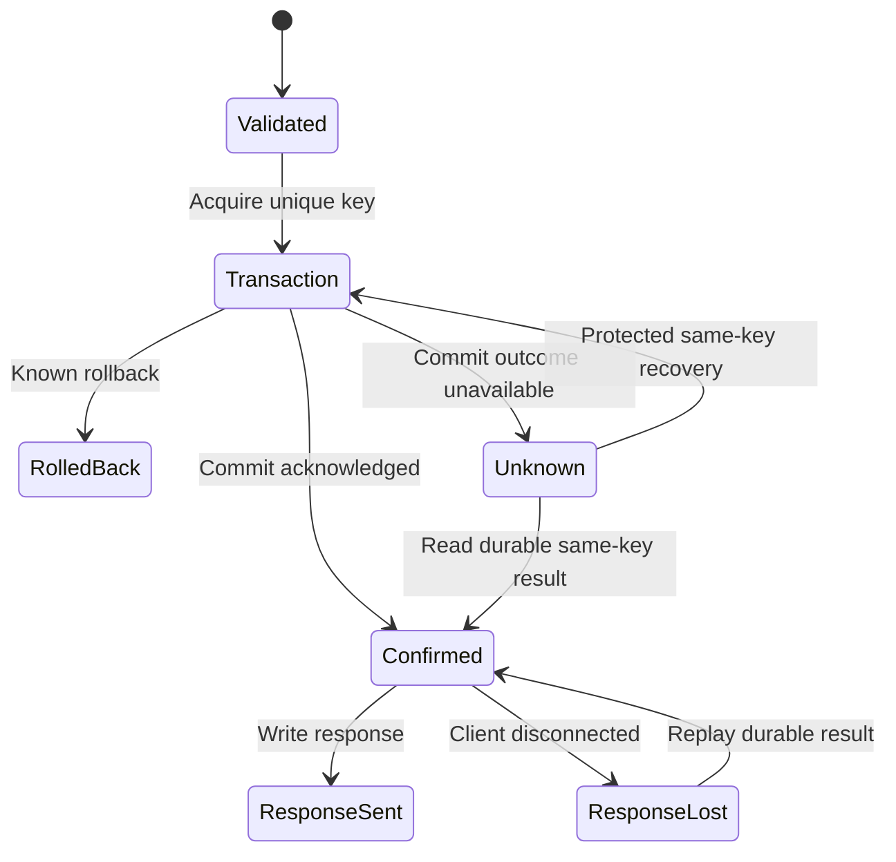

# D20 — General-purpose idempotent task reference service and integrated acceptance

| Item | Value |
| --- | --- |
| Contract | C-REFERENCE-001, 0.3.0 |
| Input tasks | R31; cross-cutting R16/R18/R19/R20/R21/R26/R27/R28/R29/R30 |
| Baseline | Design `1f7d89aa754647a6a530fa34a49acc4b0f5d9997`; Plan `da9e4a6337a5af0ec3d5e40a4695a2760d6ac5f5` |
| Status | Design specification 0.3.0 candidate; product implementation/release acceptance remains in Delivery; acceptance is determined by the same content hash and independent Review in the registry; five SQLite research-prototype checks executed; C#/Rust code examples uncompiled and product/AOT/cross-platform/stress acceptance unverified |

## 1. Goals and non-goals

The reference service provides tenant-scoped work items, paginated queries, attachment streams and a transactional outbox; it verifies whether Server, Database, ORM, generators, diagnostics and Packaging are correct, straightforward and valuable as a complete workload. It is a general NativeWeave engineering example with no ArcForges business model/dependency, and does not force downstream users to adopt a particular business schema as a production application template.

REST is the minimum required entry point. Optional gRPC and MCP call the same typed C# application service and undergo separate D19 protocol acceptance rather than duplicate transaction logic three times. The required product composition is **Rust Server + C# top-level Fluent/generic/async/AOT syntax and DTO boundaries + Rust ORM / Database Engine**, with PostgreSQL and SQLite profiles. C# uses ordinary typed Fluent APIs, with optional SG-generated static metadata/DTOs and diagnostics; Rust owns query semantics, SQL generation, ORM, drivers, connection pools, transaction execution and database resource management. Concrete ORM selection and query authority follow [D14](../database/drivers.md), [D15](../database/transactions-and-pooling.md) and [D16](../database/query-semantics.md); this application does not establish another ORM. Application developers do not need to write Rust. D18's native composition owns Rust Server networking/protocol/connection/stream and backpressure responsibilities; the C# application service composes with Rust DB contracts through existing ABI/async/buffer mechanisms. Kestrel is an independent comparator only, not the product Host.

Requiring Rust in the database lower layer is a product-scope constraint. Earlier drafts' default Npgsql / Microsoft.Data.Sqlite runtime path has been superseded; these projects and EF Core may remain source-research subjects or independent equivalent benchmarks, but must not enter NativeWeave's default database execution path. The independent Kestrel benchmark application may run without loading NativeWeave; NativeWeave's own Server example without a database must still load the Rust Server Engine. Every database composition must pass phase A's relevant ABI, ownership, callback/async, buffer, build and actual AOT gates; performance evidence optimizes the Rust path and quantifies costs rather than silently reverting to a managed database implementation based on one benchmark.

The ordinary database path uses a maintainer-precompiled SeaQuery + SQLx Rust Engine. Ordinary C# entities/projections/queries use runtime metadata and static DTOs without generating Rust Entities or requiring Cargo or CI for local execution. A specialized SeaORM model package is a separately built optional profile. Application metadata/schema, Engine ABI/capability and native hashes are verified separately; B21/B24 verify Windows/Linux AOT, clean environments without Rust, and local build/run without an explicit RID.

## 2. Business protocol and data model

| Operation | Constraints and result |
| --- | --- |
| `POST /v1/items` | Idempotency-Key required; validate title/field sizes and permissions; success returns the original operation_id/item_id and stable response; same key with a different payload returns 409 |
| `GET /v1/items?after=...&limit=...` | Tenant filtering, limit 100, stable keyset `(created_at,id)`; versioned, tamper-resistant pagination cursor; offset is not the large-data default |
| `GET /v1/operations/{id}` | Check tenant/principal/operation permissions; return a confirmed result when a durable record exists; absent records indicate only unconfirmed status, not proof of nonexecution |
| `PUT /v1/items/{id}/attachment` | Verify ownership and write permission; maximum body 64 MiB, chunks 32 KiB; separate disk/byte/active-upload quotas; binding the attachment is itself an idempotent write |
| `GET /v1/items/{id}/attachment` | Blob reads require an authorized DB reference; stream interruption releases the reader; a global hash must not bypass tenant permissions |
| outbox delivery | Stable event_id; at least once; consumers deduplicate by the same event_id and process within their own transactions |

PostgreSQL and SQLite schemas preserve the same business invariants, with types/time/locking syntax explicitly adapted per provider. The following is a logical schema, not DDL directly executable across providers:

```sql
operations(
  scope, request_key, request_hash, operation_id,
  response_version, response_bytes, completed_at,
  PRIMARY KEY(scope, request_key), UNIQUE(operation_id));
items(
  tenant_id, item_id, operation_id UNIQUE, title, created_at, version,
  PRIMARY KEY(tenant_id, item_id));
outbox(
  event_id PRIMARY KEY, tenant_id, operation_id, payload_version, payload,
  delivery_state, attempt_count, available_at, lease_until);
attachments(
  tenant_id, item_id, content_hash, content_length, operation_id, version,
  PRIMARY KEY(tenant_id, item_id));
```

`scope` comes from the authenticated tenant + principal/calling actor + endpoint semantic version; arbitrary client-supplied scope is not trusted. A Key contains 1–128 permitted ASCII characters, and default telemetry does not record the full key. `request_hash` includes every validated field affecting business effects and the method/semantic version; validate input first, then compute SHA-256 over a canonically encoded byte sequence with a fixed version. v1 uses fixed field order, length-prefixed UTF-8 and explicit integer encoding, without attempting a universal canonicalizer for arbitrary JSON. Unless Unicode normalization is declared, retain the original string code points; dates/numbers do not depend on process culture. C# and comparison implementations share golden vectors.

Commit results, business writes and outbox entries must share one database transaction; do not first commit an `InProgress` row and then perform business writes while still claiming single-transaction idempotency. This version's operation table stores only finally confirmed, replayable results; durable “in progress” state for long-running work requires a separate business state machine with leases and recovery rules and must not be silently mixed into this example.

## 3. Idempotent write algorithm and PostgreSQL concurrency details

1. Validate identity/input/limits, generate a stable `operation_id`, acquire request and DB admission, and begin a transaction.
2. Attempt to claim the unique `(scope,key)` record; within this transaction, prepare the result record first, then write the item and outbox. COMMIT only if all succeed.
3. If a record already exists, compare hashes: return the previously persisted response if equal; otherwise return 409 without modifying the original record. Do not use an upsert that “updates payload on conflict,” as different requests would overwrite the first result.
4. Report Created/ConfirmedCommitted only after COMMIT succeeds and acknowledgment is received. Failure to write the HTTP response does not change the business commit state.

The PostgreSQL v18 implementation choice under `READ COMMITTED` is:

```sql
INSERT INTO operations (...) VALUES (...)
ON CONFLICT (scope, request_key) DO NOTHING
RETURNING operation_id;
-- If 0 rows are returned: read the conflicting record with the next SQL SELECT, then compare request_hash.
```

That second SELECT must be the next statement. Official [INSERT](https://www.postgresql.org/docs/18/sql-insert.html) and [Read Committed](https://www.postgresql.org/docs/18/transaction-iso.html#XACT-READ-COMMITTED) documentation states that DO NOTHING may skip insertion because of a concurrent transaction not yet visible to the current INSERT snapshot, and RETURNING returns only actually inserted/updated rows. Therefore, “one CTE INSERT DO NOTHING UNION SELECT” is not proof that a conflicting row is always read. The next statement obtains a new snapshot; if abnormal cleanup/deletion/deadline still leaves no row, remain indeterminate or perform bounded protocol retries rather than infer rollback of the old transaction. This version does not delete operations within the retention window, avoiding this race; adopting another isolation level requires its corresponding retry/snapshot rules and renewed acceptance.

SQLite uses short `BEGIN IMMEDIATE` writer admission to serialize check-then-write; busy waiting counts toward the overall deadline, and writer waiters are bounded. It does not claim the same concurrent locking granularity as PostgreSQL. The SQL above is the semantic recipe the Rust ORM / engine must preserve; top-level C# calls typed native-backed Fluent APIs and binds parameters, while Rust validates semantics, generates SQL and executes it; the C# Source Generator must not become a second SQL/ORM authority. The prototype is not the final API and does not prove actual Rust-driver execution. No transaction waits for an HTTP client to read, calls an external service or performs a potentially long-blocking blob transfer.

The reference retention value is 7 days, with the guaranteed window explicit in the client contract; repeated submissions beyond it are not guaranteed to remain replayable. Cleanup must not delete records still under recovery and must coordinate with outbox audit/recovery references. Finite storage cannot promise permanent exactly-once behavior; if the product later requires permanent deduplication, add explicit costs and rules such as durable tombstones/business uniqueness keys.

## 4. COMMIT Unknown, cancellation and recovery

Public names follow the [database transaction specification](../database/transactions-and-pooling.md): `WeaveDataSource.OpenSessionAsync`, `DataSession.BeginTransactionAsync`, `DataTransaction.CommitAsync`. This document does not establish another transaction authority.

```csharp
// Design draft, not yet compiled; ExecuteCreateAsync calls typed native operations, and the Rust ORM generates and executes parameterized SQL.
// Returns an owned managed DTO; cleanupDeadline is a preconfigured monotonic shutdown deadline.
var session = await dataSource.OpenSessionAsync(requestAborted);
try
{
    var tx = await session.BeginTransactionAsync(
        new TransactionOptions { RecoveryKey = operationId }, requestAborted);
    var result = await ExecuteCreateAsync(session, tx, command, requestAborted);
    try
    {
        // token controls admission only before COMMIT is sent; after dispatch admission, wait for the independent commit deadline.
        await tx.CommitAsync(requestAborted);
        return result;
    }
    catch (CommitOutcomeUnknownException error)
    {
        return CreateOutcomeUnknown(operationId, command.IdempotencyKey,
            error.CorrelationId);
    }
}
finally
{
    // Session closes admission and joins existing tx/cursors; while Pending, the Engine retains every lease/root/budget.
    CleanupResult cleanup = await session.CloseAsync(cleanupDeadline);
    RecordCleanupSnapshotNoThrow(cleanup); // Bounded, nonblocking; must not overwrite the business/CommitUnknown result.
}
```

`TransactionOptions.RecoveryKey` is an application-supplied opaque string and does not cause the framework to create an idempotency table automatically. `tx.Outcome` remains readable after Dispose; `InProgress/Committed/RolledBack/Unknown` are distinct from protocol-response status. HTTP/gRPC/MCP request cancellation does not prematurely overwrite an Unknown result after COMMIT dispatch admission. Cancellation explicitly known to precede sending may roll back and report cancellation to the caller; after commit dispatch admission without final acknowledgment, only Unknown may be reported.

The reference HTTP profile uses the explicit bounded-wait shutdown above. `DataSession.CloseAsync(deadline)` closes new business admission and requests/joins termination and cleanup of existing transactions/cursors; a return of `CleanupResult(Status=Pending, ConnectionDisposition=Quarantined, LocalResourcesReleased=false)` permits ending the response wait but does not establish resource release. Engine/Session native parent leases, managed roots and budget remain held; background work only completes already admitted business terminal states and cleanup, without starting new business work or retaining an ended `HttpContext` or request DI scope. Subsequent `DisposeAsync` joins the same cleanup task without another rollback. Callers needing confirmation of local safety may choose `await using` / `DisposeAsync`; this joining profile does not falsely succeed at a deadline while native code is nonquiescent, so it cannot promise a bounded HTTP response time. This example must not implicitly execute an `await using` join after `CloseAsync` returns Pending. Likewise, bounded DataSource shutdown permits actual runtime destruction only after all children retire.

If the HTTP connection remains usable, Unknown returns 503, the stable error code `outcome_unknown`, operation_id and a recovery URI authorized for the same scope, with a bounded retry hint; it returns neither “created successfully” nor 202 suggesting reliable enqueueing. If the connection is already lost, the client may know only its original Idempotency-Key and can still resubmit with the same key/hash. Recovery first queries confirmed records; absence does not prove the original operation failed to commit or permit direct replay of unprotected writes. The same key/hash follows the uniqueness-protected transaction above; if the original transaction remains in progress, the database uniqueness constraint waits/arbitrates, ultimately allowing only one business effect. Any hash mismatch is rejected immediately.



“Protected recovery” in the diagram above is not unconditional retry of an entire external business workflow. Writes without idempotency protection and external email/payment/event publication must not be automatically replayed because of timeout. `Unknown -> RolledBack` requires actual protocol/recovery evidence rather than Dispose, pool return, one query finding no rows or a request token.

## 5. Actual atomicity of outbox and attachments

Outbox payloads share the item/result transaction. A worker claims leases in bounded batches, publishes externally after the transaction ends, then marks delivery after acknowledgment; successful publication followed by failed marking causes duplicates, so consumers must deduplicate by stable event_id. The example consumer oracle also persists deduplication and separately counts duplicate attempts and actual effects. Do not claim external end-to-end exactly-once behavior. Worker retries have exponential backoff, limits and observable failure states; shutdown first stops claims and then waits for the current publish deadline, retaining indeterminate external outcomes as retryable rather than discarding them.

Attachments are first streamed to disk-quota-controlled temporary files while calculating hash/length and persisting data; only after an atomic rename on the same file system to an immutable content-addressed path does a database transaction commit the attachment reference and result/outbox. Failure may leave an unreferenced blob but must not leave a successful DB record referencing an unfinished file. Garbage collection has a grace period and protects active uploads/recovery, operating on observable DB references and staging manifests; deleting solely by file mtime is insufficient. B22 actually verifies Windows/Linux differences in rename/fsync/directory persistence.

This is not distributed atomic commit across a DB and file system. Disk loss, replication topology and object-storage consistency belong to acceptance of the selected storage profile; a future object-storage Adapter must separately prove the “durable blob before DB reference” protocol. Every tenant download still passes through an authorized DB reference; identical hashes do not share permissions across tenants. A single upload must not hold a DB connection until its body ends; short transactions only confirm references.

## 6. Queries, resources and application experience

Common lists use natural typed C# Fluent APIs; SG optionally provides static metadata/DTOs, SeaQuery owns native construction/dialects, SQLx executes, and explicit relationship/CAS policies remain in Rust. Dynamic filters use only registered columns/operations, and native code rechecks capabilities and parameterizes. Pagination by `(created_at,id)` includes a unique tie-breaker; separate ReadCommitted operations do not promise a snapshot across pages. Consistent exports require an explicit snapshot/transaction profile, maximum duration and stream lease; slow clients must not occupy the pool forever.

The Server profile follows D18 ReferenceSmall: 512 connections, 32 HTTP2 streams per connection, 256 active/retiring requests and 128 metadata-only waiters. Managed and native application-payload budgets are each 64 MiB, with 4 MiB per request on each side; when both copies coexist, both are charged, retaining credit for the backing allocation's actual capacity until the last owner releases it. Chunks are at most 32 KiB and headers at most 32 KiB; TLS/socket/protocol/allocator/GC overhead is observed separately, and these payload caps are not process RSS bounds. Database pools and upload/outbox concurrency each have finite limits; slow responses promptly release DB leases no longer needed. Fixed DTO JSON is at most 1 MiB, pagination at most 100, and the 64 MiB attachment cap is the whole-route length limit, streamed in 32 KiB chunks; do not load a 64 MiB attachment all at once into a 4 MiB request budget. Reject a single allocation exceeding the request's absolute peak budget before enqueueing; ordinary waits for satisfiable credit are governed by the overall deadline and cancellation, and Pending cleanup continues holding credit. All numbers are initial reference configuration, becoming reproducible experiment inputs only after performance-acceptance freeze rather than general recommended capacities.

Each request/operation records low-cardinality outcomes, cancellation/Unknown, pool waits, bytes/copies, FFI crossings and final lease return; logs do not record sensitive bodies/keys. Completed requests must not retain contexts/DI scopes/GCHandles. Avoid double JSON serialization on the hot path; idempotent responses retain an explicit schema version and byte limit, and upgrades must still replay old versions or provide explicit compatibility handling rather than silently misinterpret old bytes using a new DTO.

## 7. Actual experiments in this round and limitations

The [R31 research script](../research/topics/R31/idempotency_experiment.py) and [raw results](../research/topics/R31/experiment-result.json) were actually executed in this environment: Python 3.12.14, SQLite 3.53.1, Linux x64, WAL/synchronous=FULL, main-process exit 0. Five assertions passed: the same key/hash returns the original result; a different hash produces no new effect; 4 independent concurrent connections produce only 1 transaction effect; simulated response loss after actual COMMIT permits replay; a subprocess actually calls `os._exit(17)` before COMMIT, and reopening the connection shows no effect from the original transaction and permits a safe retry. Final operations/items/outbox counts are 4 rows each.

This proves only the tested transaction boundaries in the minimal SQLite research prototype; it does not prove NativeWeave C#/Rust implementation, PostgreSQL concurrency, actual network faults, Native AOT, OS power loss or storage-hardware durability. The prototype constructs test hashes with fixed-field JSON and does not verify this document's v1 length-prefixed canonical bytes or cross-language golden vectors. The script/hash/raw stdout/commands and limitations are recorded in R31 evidence and must not be promoted into passed product validation.

## 8. Complete workload, fault and performance matrix

| Verification axis | Exact scenario/criterion |
| --- | --- |
| Idempotency | First request/replay/different hash, same-key concurrency, same key across tenants, recovery windows, retention races; independent oracle counts business effects and outbox entries |
| DB faults | Disconnection at BEGIN/write/before COMMIT send/after send/lost acknowledgment; PG restart, SQLite busy/disk full, pool-reset failure; outcomes must be accurately Confirmed/RolledBack/Unknown |
| HTTP/protocol | Slow uploads/downloads, oversized body, error after header commit, HTTP1 half-close/HTTP2 reset, gRPC decompression, MCP profile mismatch, SSE cancellation |
| Resources | Waiter saturation, managed/native byte caps, two live copies, pool waits, attachment disk quotas, blocked exporters; no unbounded queues or final leaks |
| Lifetime | Partial startup failure, drain deadline, callbacks racing Dispose, host shutdown during COMMIT; CloseAsync Pending may end response waiting while owners/budget remain retained, and DisposeAsync succeeds only with local safety; crash after outbox publication, crash between attachment rename and DB commit |
| AOT/platform | Actual net11 Windows/Linux published binaries; every DB profile loads the mandatory Rust DB Engine, checking ABI/version rejection, native dependencies, instance closure and clean-machine startup; Rust Server is mandatory in tests for every product Server composition; native modules remain until process exit without hot unloading; a standalone Server without a DB must also load native Server assets |
| Security | Tenant isolation, query injection, forged scope, trace pollution, oversized compressed/JSON input, missing authentication, sensitive log/heap-dump handling policies |
| Long-running | Initial 30 min steady-state, 24 h regression, release 72 h soak; load variation/connection churn/cancellation and faults; resources return to a stable plateau without linear growth with request count |

Model/property verification checks “at most one business effect per scope+key,” “atomic existence of item/result/outbox,” “every owner eventually released or explicitly fault-isolated,” and “irreversible terminal state for the same operation.” Models require explicit scheduling fairness, fault assumptions and finite boundaries; finite models are not proof of all actual thread schedules. Fuzzing covers ABI lengths, SQL/query-operation descriptions and HTTP/MCP inputs; handle generations are verified only when a domain actually has reusable IDs, without assuming a global Core generational table. Race tests use controlled barriers and actual multiple threads rather than just sleep. Lock/time stress, long-running tests and Sanitizer/platform tools run separately according to component capabilities, without falsely claiming one cross-language tool has already caught every issue.

The performance matrix distinguishes the product from external comparators: the required product baseline is Rust Server + C# application/typed Fluent/DTO + Rust ORM / PostgreSQL or SQLite Engine. Different Rust Server compositions are compared within the same protocol/feature scope; Kestrel is not a product branch. Kestrel + Npgsql / Microsoft.Data.Sqlite (and EF Core where applicable) are independent nonproduct managed comparators, and a pure Rust reference implementation compares ecosystem/cross-language costs; neither becomes a NativeWeave managed database backend. Test only combinations that actually exist, marking unimplemented cells not-run; selected product combinations must first meet the same correctness criteria. Fully align TLS/HTTP versions, DB versions/schema/indexes/isolation/pools, payloads/data volume/cache hit rates, error/cancellation rates, CPU limits, deployment nodes, log sampling and durability conditions.

Freeze random seeds/datasets/query golden results; use a fixed arrival rate and record queueing time rather than report only closed-loop client latencies that miss tail effects. Output throughput, p50/p95/p99/p99.9 and max, error/Unknown rates, CPU/op, allocated bytes/op, GC, managed heap, native allocated/retained memory, RSS, threads/handles/sockets, FFI counts and copied bytes; provide raw histograms, environment, warmup, repeated runs and uncertainty. Performance thresholds derive from the B23 frozen baseline and actual product requirements rather than invented “30% faster” claims or implicit concessions in memory/developer efficiency. If end-to-end Rust DB cost is unsatisfactory, publish the evidence and optimize batching, owned buffers, static mapping and call granularity; the Rust database constraint remains. If Rust Server boundary cost is unsatisfactory, publish measurements and optimize handler batches, scheduling, streams and ownership; do not silently switch the product Host to Kestrel.

## 9. Existing Codex tasks and acceptance handoff

| Task | Directly implementable inputs and deliverables |
| --- | --- |
| B21 | This document's business schema, API/golden vectors, typed queries, transactional idempotency/result/outbox and attachment pipeline; C# app + mandatory Rust PostgreSQL/SQLite DB Engine and optional protocol facades; no ArcForges dependency |
| B22 | Independent oracle, COMMIT and network fault points, actual process/database crashes, reclamation/retention/attachment faults, 24 h/72 h resource evidence; retain Unknown without hiding errors through retries |
| B23 | Equivalent-profile harness, pinned workloads/hardware, raw results/cost breakdown, baseline-regression thresholds; no assertions of unmeasured benefits |
| B24 | Profile/RID/engine/protocol compatibility matrix, clean-machine AOT execution, independent-package version rejection, SBOM/LICENSE/NOTICE, upgrade/rollback and final acceptance |

Design research has decided idempotency, Unknown recovery, integrated scenarios and evidence interpretation; remaining obligations are explicit product implementation and acceptance tasks, without requiring all design questions to remain Open until the product is complete. Independent Review priorities: the PG snapshot counterexample, SQLite writer granularity, protocol cancellation and COMMIT boundaries, external outbox duplicates, blob persistence before references, retention commitments, performance equivalence and accuracy of experiment claims.

## 10. Research-design closure and implementation handoff

The product composition is fixed at Rust Server + C# business handlers + Rust
Database/ORM; D18 selects native server components and D14/D16 select the database
boundary. Kestrel is solely a separate comparable application. Ordinary entity,
projection and query additions use the maintainer-precompiled native module.

The preserved R31 SQLite experiment already proves its finite scoped idempotency,
concurrent-key, outbox and crash assertions. The database-completion PG study adds
real discarded COMMIT replies and a real conflicting-insert snapshot race. Its
proxy and server/lock observations provide precise B21/B22 oracles: Unknown does
not imply absence of effects; a same-statement fallback can miss the winning row;
next-statement recovery must still verify scope and request hash. Those native
experiments do not imply the reference C# application has been implemented.

| Stage | Completion criterion | Remaining owner |
| --- | --- | --- |
| Research/design | Fixed native responsibilities, command/response/schema, idempotency/Unknown/outbox protocol, limits and independent review | R31/D20/D32 |
| Product implementation | Static C# handlers and DTOs consume both actual Rust Engines through accepted contracts; local build/run and Native AOT | B21 with A/B prerequisites |
| Fault acceptance | Real proxy/server/process/file faults, independent durable-effect oracle, safe cleanup and unchanged primary outcome | B22 |
| Performance/release | Same semantics/limits/durability, cold+warm and long-load measurements, packages consumed independently on Windows/Linux | B23/B24 |

No future product success is required merely to accept this implementation-guiding
design. Conversely, accepting the design does not satisfy any missing product,
TLS/protocol, filesystem durability, long-load or performance test.

### Published research CI evidence

The [database CI confirmation](../../verification/database-completion/ci-confirmation.json) binds source `7ea84e11ee19e6dad4503a5872eb27c6c7f44e80` and run `43388468172` to actual Windows/Linux metadata/SQLite results (5/5 on each) and Linux PostgreSQL 18.0 results (6/6). Archived inputs/logs were checked byte-for-byte; Windows CRLF inputs remain separately identified. This confirms the finite native research oracles and leaves the specified C# product, TLS, concurrency, long-load and independent design-review obligations distinct.
